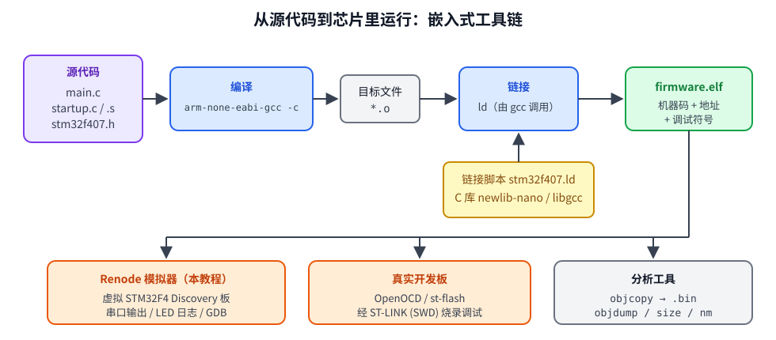

# 第 1 章　环境搭建与第一个程序

## 本章目标

- 装好交叉编译工具链、Renode 模拟器和 GDB
- 理解“交叉编译”和“在模拟器里运行固件”是怎么回事
- 运行第一个例子：串口打印 `Hello, STM32F407!`，让绿灯闪烁

## 1.1 嵌入式开发和 PC 开发有什么不同

在 PC 上写 C 程序：`gcc main.c && ./a.out`，编译器生成本机（x86-64）指令，操作系统负责加载、分配内存、提供 `printf` 背后的终端。

在单片机上：

|                   | PC 程序          | STM32 固件                                                            |
| ----------------- | ---------------- | --------------------------------------------------------------------- |
| CPU               | x86-64           | ARM Cortex-M4（Thumb-2 指令集）                                       |
| 编译器            | `gcc`          | `arm-none-eabi-gcc`（**交叉编译器**：在 x86 上生成 ARM 代码） |
| 操作系统          | Linux            | **没有**，你的程序就是唯一的软件                                |
| 程序从哪开始      | OS 调用 `main` | 芯片复位后从 Flash 固定地址取指（第 3 章）                            |
| 内存              | 虚拟内存，几 GB  | 物理地址，1 MB Flash + 128 KB RAM                                     |
| `printf` 输出到 | 终端             | 你自己实现：通常发到串口（第 8 章）                                   |
| 运行方式          | 直接运行         | 烧进芯片 Flash，或者 **在模拟器里运行**                         |

`arm-none-eabi` 的含义：目标是 ARM，`none` 表示没有操作系统，`eabi` 是 ARM 的嵌入式调用约定。



## 1.2 Renode 是什么

[Renode](https://renode.io) 是 Antmicro 开源的嵌入式系统模拟器。它不仅模拟 CPU 指令，还模拟芯片上的外设（GPIO、UART、定时器、中断控制器……）和板上的器件（LED、按键）。我们的固件 **不用改一行代码**，就能在 Renode 里像在真芯片上一样运行：

- 串口输出可以写入文件或转发到 TCP 端口
- LED 的亮灭会出现在日志里
- 可以用脚本在指定的“虚拟时间”按下按键、往串口里打字
- 内置 GDB 服务器，可以单步调试

本教程用的是 Renode 自带的 `stm32f4_discovery-kit` 平台，在 `examples/common/board.repl` 里补上了 Discovery 板另外 3 个 LED。

## 1.3 安装

### 普通 Ubuntu/Debian（有 sudo）

```bash
sudo apt update
sudo apt install gcc-arm-none-eabi libnewlib-arm-none-eabi \
                 libstdc++-arm-none-eabi-newlib gdb-multiarch \
                 make git curl
```

Renode 从 [GitHub Releases](https://github.com/renode/renode/releases) 下载 **portable** 版本（自带 .NET 运行时，解压即用）：

```bash
mkdir -p ~/.local/opt && cd ~/.local/opt
curl -LO https://github.com/renode/renode/releases/download/v1.15.3/renode-1.15.3.linux-portable.tar.gz
tar xf renode-1.15.3.linux-portable.tar.gz
ln -s ~/.local/opt/renode_1.15.3_portable/renode ~/.local/bin/renode   # 目录名以实际解压结果为准
```

版本号请换成 Releases 页面上的最新版；也可以下载 nightly 构建。

### 本机的实际情况（无 sudo）

编写本教程的机器是 WSL2 上的 Ubuntu，没有 sudo 权限，所以采用了“下载 deb 包、解压到用户目录”的方式：

```bash
apt-get download gcc-arm-none-eabi libnewlib-arm-none-eabi libnewlib-dev \
                 libstdc++-arm-none-eabi-newlib gdb-multiarch ...
for f in *.deb; do dpkg-deb -x "$f" ~/.local/pkgroot; done
```

Debian 打包的 newlib 头文件和库放在 `/usr/lib/arm-none-eabi/newlib/` 这类绝对路径下，解压到别处后 gcc 找不到它们，因此在 `~/.local/bin/` 里放了几个包装脚本，给 gcc 补上 `-B .../newlib/ -isystem .../include/newlib`。Renode 用的是 portable 版，位于 `~/.local/opt/renode`。

如果你的机器有 sudo，直接用上面的 `apt install` 即可，不需要这些包装。

### 验证

```bash
arm-none-eabi-gcc --version     # 本机：14.2.1
renode --version                # 本机：1.17.0
gdb-multiarch --version
```

### 下载 CMSIS 与 HAL（第 11 章起需要）

```bash
cd examples/third_party
./fetch.sh
```

它会下载 ST 的 `cmsis-device-f4`（v2.6.9）、`stm32f4xx-hal-driver`（v1.8.5）和 ARM CMSIS_5 的 Cortex-M 内核头文件（5.9.0）。前 10 章不需要这一步。

## 1.4 第一个程序

```bash
cd examples/01-hello
make run
```

你应当看到（编译输出省略；LED 日志行开头的时间戳是 **电脑上的实际时间**，每次都不一样）：

```
Memory region         Used Size  Region Size  %age Used
           FLASH:        7912 B         1 MB      0.75%
             RAM:        8648 B       128 KB      6.60%
   text	   data	    bss	    dec	    hex	filename
   7804	    100	   8556	  16460	   404c	build/firmware.elf
[21:40:17.0328] [NOISY] gpioPortD.UserLED: LED state changed to True
[21:40:17.0437] [NOISY] gpioPortD.UserLED: LED state changed to False
[21:40:17.0552] [NOISY] gpioPortD.UserLED: LED state changed to True
[21:40:17.0621] [NOISY] gpioPortD.UserLED: LED state changed to False
[21:40:17.0870] [NOISY] gpioPortD.UserLED: LED state changed to True

----- USART2 output -----
Hello, STM32F407!
blink 1, green LED is on
blink 2, green LED is off
blink 3, green LED is on
blink 4, green LED is off
blink 5, green LED is on
done

-------------------------
```

- `Memory region` 表：链接器报告 Flash 和 RAM 用了多少（第 3 章解释 RAM 为什么用了 8 KB）
- `gpioPortD.UserLED`：Renode 里 PD12 上的绿灯，`True` = 亮
- `USART2 output`：固件通过串口 2 发出的全部字符

### 代码

[`examples/01-hello/main.c`](../examples/01-hello/main.c)：

```c
#include <stdio.h>

#include "drivers/board.h"
#include "drivers/uart.h"

static void busy_delay(volatile uint32_t count)
{
    while (count-- != 0) {
    }
}

int main(void)
{
    board_init_leds();
    uart_init(HSI_HZ, 115200);

    printf("Hello, STM32F407!\n");

    for (int i = 1; i <= 5; i++) {
        led_toggle(LED_GREEN);
        printf("blink %d, green LED is %s\n", i, (LED_PORT->ODR & BIT(LED_GREEN)) ? "on" : "off");
        busy_delay(100000);
    }

    printf("done\n");
    for (;;) {
    }
}
```

看起来和 PC 程序差不多，但有几处“嵌入式特色”，后面的章节会一一拆开：

| 代码                             | 含义                                                         | 在哪章讲   |
| -------------------------------- | ------------------------------------------------------------ | ---------- |
| `board_init_leds()`            | 打开 GPIOD 时钟，把 PD12~15 设为输出                         | 第 4 章    |
| `uart_init(HSI_HZ, 115200)`    | 按 16 MHz 时钟配置串口 2 为 115200 波特                      | 第 8 章    |
| `printf`                       | newlib 的 printf，最后调用我们写的 `__io_putchar` 发到串口 | 第 8 章    |
| `LED_PORT->ODR`                | 读 GPIOD 的输出数据寄存器                                    | 第 2、4 章 |
| `busy_delay` 里的 `volatile` | 防止编译器把空循环优化掉                                     | 第 2 章    |
| 结尾 `for (;;)`                | `main` 不能返回：没有操作系统可以返回                      | 第 3 章    |

## 1.5 构建系统

每课的 `Makefile` 只有几行，例如 `01-hello/Makefile`：

```make
SRCS := main.c ../common/drivers/uart.c
RUN_TIME := 0.5

include ../common/lesson.mk
```

`common/lesson.mk` 提供了公共规则。关键的编译选项：

```make
ARCH := -mcpu=cortex-m4 -mthumb -mfpu=fpv4-sp-d16 -mfloat-abi=hard
COMMON_FLAGS := $(ARCH) $(OPT) -g3 -Wall -Wextra -ffunction-sections -fdata-sections
LDFLAGS  += $(ARCH) -T$(LDSCRIPT) --specs=nano.specs --specs=nosys.specs \
            -Wl,--gc-sections -Wl,-Map=$(BUILD)/$(TARGET).map -Wl,--print-memory-usage
```

| 选项                                                        | 作用                                                     |
| ----------------------------------------------------------- | -------------------------------------------------------- |
| `-mcpu=cortex-m4 -mthumb`                                 | 生成 Cortex-M4 的 Thumb-2 指令（M 系列只支持 Thumb）     |
| `-mfpu=fpv4-sp-d16 -mfloat-abi=hard`                      | 使用片上单精度 FPU，浮点参数走 FPU 寄存器                |
| `-ffunction-sections -fdata-sections` + `--gc-sections` | 每个函数单独一个段，链接时删掉没用到的，减小体积         |
| `-T stm32f407.ld`                                         | 链接脚本：告诉链接器 Flash/RAM 在哪（第 3 章）           |
| `--specs=nano.specs`                                      | 使用精简版 C 库 newlib-nano（printf 默认不支持 `%f`）  |
| `--specs=nosys.specs`                                     | 系统调用用空实现；我们在 `syscalls.c` 里覆盖需要的几个 |
| `-g3`                                                     | 带完整调试信息（不会进入 .bin，只在 .elf 里）            |

常用目标：

| 命令               | 作用                                                               |
| ------------------ | ------------------------------------------------------------------ |
| `make`           | 只编译，生成 `build/firmware.elf` 和 `.bin`                    |
| `make run`       | 编译并在 Renode 里无界面运行 `RUN_TIME` 秒虚拟时间，打印串口输出 |
| `make run V=1`   | 同上，并显示 Renode 的警告（访问了未模拟的寄存器等）               |
| `make sim`       | 交互式 Renode：串口在 TCP 3456，GDB 在 3333                        |
| `make sim GUI=1` | 同上，但监视器和串口终端各开一个窗口                               |
| `make gdb`       | 连接到 `make sim` 启动的 GDB 服务器                              |
| `make disasm`    | 生成带源码的反汇编 `build/firmware.lst`                          |
| `make size`      | 各段大小                                                           |
| `make clean`     | 删除 `build/`                                                    |

`.elf` 是带地址和符号的完整镜像，模拟器和调试器用它；`.bin` 是纯二进制，内容就是要写进 Flash 的字节，烧录真板时会用到。

## 1.6 `make run` 背后发生了什么

`common/run.sh` 用下面的方式启动 Renode：

```bash
renode --disable-gui --console --plain \
    -e '$bin=@build/firmware.elf' \
    -e 'i @common/board.resc' \
    -e 'sysbus.usart2 CreateFileBackend @build/uart.log true' \
    -e 'emulation RunFor "0.5"' \
    -e 'quit'
```

1. `board.resc` 创建一台虚拟 STM32F4 Discovery，加载 ELF
2. 把 USART2 的输出接到文件 `build/uart.log`
3. 运行 0.5 秒 **虚拟时间**（与电脑快慢无关）
4. 退出后，`run.sh` 从 `build/renode.log` 里挑出 LED 变化和错误，再打印 `uart.log`

如果课程目录里有 `stimulus.resc`，就用它代替第 3 步，脚本里可以在指定时刻按键或往串口输入（第 5 章起用到）。完整说明见 [附录 B](appendix-b-renode.md)。

## 1.7 交互式运行（可选）

```bash
cd examples/01-hello
make sim
```

Renode 启动后停在监视器提示符 `(stm32f4-discovery)`。在 **另一个终端** 里连接串口：

```bash
nc localhost 3456
```

回到 Renode 终端输入 `start`，`nc` 那边就会出现 `Hello, STM32F407!`。`pause` 暂停，`quit` 退出。第 9 章会用这种方式和固件里的命令行交互。

有图形桌面时（Windows 11 的 WSLg、Linux 桌面）也可以用图形界面：

```bash
make sim GUI=1
```

Renode 会打开两个窗口：监视器窗口（在这里输入 `start` / `pause` / `quit`）和 USART2 终端窗口（串口输出直接显示在里面，也可以在里面打字）。这时不需要再开 `nc`，不过 TCP 3456 和 GDB 3333 照样可用。LED 变化等日志仍打印在运行 `make` 的终端里。Renode 的图形界面不画开发板，LED 和按键没有图形控件。

## 练习

1. 把闪烁次数改成 10 次，把 `RUN_TIME` 改成 `1`，重新 `make run`。
2. 把 `busy_delay(100000)` 改成 `busy_delay(10)`，LED 日志的行数变了吗？串口输出变了吗？（提示：虚拟时间只运行 0.5 秒）
3. 把 `LED_GREEN` 换成 `LED_RED`，看日志里出现的设备名。
4. 运行 `make size` 和 `arm-none-eabi-nm -n build/firmware.elf | head -30`，找到 `main` 的地址。

## 常见坑

- **`arm-none-eabi-gcc: fatal error: cannot read spec file 'nano.specs'`**：没装 `libnewlib-arm-none-eabi`。
- **`renode: command not found`**：Renode 不在 `PATH` 里；portable 版需要自己建符号链接或把目录加入 `PATH`。
- **串口输出为空**：看 `build/renode.log` 的最后几行，常见原因是固件跑飞（`CPU abort`）或运行时间太短。
- **`make sim` 后直接退出**：Renode 交互模式需要一个真正的终端作为标准输入；不要用管道把它的输入接到 `/dev/null`。
- **`make sim GUI=1` 没有窗口**：检查 `echo $DISPLAY` 是否为空。WSL 需要 Windows 11（或 Windows 10 21H2 以上）自带的 WSLg；纯命令行环境请用不带 `GUI=1` 的 `make sim`。

---

下一章：[第 2 章　MCU 基础：存储器映射与寄存器](02-mcu-basics.md)
