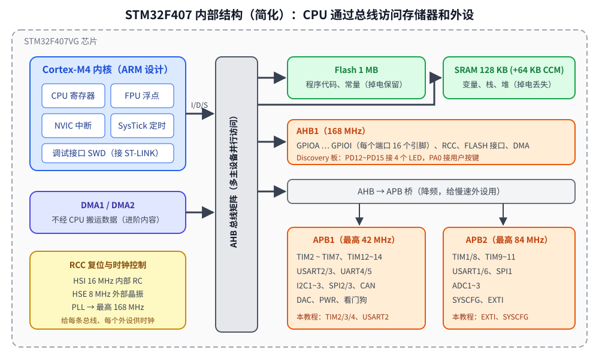
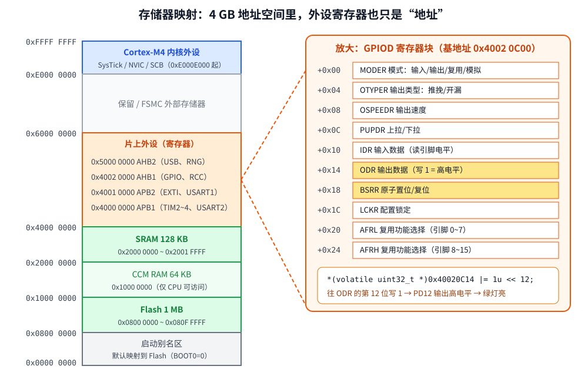

# 第 2 章　MCU 基础：存储器映射与寄存器

## 本章目标

- 知道 STM32F407 内部由哪些部分组成，它们怎么连在一起
- 理解 **“外设寄存器就是某个地址上的内存”** 这一核心思想
- 掌握对寄存器的四种位操作：置位、清零、翻转、测试，以及多位字段的修改
- 理解为什么访问寄存器必须用 `volatile`
- 会看参考手册里的寄存器描述

## 2.1 芯片里有什么



一颗 STM32F407 可以看成一台“片上计算机”：

- **Cortex-M4 内核**：ARM 公司设计、ST 购买授权。包括 CPU、FPU（浮点单元）、NVIC（中断控制器）、SysTick（系统定时器）和调试接口。所有 Cortex-M4 芯片（ST、NXP、TI……）的内核部分是一样的。
- **存储器**：Flash 存程序（掉电不丢），SRAM 存变量（掉电丢失）。
- **外设**：GPIO、UART、定时器、ADC、SPI、I2C、USB……这些是 ST 自己设计的，不同厂家完全不同。
- **总线**：CPU 通过总线矩阵访问存储器和外设。高速外设挂在 AHB 上，低速外设挂在 APB1/APB2 上。
- **RCC**：复位与时钟控制，给每条总线、每个外设提供时钟（第 4、6 章）。

> 区分“内核外设”和“芯片外设”很重要：NVIC、SysTick 的资料在 ARM 的 PM0214 里；GPIO、USART 的资料在 ST 的 RM0090 里。

## 2.2 存储器映射：一切皆地址

Cortex-M 是 32 位处理器，地址空间 4 GB。ARM 规定了大致分区，ST 在其中安排了 Flash、RAM 和外设：



关键一点：**外设的控制寄存器被映射到了地址空间里**。CPU 访问 `0x40020C14` 时，总线不会去读写 RAM，而是把这次访问交给 GPIOD 模块，GPIOD 根据偏移 `0x14` 知道你在操作它的 ODR（输出数据寄存器）。往 ODR 的第 12 位写 1，PD12 引脚就输出 3.3 V。

所以在 C 里控制硬件，本质就是 **对特定地址做读写**：

```c
*(volatile uint32_t *)0x40020C14 |= 1u << 12;   // PD12 输出高电平
```

地址怎么来的？查 RM0090：

- 第 2.3 节 “Memory map” 表：GPIOD 的地址范围是 `0x4002 0C00 - 0x4002 0FFF`
- 第 8.4 节 “GPIO registers”：ODR 的 “Address offset: 0x14”

`0x40020C00 + 0x14 = 0x40020C14`。

## 2.3 三种写法访问同一个寄存器

例子 [`examples/02-registers/main.c`](../examples/02-registers/main.c) 演示了三种越来越好用的写法。

**写法一：裸地址宏**

```c
#define GPIOD_ODR_ADDR  0x40020C14u
#define GPIOD_ODR_RAW   (*(volatile uint32_t *)GPIOD_ODR_ADDR)

GPIOD_ODR_RAW |= BIT(12);
```

**写法二、三：结构体覆盖（本教程 `common/stm32f407.h` 的做法，也是 ST 官方头文件的做法）**

一个外设的寄存器在地址上是连续排列的，正好可以用一个结构体描述，结构体成员的偏移量就等于寄存器偏移：

```c
typedef struct {
    __IO uint32_t MODER;       /* 0x00 mode: 00 input, 01 output, 10 AF, 11 analog */
    __IO uint32_t OTYPER;      /* 0x04 output type: 0 push-pull, 1 open-drain */
    __IO uint32_t OSPEEDR;     /* 0x08 output speed */
    __IO uint32_t PUPDR;       /* 0x0C pull-up / pull-down */
    __I  uint32_t IDR;         /* 0x10 input data */
    __IO uint32_t ODR;         /* 0x14 output data */
    __IO uint32_t BSRR;        /* 0x18 bit set (low half) / reset (high half) */
    __IO uint32_t LCKR;        /* 0x1C configuration lock */
    __IO uint32_t AFR[2];      /* 0x20 alternate function low/high */
} GPIO_TypeDef;

#define AHB1PERIPH_BASE (PERIPH_BASE + 0x20000u)
#define GPIOD_BASE      (AHB1PERIPH_BASE + 0x0C00u)
#define GPIOD   ((GPIO_TypeDef *)GPIOD_BASE)

GPIOD->ODR |= BIT(12);       // 编译器算出地址 0x40020C00 + 0x14
```

其中 `__IO` 就是 `volatile`，`__I` 是 `volatile const`（只读寄存器）。

结构体中间若有保留的空洞，必须用占位成员填上，否则后面的偏移全错。`stm32f407.h` 末尾用静态断言在编译期检查：

```c
STATIC_ASSERT(offsetof(GPIO_TypeDef, AFR) == 0x20, "GPIO layout");
STATIC_ASSERT(offsetof(TIM_TypeDef, CCR) == 0x34, "TIM layout");
STATIC_ASSERT(offsetof(NVIC_TypeDef, IP) == 0x300, "NVIC layout");
```

## 2.4 位操作

寄存器通常是 32 位，每一位或几位控制一个功能。必须熟练下面几种操作（`BIT(n)` 定义为 `1u << n`）：

| 操作 | 写法 | 说明 |
|------|------|------|
| 置位 | `REG \|= BIT(n);` | 只把第 n 位变 1，其他位不变 |
| 清零 | `REG &= ~BIT(n);` | 只把第 n 位变 0 |
| 翻转 | `REG ^= BIT(n);` | 0 变 1，1 变 0 |
| 测试 | `if (REG & BIT(n))` | 第 n 位是否为 1 |
| 改多位字段 | `REG = (REG & ~(MASK << POS)) \| (VAL << POS);` | 先清掉字段，再写入新值 |

`|=`、`&=`、`^=` 都是 **读-改-写**：先读出整个寄存器，改一位，再整个写回。

多位字段的例子：MODER 寄存器每个引脚占 2 位（引脚 n 占 bit `2n+1:2n`），把 PD12~PD15 都设为输出（`01`）：

```
MODER:  31 30 29 28 27 26 25 24 23 ... 1 0
        └PD15┘└PD14┘└PD13┘└PD12┘
目标：   0  1  0  1  0  1  0  1   → 第 24~31 位 = 0x55
```

```c
uint32_t moder = GPIOD->MODER;
moder &= ~(0xFFu << 24);   // 清掉 PD12..15 的 8 位
moder |= (0x55u << 24);    // 每个引脚写 01
GPIOD->MODER = moder;
```

## 2.5 volatile：为什么必不可少

编译器优化时假设“内存里的值只有我的代码会改”。对普通变量这没问题，但寄存器的值会被 **硬件** 改变（例如串口发送完一个字节后，硬件把状态寄存器的 TXE 位置 1）。

例子里有两个等待函数：

```c
__attribute__((noinline)) void wait_txe_without_volatile(void)
{
    uint32_t *sr = (uint32_t *)&USART2->SR;   // 故意去掉 volatile
    while ((*sr & USART_SR_TXE) == 0) {
    }
}

__attribute__((noinline)) void wait_txe_with_volatile(void)
{
    while ((USART2->SR & USART_SR_TXE) == 0) {
    }
}
```

`make disasm` 后在 `build/firmware.lst` 里对比（`-O2` 编译，本机实际结果）：

```
08001b78 <wait_txe_without_volatile>:
 8001b78:	f04f 2340 	mov.w	r3, #1073758208	@ 0x40004000
 8001b7c:	f8d3 3400 	ldr.w	r3, [r3, #1024]	@ 0x400   ← 只读一次
 8001b80:	061b      	lsls	r3, r3, #24
 8001b82:	d500      	bpl.n	8001b86
 8001b84:	4770      	bx	lr
 8001b86:	e7fe      	b.n	8001b86          ← 跳到自己：死循环，再也不读寄存器

08001b88 <wait_txe_with_volatile>:
 8001b88:	4a02      	ldr	r2, [pc, #8]     @ r2 = 0x40004400
 8001b8a:	6813      	ldr	r3, [r2, #0]     ← 每次循环都重新读
 8001b8c:	061b      	lsls	r3, r3, #24
 8001b8e:	d5fc      	bpl.n	8001b8a          ← 回到 ldr
 8001b90:	4770      	bx	lr
```

没有 `volatile` 时，编译器认为 `*sr` 不会变，于是只读一次；如果第一次读到 TXE=0，就进入 `b.n 8001b86` 永远自旋。这就是嵌入式里最经典的 bug 之一。

规则：

- 所有寄存器访问都要经过 `volatile` 指针（头文件已经帮你做了）
- 在中断和主循环之间共享的变量也要 `volatile`（第 7 章）
- `volatile` **不** 保证原子性，也不是线程同步原语

## 2.6 运行例子

```bash
cd examples/02-registers
make run
```

串口输出（本机实际结果）：

```
== Same register, three spellings ==
raw address      : 0x40020c14
&GPIOD_ODR_RAW   : 0x40020c14
&GPIOD->ODR      : 0x40020c14

== Read-only identification register ==
SCB->CPUID       : 0x410fc240 (0x410FC24x = Cortex-M4, x = revision)

== Bit operations on GPIOD ==
after reset:                 MODER=0x00000000 ODR=0x0000
PD12-15 -> output:           MODER=0x55000000 ODR=0x0000
set bit 12 (raw):            MODER=0x55000000 ODR=0x1000
set bits 13,14:              MODER=0x55000000 ODR=0x7000
clear bit 13:                MODER=0x55000000 ODR=0x5000
toggle bit 15:               MODER=0x55000000 ODR=0xd000
BSRR reset bit 12:           MODER=0x55000000 ODR=0xc000
test bit 14      : set

== volatile ==
wait_txe_without_volatile @ 0x08001b79
wait_txe_with_volatile    @ 0x08001b89
run `make disasm` and compare them in build/firmware.lst
```

逐行核对 ODR：

| 操作 | ODR（二进制，位 15..12） | 十六进制 |
|------|----------------------|---------|
| 置位 12 | `0001` | `0x1000` |
| 置位 13、14 | `0111` | `0x7000` |
| 清零 13 | `0101` | `0x5000` |
| 翻转 15 | `1101` | `0xd000` |
| BSRR 复位 12 | `1100` | `0xc000` |

几个细节：

- **CPUID = 0x410FC240**：`0x41` 是 ARM 的厂商码，`0xC24` 是 Cortex-M4 的型号，最后一位是修订版本号。真实 STM32F407 读出来一般是 `0x410FC241`（r0p1），Renode 模拟的是 r0p0。
- **函数地址是奇数**（`0x08001b79`）：Cortex-M 的函数指针最低位为 1 表示 Thumb 状态，实际指令在 `0x08001b78`。第 13 章会看到把这一位清零会导致什么故障。
- **BSRR**：写 1 到低 16 位置位对应引脚，写 1 到高 16 位复位对应引脚，写 0 无影响。不需要读-改-写，第 4 章详细讲。

## 2.7 怎么读参考手册的寄存器描述

以 RM0090 中 GPIO 的 MODER 为例，手册里是这样的格式：

```
8.4.1 GPIO port mode register (GPIOx_MODER) (x = A..I/J/K)
Address offset: 0x00
Reset values:
  • 0xA800 0000 for port A
  • 0x0000 0280 for port B
  • 0x0000 0000 for other ports

 31 30 29 28 ... 3 2 1 0
 MODER15[1:0] ... MODER1[1:0] MODER0[1:0]
 rw rw ...

Bits 2y:2y+1 MODERy[1:0]: Port x configuration bits (y = 0..15)
  00: Input (reset state)
  01: General purpose output mode
  10: Alternate function mode
  11: Analog mode
```

要关注四件事：

1. **Address offset**：寄存器在外设内的偏移
2. **Reset value**：复位后的值。注意 GPIOA/GPIOB 不是 0，因为 PA13/PA14/PA15/PB3/PB4 默认是调试接口，**不要随便改这几个引脚的模式**，否则调试器会连不上真板
3. **访问类型**：`rw` 可读写，`r` 只读，`w` 只写，`rc_w1` 写 1 清零，`rc_w0` 写 0 清零（第 7、10 章会遇到）
4. **位定义**：每个字段的含义和取值

## 练习

1. 在 `main.c` 里用三种写法分别读 GPIOD 的 IDR 地址并打印，确认都是 `0x40020c10`。
2. 只用 `^=` 让 PD13 翻转 3 次，每次打印 ODR。
3. 写一个通用宏 `FIELD_SET(reg, pos, width, val)`，用它重写 MODER 那段代码。
4. 把 `wait_txe_without_volatile` 的编译优化等级改成 `-O0`（在 Makefile 里加 `OPT := -O0`），再看反汇编，死循环还在吗？这说明了什么？

## 常见坑

- `1 << 31` 是有符号整数溢出（未定义行为），寄存器位操作一律用 `1u << n`。
- 结构体里漏了保留字段，后面所有寄存器的偏移都错位。用 `offsetof` 静态断言防范。
- `REG = BIT(n)` 和 `REG |= BIT(n)` 完全不同：前者把其他位全清零了。
- 不要对只读寄存器（如 IDR）写，也不要对只写寄存器（如 BSRR）做 `|=`：读出来的值没有意义。

---

上一章：[第 1 章　环境搭建](01-setup.md)　｜　下一章：[第 3 章　启动过程与链接脚本](03-startup.md)
