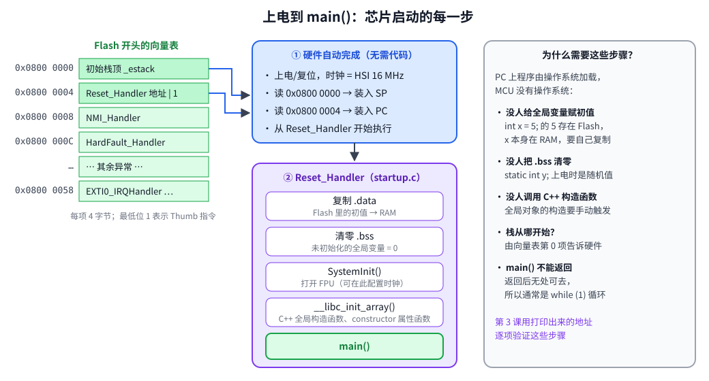
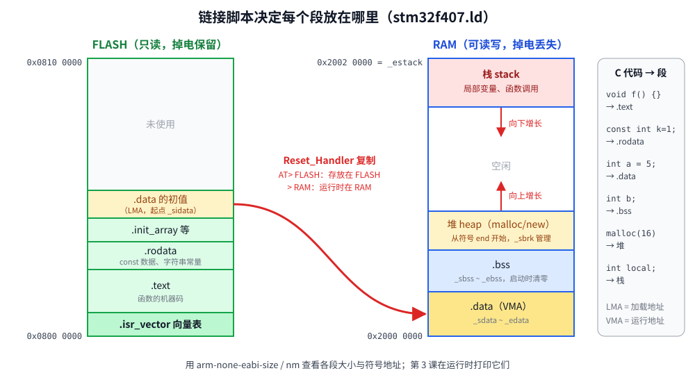

# 第 3 章　启动过程与链接脚本

## 本章目标

- 理解芯片上电后、`main()` 之前发生的每一件事
- 读懂向量表、`Reset_Handler` 和链接脚本
- 知道全局变量、常量、局部变量、`malloc` 的内存分别在哪里
- 会用 `size`、`nm`、`.map` 文件查看程序的内存布局

这一章是“PC 程序员”和“嵌入式程序员”的分水岭。在 PC 上，这些工作由操作系统和 C 运行时悄悄完成；在 MCU 上，**这些代码就在我们的工程里**：`common/startup.c` 和 `common/stm32f407.ld`。

## 3.1 上电后的启动序列



Cortex-M 的启动规则非常简单（ARMv7-M 架构规定）：

1. 复位后，CPU 从地址 `0x00000000` 读第一个字（4 字节）装入栈指针 SP
2. 从地址 `0x00000004` 读第二个字装入程序计数器 PC，开始执行

STM32 在 BOOT0 引脚为低电平时，把 Flash（`0x08000000`）映射到地址 0，所以这两个字实际来自 Flash 的开头。这段数据叫 **向量表**：第 0 项是初始栈顶，第 1 项是复位处理函数的地址，后面是各种异常和中断处理函数的地址。

此时 CPU 运行在内部 16 MHz RC 振荡器（HSI）上，所有外设时钟关闭，RAM 内容随机。接下来由我们的 `Reset_Handler` 把 C 语言运行环境准备好。

## 3.2 向量表

[`examples/common/startup.c`](../examples/common/startup.c)：

```c
#define WEAK_HANDLER(name) void name(void) __attribute__((weak, alias("Default_Handler")))

WEAK_HANDLER(NMI_Handler);
WEAK_HANDLER(HardFault_Handler);
/* ... 所有异常和 82 个外设中断 ... */
WEAK_HANDLER(SysTick_Handler);
WEAK_HANDLER(EXTI0_IRQHandler);
WEAK_HANDLER(USART2_IRQHandler);

__attribute__((section(".isr_vector"), used))
const vector_t g_vector_table[16 + 82] = {
    (vector_t)&_estack,      /* 0: 初始栈顶 */
    Reset_Handler,           /* 1: 复位 */
    NMI_Handler,             /* 2 */
    HardFault_Handler,       /* 3 */
    MemManage_Handler,
    BusFault_Handler,
    UsageFault_Handler,
    0, 0, 0, 0,
    SVC_Handler,
    DebugMon_Handler,
    0,
    PendSV_Handler,
    SysTick_Handler,         /* 15 */

    WWDG_IRQHandler,         /* 16 + 0：外设中断 0 */
    /* ... */
    EXTI0_IRQHandler,        /* 16 + 6 */
    /* ... */
};
```

要点：

- **前 16 项** 是 Cortex-M 内核定义的系统异常，所有 Cortex-M 芯片相同。
- **后 82 项** 是 ST 定义的外设中断（IRQ），编号从 0 开始，顺序见 RM0090 表 61。EXTI0 是 IRQ 6，所以在向量表第 16+6 = 22 项，地址偏移 22×4 = `0x58`。
- `section(".isr_vector")`：放进一个专门的段，链接脚本把它放到 Flash 开头。`used` 防止编译器因为“没人引用”而删掉它。
- **弱别名**：每个处理函数都是 `Default_Handler`（死循环）的弱别名。你在任何地方定义一个同名的强符号函数，比如 `void SysTick_Handler(void) {...}`，链接器就用你的版本替换掉。这就是“写一个特定名字的函数就能处理中断”的原理，函数名拼错了就会悄悄进入 `Default_Handler`。

## 3.3 Reset_Handler

```c
void Reset_Handler(void)
{
    uint32_t *src = &_sidata;
    uint32_t *dst = &_sdata;

    while (dst < &_edata) {      /* 1. 把 .data 的初值从 Flash 复制到 RAM */
        *dst++ = *src++;
    }

    for (dst = &_sbss; dst < &_ebss;) {   /* 2. 把 .bss 清零 */
        *dst++ = 0;
    }

    SystemInit();                /* 3. 芯片级初始化：打开 FPU */
    __libc_init_array();         /* 4. 调用 C++ 全局构造函数 / constructor 函数 */

    main();                      /* 5. 进入 main */

    for (;;) {                   /* main 返回了：无处可去 */
    }
}

__attribute__((weak)) void SystemInit(void)
{
    SCB->CPACR |= (3u << 20) | (3u << 22);   /* 允许访问协处理器 CP10/CP11 = FPU */
    __asm__ volatile("dsb\n isb");
}
```

为什么要打开 FPU？我们用 `-mfloat-abi=hard` 编译，编译器可能在任何地方使用浮点指令（甚至 `printf` 内部）。FPU 复位后是关闭的，执行第一条浮点指令就会触发 UsageFault（NOCP）。

`_sidata`、`_sdata` 这些符号不是变量，而是 **链接脚本定义的地址**。在 C 里声明成 `extern uint32_t _sdata;`，只用它的地址 `&_sdata`。

## 3.4 链接脚本



编译器把每个 `.c` 编译成 `.o`，里面的代码和数据按类型分在不同的 **段（section）** 里：

| C 代码 | 段 | 最终位置 |
|--------|----|---------|
| 函数 | `.text` | Flash |
| `const int k = 1;`、字符串常量 | `.rodata` | Flash |
| `int a = 5;`（有非零初值的全局/静态变量） | `.data` | 运行在 RAM，初值存 Flash |
| `int b;`、`static int c = 0;` | `.bss` | RAM，启动时清零 |
| `malloc` | 堆 | RAM，`.bss` 之后向上长 |
| 局部变量、函数调用 | 栈 | RAM 顶部向下长 |

链接脚本告诉链接器芯片有哪些存储器、每个段放在哪里。它分成两个文件：[`examples/common/stm32f407.ld`](../examples/common/stm32f407.ld) 写 `MEMORY`，最后一行 `INCLUDE stm32f407-sections.ld` 引入 [`stm32f407-sections.ld`](../examples/common/stm32f407-sections.ld) 里的 `SECTIONS`（第 23 章的 bootloader 和 app 会各写一个只改 `MEMORY` 的脚本，复用同一份 `SECTIONS`）。合在一起看是这样：

```ld
ENTRY(Reset_Handler)

MEMORY
{
    FLASH (rx)  : ORIGIN = 0x08000000, LENGTH = 1024K
    RAM   (rwx) : ORIGIN = 0x20000000, LENGTH = 128K
}

_estack = ORIGIN(RAM) + LENGTH(RAM);     /* 0x20020000：栈从 RAM 末尾开始 */

SECTIONS
{
    .isr_vector : { . = ALIGN(4); KEEP(*(.isr_vector)) . = ALIGN(4); } > FLASH

    .text   : { *(.text) *(.text*) KEEP(*(.init)) KEEP(*(.fini)) ... } > FLASH
    .rodata : { *(.rodata) *(.rodata*) } > FLASH

    .init_array : {                       /* 构造函数指针表 */
        PROVIDE_HIDDEN(__init_array_start = .);
        KEEP(*(SORT(.init_array.*)))
        KEEP(*(.init_array*))
        PROVIDE_HIDDEN(__init_array_end = .);
    } > FLASH

    _sidata = LOADADDR(.data);            /* .data 初值在 Flash 中的地址 */

    .data : {
        . = ALIGN(4);
        _sdata = .;
        *(.data) *(.data*)
        . = ALIGN(4);
        _edata = .;
    } > RAM AT> FLASH                     /* 运行地址在 RAM，存放地址在 Flash */

    .bss (NOLOAD) : {
        . = ALIGN(4);
        _sbss = .;
        *(.bss) *(.bss*) *(COMMON)
        . = ALIGN(4);
        _ebss = .;
    } > RAM

    ._user_heap_stack (NOLOAD) : {        /* 只是预留，保证堆和栈至少各有 4 KB */
        . = ALIGN(8);
        PROVIDE(end = .);                 /* 堆从这里开始 */
        . = . + _min_heap_size;
        . = . + _min_stack_size;
    } > RAM
}
```

最关键的一行是 `> RAM AT> FLASH`：

- **VMA**（Virtual Memory Address，运行地址）在 RAM：代码里访问 `g_initialized` 时用的是 RAM 地址
- **LMA**（Load Memory Address，加载地址）在 Flash：烧录时初值写在 Flash 里

上电时 RAM 是随机的，所以 `Reset_Handler` 要把 LMA 处的数据复制到 VMA。`.bss` 只需要清零，不占 Flash 空间（`NOLOAD`）。

`KEEP(...)`：我们用了 `--gc-sections` 删掉没被引用的段，向量表和构造函数表没有任何代码直接引用，必须用 `KEEP` 保住。

## 3.5 运行例子：亲眼看到这些地址

[`examples/03-startup/main.c`](../examples/03-startup/main.c) 定义了各种变量并打印它们的地址：

```c
int g_initialized = 0x12345678;            /* .data */
int g_zeroed;                              /* .bss */
static int s_counter = 42;                 /* .data */
const char g_message[] = "I live in FLASH"; /* .rodata */

__attribute__((constructor)) static void before_main(void)
{
    s_constructor_ran = 1;                 /* 由 __libc_init_array 调用 */
}
```

```bash
cd examples/03-startup
make run
```

本机实际输出：

```
== Where variables live ==
  g_vector_table   @ 0x08000000  .isr_vector (FLASH)
  main             @ 0x08001b99  .text       (FLASH)
  g_message        @ 0x08002360  .rodata     (FLASH)
  g_initialized    @ 0x20000060  .data       (RAM)
  s_counter        @ 0x2000005c  .data       (RAM)
  g_zeroed         @ 0x200001cc  .bss        (RAM)
  local            @ 0x2001ffe4  stack       (RAM)

== Values set up by Reset_Handler ==
  g_initialized = 0x12345678 (copied from FLASH)
  s_counter     = 42
  g_zeroed      = 0 (cleared)
  constructor   = ran before main

== Linker script symbols ==
  _sidata = 0x08002384  initial values of .data in FLASH
  _sdata  = 0x20000000  _edata = 0x20000064  (.data 100 bytes)
  _sbss   = 0x20000064  _ebss  = 0x200001d4  (.bss 368 bytes)
  _estack = 0x20020000  top of RAM

== Vector table ==
  word 0 (initial SP)    = 0x20020000
  word 1 (Reset_Handler) = 0x08001e45 (odd: Thumb bit)
  &Reset_Handler         = 0x08001e45

== Stack and heap ==
  SP now      = 0x2001ffe0 (32 bytes used)
  malloc(64)  = 0x200005e8 (heap starts after .bss)
```

对照布局图逐项验证：

- 向量表在 `0x08000000`，第 0 项 = `_estack` = `0x20020000`，第 1 项是 `Reset_Handler` 地址（奇数 = Thumb）
- `g_initialized` 在 RAM（`0x2000xxxx`），值是 `0x12345678`，说明复制成功
- `g_zeroed` 在 `.bss` 范围 `[0x20000064, 0x200001d4)` 内，值为 0
- `local` 在 RAM 顶部附近：栈从 `0x20020000` 向下增长，`main` 只用了 32 字节
- `malloc` 返回的地址在 `.bss` 之后：堆从 `end` 符号向上增长
- `.data` 有 100 字节，比我们定义的两个 `int` 多得多：newlib 自己也有带初值的全局变量（如 `_impure_ptr`）

## 3.6 用工具查看内存布局

```bash
arm-none-eabi-size build/firmware.elf
```

```
   text	   data	    bss	    dec	    hex	filename
   9072	    112	   8564	  17748	   4554	build/firmware.elf
```

- `text` = `.isr_vector + .text + .rodata + ...`，全部在 Flash
- `data` = `.data`，**同时占用 Flash（初值）和 RAM**
- `bss` = `.bss + ._user_heap_stack`，只占 RAM。这里的 8564 包含了为堆和栈预留的 8 KB，所以第 1 章看到 RAM 用了 8 KB 多

```bash
arm-none-eabi-nm -n build/firmware.elf | grep -E ' (g_|s_|_s|_e)'   # 按地址排序列出符号
less build/firmware.map                                           # 链接器生成的完整布局
```

`.map` 文件列出了每个 `.o` 的每个段被放在哪个地址、占多大，是排查“Flash 不够用”“某个库为什么被链接进来”的利器。

## 3.7 系统调用与堆：syscalls.c

newlib 是为嵌入式设计的 C 库，它不知道你的硬件，把底层操作留给几个“系统调用”函数。[`examples/common/syscalls.c`](../examples/common/syscalls.c) 实现了最少的一组：

| 函数 | 被谁调用 | 我们的实现 |
|------|---------|-----------|
| `_write` | `printf`、`puts` | 逐字节调用 `__io_putchar`（由 UART 驱动提供） |
| `_read` | `scanf`、`getchar` | 逐字节调用 `__io_getchar` |
| `_sbrk` | `malloc` | 从 `end` 开始向上分配，碰到栈的保留区就返回失败 |
| `_close/_fstat/_isatty/_lseek` | stdio 内部 | 返回固定值，让 stdout 看起来像终端 |
| `_exit/_kill/_getpid` | `abort`、`exit` | 死循环或返回错误 |

```c
void *_sbrk(int incr)
{
    extern uint8_t end;
    extern uint8_t _estack;
    extern uint32_t _min_stack_size;
    static uint8_t *heap_end;

    if (heap_end == 0) {
        heap_end = &end;
    }

    uint8_t *stack_limit = &_estack - (uint32_t)&_min_stack_size;
    if (heap_end + incr > stack_limit) {
        errno = ENOMEM;
        return (void *)-1;
    }

    uint8_t *prev = heap_end;
    heap_end += incr;
    return prev;
}
```

> 嵌入式里通常尽量避免 `malloc`：内存碎片和分配失败在长时间运行的设备上很难处理。本教程只在第 3 章演示它。

## 练习

1. 定义一个 `static const int table[256] = {1};` 并在 `main` 里用到它，比如 `printf("%d\n", table[g_zeroed]);`（没被引用的数据会被 `--gc-sections` 删掉），它会出现在哪个段？`size` 的哪一列会增加？
2. 定义一个 `int big[1000];`（不初始化）和一个 `int big2[1000] = {1};`，同样在代码里用到它们，分别看 `size` 的变化。为什么后者同时增加了 Flash 占用？
3. 在 `Reset_Handler` 里注释掉清零 `.bss` 的循环，重新运行，`g_zeroed` 还是 0 吗？（Renode 的 RAM 初始为 0，所以可能看不出问题。真芯片上 RAM 是随机值。这正是“模拟器上能跑、实物上不能跑”的一类 bug）
4. 在 `.map` 文件里找到 `printf` 来自哪个库文件，占多少字节。

## 常见坑

- **忘记 `KEEP(*(.isr_vector))`**：开了 `--gc-sections` 后向量表被删除，芯片上电就跑飞。
- **向量表顺序错一个**：中断进了别人的处理函数。用 ST 官方启动文件（第 11 章）可以避免手写错误。
- **栈溢出**：栈向下长，撞进堆或 `.bss`，表现为全局变量被莫名修改。大数组不要放在局部变量里。
- **函数指针最低位**：手动构造函数指针时，Thumb 函数地址必须是奇数，否则触发 INVSTATE 故障（第 13 章演示）。

---

上一章：[第 2 章　MCU 基础](02-mcu-basics.md)　｜　下一章：[第 4 章　GPIO 输出](04-gpio-output.md)
