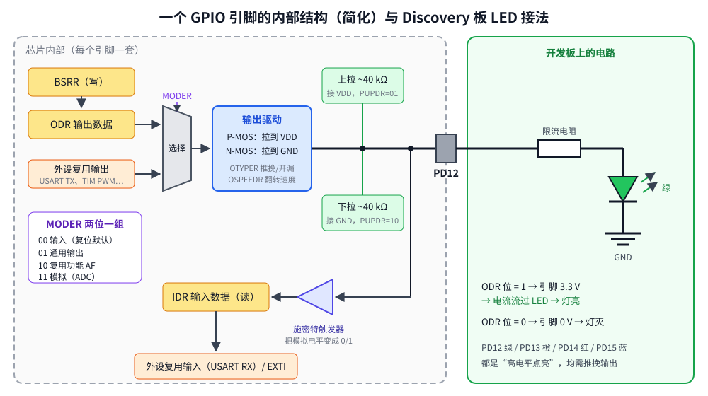

# 第 4 章　GPIO 输出：点亮 LED

## 本章目标

- 理解 GPIO 引脚的内部结构：推挽/开漏、上下拉、复用功能
- 掌握“使用任何外设的三步”：开时钟 → 配置 → 使用
- 用 MODER、OTYPER、OSPEEDR、PUPDR、ODR、BSRR 控制 LED
- 理解 BSRR 为什么比 `ODR |=` 更安全

## 4.1 GPIO 是什么

GPIO（General Purpose Input/Output，通用输入输出）是 MCU 和外部世界最直接的接口。STM32F407 有 GPIOA ~ GPIOI 共 9 个端口，每个端口 16 个引脚，命名为 `P<端口><编号>`，例如 PD12 = 端口 D 的第 12 脚。



每个引脚都可以独立配置成四种模式之一（MODER）：

| MODER | 模式 | 用途 |
|-------|------|------|
| `00` | 输入（复位默认） | 读按键、读数字信号 |
| `01` | 通用输出 | 点 LED、控制继电器 |
| `10` | 复用功能（AF） | 把引脚交给片上外设：USART 的 TX/RX、定时器 PWM 输出…… |
| `11` | 模拟 | ADC/DAC，数字电路断开 |

输出模式下还有：

- **OTYPER 输出类型**：`0` 推挽（P-MOS 和 N-MOS 都工作，能输出高也能输出低）；`1` 开漏（只有 N-MOS，只能拉低，高电平靠外部上拉电阻，用于 I2C 或电平转换）
- **OSPEEDR 速度**：控制电平翻转的边沿速度。越快 EMI 越大、功耗越高；点 LED 用最低档就够
- **PUPDR 上下拉**：内部约 40 kΩ 的上拉/下拉电阻，主要用于输入（第 5 章）

## 4.2 Discovery 板上的 LED

Discovery 板上 4 个 LED 的接法相同：`PDx → 限流电阻 → LED → GND`。引脚输出高电平（3.3 V）时电流流过 LED，灯亮；输出低电平时灯灭。这叫“高电平有效”。

| 引脚 | 颜色 | 板上丝印 |
|------|------|---------|
| PD12 | 绿 | LD4 |
| PD13 | 橙 | LD3 |
| PD14 | 红 | LD5 |
| PD15 | 蓝 | LD6 |

## 4.3 使用外设的三步

### 第一步：打开外设时钟（RCC）

STM32 为了省电，**复位后几乎所有外设的时钟都是关闭的**。没有时钟的外设，寄存器写不进去、读出来是 0。GPIOD 挂在 AHB1 总线上，它的时钟开关是 `RCC_AHB1ENR` 的第 3 位：

```
RCC_AHB1ENR（RCC 基地址 0x40023800 + 偏移 0x30）
bit:  …  8     7     6     5     4     3     2     1     0
     … GPIOI GPIOH GPIOG GPIOF GPIOE GPIOD GPIOC GPIOB GPIOA  EN
```

```c
RCC->AHB1ENR |= RCC_AHB1ENR_GPIODEN;   /* BIT(3) */
```

> **注意**：Renode 不模拟时钟门控，不开时钟 LED 也能亮。真芯片上忘记开时钟是新手第一大 bug，养成习惯：用任何外设之前先开它的时钟。

### 第二步：配置引脚

把 PD12 设为推挽输出、低速、无上下拉：

```c
GPIOD->MODER   = (GPIOD->MODER & ~(3u << (12 * 2))) | (1u << (12 * 2));  /* 01 = 输出 */
GPIOD->OTYPER &= ~BIT(12);                                               /* 0 = 推挽 */
GPIOD->OSPEEDR &= ~(3u << (12 * 2));                                     /* 00 = 低速 */
GPIOD->PUPDR  &= ~(3u << (12 * 2));                                      /* 00 = 无 */
```

后三项的复位值本来就是 0，可以省略，但写出来意图更清楚。

### 第三步：使用

```c
GPIOD->ODR |= BIT(12);    /* 亮 */
GPIOD->ODR &= ~BIT(12);   /* 灭 */
```

## 4.4 BSRR：原子的置位/复位

`ODR |= BIT(12)` 是三条指令：读 ODR → 或运算 → 写回 ODR。如果在读和写之间发生了中断，而中断处理函数也修改了 ODR 的其他位（比如翻转 PD15），那么主程序写回时会把中断的修改覆盖掉。

BSRR（Bit Set/Reset Register）解决了这个问题：

```
BSRR  31 … 16 | 15 … 0
      BR15…BR0 | BS15…BS0
      写1=复位  | 写1=置位       写0=无影响
```

```c
GPIOD->BSRR = BIT(12);         /* PD12 = 1，其他引脚不变 */
GPIOD->BSRR = BIT(12 + 16);    /* PD12 = 0，其他引脚不变 */
```

一次写操作，硬件内部完成，不可能被打断。同时置位和复位同一个引脚时，置位优先。`common/drivers/gpio.h` 里的 `gpio_write` 就是用 BSRR 实现的：

```c
static inline void gpio_write(GPIO_TypeDef *port, uint32_t pin, int high)
{
    port->BSRR = high ? BIT(pin) : BIT(pin + 16u);
}
```

## 4.5 例子代码

[`examples/04-gpio-output/main.c`](../examples/04-gpio-output/main.c) 分两步。

**第一步：只用裸地址点亮绿灯**，每个地址都能在 RM0090 里查到：

```c
#define REG32(addr)      (*(volatile uint32_t *)(addr))
#define RCC_AHB1ENR_RAW  REG32(0x40023800u + 0x30u)
#define GPIOD_MODER_RAW  REG32(0x40020C00u + 0x00u)
#define GPIOD_ODR_RAW_   REG32(0x40020C00u + 0x14u)

static void step1_raw_green_led(void)
{
    RCC_AHB1ENR_RAW |= (1u << 3);                 /* 1. clock GPIOD (bit 3 = GPIODEN) */
    GPIOD_MODER_RAW &= ~(3u << (12 * 2));         /* 2. clear PD12 mode bits ...      */
    GPIOD_MODER_RAW |=  (1u << (12 * 2));         /*    ... and select 01 = output    */
    GPIOD_ODR_RAW_  |=  (1u << 12);               /* 3. drive PD12 high: LED on       */
}
```

**第二步：用结构体和 BSRR 做流水灯**。`show_one` 用一次 BSRR 写入同时点亮一个灯、熄灭另外三个：

```c
static void show_one(uint32_t pin)
{
    /* Low half of BSRR sets pins, high half resets them; one write does both. */
    uint32_t set = BIT(pin);
    uint32_t reset = (0xFu << 12) & ~set;
    GPIOD->BSRR = set | (reset << 16);
}
```

以 `pin = 13` 为例：`set = 0x2000`，`reset = 0xF000 & ~0x2000 = 0xD000`，写入 `0xD0002000`，即复位 PD12/14/15、置位 PD13。

## 4.6 运行

```bash
cd examples/04-gpio-output
make run
```

本机实际输出（LED 日志的时间戳略）：

```
gpioPortD.UserLED: LED state changed to True        ← 第一步：绿灯亮
gpioPortD.UserLED: LED state changed to False       ← 流水灯开始
gpioPortD.OrangeLED: LED state changed to True
gpioPortD.OrangeLED: LED state changed to False
gpioPortD.RedLED: LED state changed to True
gpioPortD.RedLED: LED state changed to False
gpioPortD.BlueLED: LED state changed to True
gpioPortD.BlueLED: LED state changed to False
gpioPortD.UserLED: LED state changed to True
...
gpioPortD.BlueLED: LED state changed to False

----- USART2 output -----
step 1: GPIOD MODER=0x01000000 ODR=0x1000 -> green LED on
step 2: chaser
  ODR=0x1000  green
  ODR=0x2000  orange
  ODR=0x4000  red
  ODR=0x8000  blue
  ODR=0x1000  green
  ODR=0x2000  orange
  ODR=0x4000  red
  ODR=0x8000  blue
all LEDs off, ODR=0x0000
```

- 第一步后 `MODER=0x01000000`：只有 bit 24 为 1，即 PD12 的 MODER 字段 = `01`
- Renode 中 PD12 的 LED 叫 `UserLED`（来自 Renode 自带的板级描述），其余三个是我们在 `board.repl` 里加的

## 4.7 封装成驱动

从这一课开始，GPIO 操作被提炼到 `common/drivers/gpio.h` 和 `board.h`，后面各课直接使用：

```c
static inline void gpio_set_mode(GPIO_TypeDef *port, uint32_t pin, uint32_t mode)
{
    uint32_t shift = pin * 2u;
    port->MODER = (port->MODER & ~(3u << shift)) | (mode << shift);
}

static inline void board_init_leds(void)
{
    RCC->AHB1ENR |= RCC_AHB1ENR_GPIODEN;
    for (uint32_t pin = LED_GREEN; pin <= LED_BLUE; pin++) {
        gpio_set_mode(LED_PORT, pin, GPIO_MODE_OUTPUT);
    }
}

static inline void led_on(uint32_t led)     { gpio_write(LED_PORT, led, 1); }
static inline void led_off(uint32_t led)    { gpio_write(LED_PORT, led, 0); }
static inline void led_toggle(uint32_t led) { gpio_toggle(LED_PORT, led); }
```

全部是 `static inline`，编译后和直接写寄存器没有区别。

## 练习

1. 让 4 个 LED 以二进制计数的方式显示 0~15（PD12 是最低位）。提示：`GPIOD->BSRR = (value << 12) | ((~value & 0xF) << (12 + 16));`
2. 把 PD12 配成开漏输出（`OTYPER` 第 12 位置 1），在 Renode 里 LED 还会亮吗？在真板上呢？（真板上开漏输出 1 = 高阻，LED 没有电流，不亮）
3. 写一个 `leds_write(uint8_t mask)`，只用一次 BSRR 写入设置 4 个 LED 的状态。
4. 不调用 `board_init_leds()`，直接 `led_on(LED_RED)`，Renode 里会亮吗？查 RM0090 说明真芯片上的结果。

## 常见坑

- **忘开 GPIO 时钟**：真芯片上什么都不发生，Renode 上却正常。
- **MODER 只做了 `|=`**：如果该字段原来是 `10`（例如复位后 PA13/PA14 是调试口），`|= 01` 得到 `11`（模拟模式）。一定要先清再设。
- **改错端口**：GPIOA 的 PA13/PA14 是 SWD 调试引脚，改它们的模式会导致真板上调试器连不上。
- **在中断和主循环里同时 `ODR ^=`**：读-改-写竞争，用 BSRR。

---

上一章：[第 3 章　启动过程](03-startup.md)　｜　下一章：[第 5 章　GPIO 输入](05-gpio-input.md)
