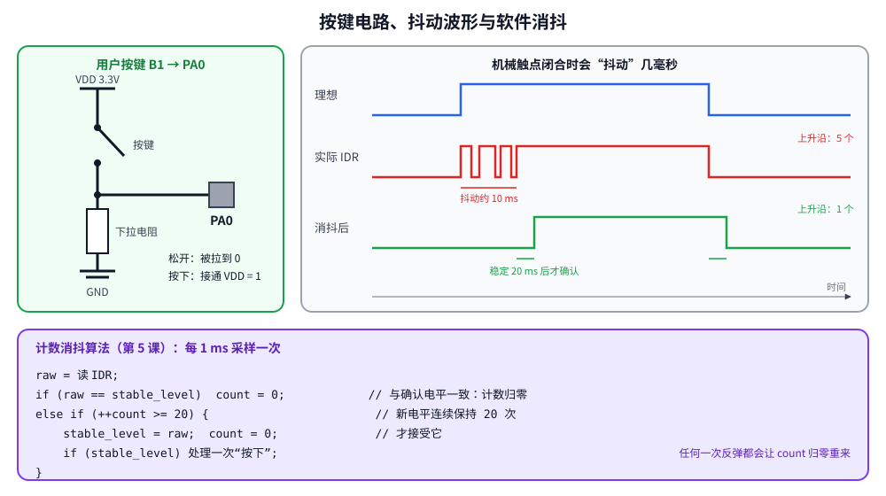

# 第 5 章　GPIO 输入：按键与消抖

## 本章目标

- 用 IDR 读引脚电平，理解上拉/下拉电阻的作用
- 理解机械按键的“抖动”，用软件计数法消抖
- 学会在 Renode 里用脚本模拟按键（包括抖动）

## 5.1 按键电路



Discovery 板的用户按键 B1（蓝色）接在 PA0 上：按键一端接 VDD（3.3 V），另一端接 PA0，PA0 再通过下拉电阻接地。

- 松开：PA0 通过下拉电阻接地 → 读到 **0**
- 按下：PA0 直接接通 VDD → 读到 **1**

为什么需要下拉电阻？如果没有它，按键松开时 PA0 什么都没接（“悬空”），输入电路会拾取周围的电磁干扰，读到的值随机跳变。上拉/下拉电阻给引脚一个确定的默认电平。

板上已经有外部下拉电阻，代码里我们 **再打开内部下拉**（PUPDR = `10`），这样即使换到没有外部电阻的电路也能正确工作。

## 5.2 读输入的寄存器

| 寄存器 | 作用 |
|--------|------|
| MODER | 设为 `00` 输入（复位默认就是） |
| PUPDR | `00` 无、`01` 上拉、`10` 下拉 |
| IDR | 只读，第 n 位 = 引脚 n 当前电平 |

```c
static inline void board_init_button(void)
{
    RCC->AHB1ENR |= RCC_AHB1ENR_GPIOAEN;
    gpio_set_mode(BUTTON_PORT, BUTTON_PIN, GPIO_MODE_INPUT);
    gpio_set_pull(BUTTON_PORT, BUTTON_PIN, GPIO_PULL_DOWN);
}

static inline int gpio_read(GPIO_TypeDef *port, uint32_t pin)
{
    return (int)((port->IDR >> pin) & 1u);
}
```

## 5.3 抖动

机械按键的金属触点在闭合和断开的瞬间会弹跳几次，持续几毫秒到十几毫秒。在这段时间里 IDR 会快速地在 0 和 1 之间来回跳。如果每个上升沿都算一次“按下”，按一次可能被当作按了好几次。

消抖的思路：**电平必须稳定保持一段时间，才承认它变了**。本课的算法（每约 1 ms 采样一次）：

```c
if (raw == stable_level) {
    stable_count = 0;                    /* 和已确认的电平相同：没有变化 */
} else if (++stable_count >= DEBOUNCE_SAMPLES) {
    stable_level = raw;                  /* 新电平连续出现 20 次：接受 */
    stable_count = 0;
    /* 处理一次按下或松开 */
}
```

抖动期间只要电平跳回原值，`stable_count` 就归零，必须重新数满 20 次。

## 5.4 例子代码

[`examples/05-gpio-input/main.c`](../examples/05-gpio-input/main.c) 同时统计两样东西：未消抖的原始上升沿个数，以及消抖后的按下次数。

```c
#define DEBOUNCE_SAMPLES 20u

/* Roughly 1 ms at 16 MHz; lesson 6 replaces this guess with a real timer. */
static void delay_about_1ms(void)
{
    for (volatile uint32_t i = 0; i < 1600u; i++) {
    }
}

int main(void)
{
    board_init_leds();
    board_init_button();
    uart_init(HSI_HZ, 115200);
    ...
    for (;;) {
        int raw = button_pressed();

        if (raw && !last_raw) {
            raw_edges++;
        }
        last_raw = raw;

        if (raw == stable_level) {
            stable_count = 0;
        } else if (++stable_count >= DEBOUNCE_SAMPLES) {
            stable_level = raw;
            stable_count = 0;
            if (stable_level) {
                presses++;
                led_toggle(LED_ORANGE);
                printf("press #%lu  (raw rising edges so far: %lu)\n",
                       (unsigned long)presses, (unsigned long)raw_edges);
            } else {
                printf("release\n");
            }
        }

        delay_about_1ms();
    }
}
```

`delay_about_1ms` 用空循环估计时间，很不精确（取决于编译优化和 CPU 频率）。第 6 章会用 SysTick 定时器替换它。

## 5.5 用脚本模拟按键

模拟器里没有手指，所以用 Renode 脚本按键。课程目录下的 [`stimulus.resc`](../examples/05-gpio-input/stimulus.resc) 会被 `make run` 自动使用：

```
emulation RunFor "0.05"

# 1) A clean press held for 100 ms.
gpioPortA.UserButton Press
emulation RunFor "0.1"
gpioPortA.UserButton Release
emulation RunFor "0.1"

# 2) A bouncy press: the contact chatters for about 10 ms before settling.
gpioPortA.UserButton Press
emulation RunFor "0.002"
gpioPortA.UserButton Release
emulation RunFor "0.0015"
gpioPortA.UserButton Press
emulation RunFor "0.003"
gpioPortA.UserButton Release
emulation RunFor "0.001"
gpioPortA.UserButton Press
emulation RunFor "0.002"
gpioPortA.UserButton Release
emulation RunFor "0.001"
gpioPortA.UserButton Press
emulation RunFor "0.1"
gpioPortA.UserButton Release
emulation RunFor "0.1"
```

`emulation RunFor "0.002"` 让虚拟时间前进 2 ms，所以按键事件的时序是精确可重复的。第二次按键在约 10 ms 内产生了 4 个上升沿（3 次弹跳 + 最终闭合）。

## 5.6 运行

```bash
cd examples/05-gpio-input
make run
```

本机实际输出：

```
gpioPortD.OrangeLED: LED state changed to True
gpioPortD.OrangeLED: LED state changed to False

----- USART2 output -----
PA0 MODER=0 PUPDR=2 (0=input, 2=pull-down)
waiting for button presses...
press #1  (raw rising edges so far: 1)
release
press #2  (raw rising edges so far: 5)
release
```

第二次按下时原始上升沿计数从 1 变成 5（这一次按键产生了 4 个上升沿），但消抖后只计为一次按下。

## 5.7 轮询的局限

本课的主循环一直在读按键，CPU 100% 忙碌，而且如果主循环还要做别的耗时工作，就可能错过短暂的按键。解决办法：

- 第 6 章：用 SysTick 定时器提供精确的毫秒时间
- 第 7 章：用外部中断（EXTI），按键时硬件主动通知 CPU，平时 CPU 可以睡眠

## 练习

1. 把 `DEBOUNCE_SAMPLES` 改成 2，重新运行。第二次按键会被算成几次？
2. 实现“长按检测”：按住超过 500 ms 打印 `long press`。
3. 修改 `stimulus.resc`，加一次只持续 5 ms 的“误触”，确认它不会被算作按键。
4. 改成“按一次切换一个 LED”：第 1 次绿，第 2 次橙……循环。

## 常见坑

- **悬空输入**：没有上下拉的输入引脚读数随机。按键电路一定要有确定的默认电平。
- **把 `IDR` 当成可写**：IDR 是只读的，想改输出电平请用 ODR/BSRR。
- **消抖时间太短或太长**：太短挡不住抖动，太长会感觉按键“迟钝”。10~20 ms 是常见取值。
- **Renode 里的抖动是脚本写死的**：真按键的抖动更随机，松开时也会抖，算法要对两个方向都消抖（本课的算法已经是对称的）。

---

上一章：[第 4 章　GPIO 输出](04-gpio-output.md)　｜　下一章：[第 6 章　时钟树与 SysTick](06-clock-systick.md)
