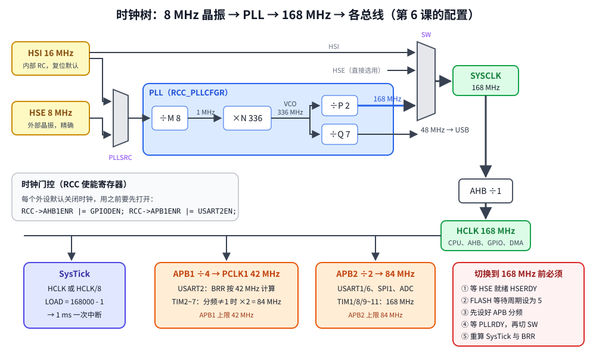
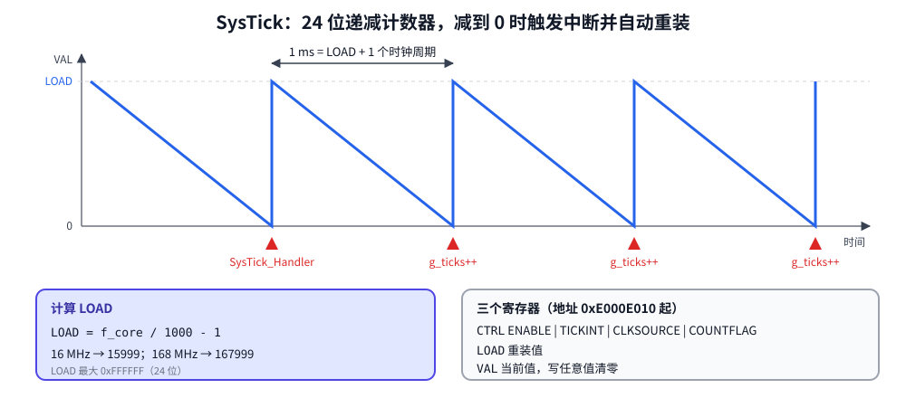

# 第 6 章　时钟树与 SysTick

## 本章目标

- 理解 STM32 的时钟来源（HSI、HSE、PLL）和时钟树
- 亲手把 CPU 从 16 MHz 切换到 168 MHz，理解每一步的必要性
- 用内核的 SysTick 定时器产生 1 ms 节拍，实现 `millis()` 和 `delay_ms()`
- 明白“时钟一变，所有依赖时钟的配置都要重算”

## 6.1 为什么需要“时钟树”

数字电路的每一步动作都由时钟驱动。CPU 主频决定指令执行速度，串口的波特率、定时器的计数速度也都是从某个时钟分频得到的。STM32 有多个时钟源，经过选择、倍频、分频后分发给各个部分，画出来像一棵树：



| 时钟源 | 频率 | 特点 |
|--------|------|------|
| HSI | 16 MHz | 芯片内部 RC 振荡器，**复位后默认使用**，精度约 ±1% |
| HSE | 4~26 MHz（Discovery 板是 8 MHz 晶振） | 外部晶体，精确稳定，需要等待起振 |
| PLL | 最高 168 MHz | 锁相环，把 HSI 或 HSE 倍频 |
| LSI / LSE | 32 kHz | 低速时钟，给看门狗和 RTC（本教程不用） |

PLL 的计算（RM0090 6.3.2 节 RCC_PLLCFGR）：

```
f_VCO_in  = f_src / M          要求 1~2 MHz，推荐 2 MHz 以减少抖动
f_VCO     = f_VCO_in × N       要求 100~432 MHz
f_SYSCLK  = f_VCO / P          P ∈ {2, 4, 6, 8}，不超过 168 MHz
f_USB     = f_VCO / Q          USB 需要正好 48 MHz
```

Discovery 板的经典配置：`8 MHz / 8 × 336 / 2 = 168 MHz`，`336 / 7 = 48 MHz`。

SYSCLK 再经过三个分频器：

| 时钟 | 分频 | 频率 | 上限 | 谁在用 |
|------|------|------|------|--------|
| HCLK（AHB） | /1 | 168 MHz | 168 MHz | CPU、GPIO、DMA、SysTick |
| PCLK1（APB1） | /4 | 42 MHz | 42 MHz | USART2、TIM2~7 |
| PCLK2（APB2） | /2 | 84 MHz | 84 MHz | USART1、SPI1、ADC、EXTI |

**定时器时钟的特殊规则**：APB 分频系数不为 1 时，该总线上定时器的时钟是 PCLK 的 2 倍。所以 168 MHz 配置下 TIM2~7 的时钟是 84 MHz，而不是 42 MHz。

## 6.2 切换到 168 MHz 的步骤

[`examples/06-clock-systick/main.c`](../examples/06-clock-systick/main.c)：

```c
static void clock_init_168mhz(void)
{
    RCC->CR |= RCC_CR_HSEON;                       /* 1. 启动外部晶振 */
    while ((RCC->CR & RCC_CR_HSERDY) == 0) {       /*    等它稳定 */
    }

    /* FLASH cannot answer in one 168 MHz cycle: 5 wait states at 2.7-3.6 V. */
    FLASH->ACR = FLASH_ACR_ICEN | FLASH_ACR_DCEN | FLASH_ACR_PRFTEN | 5u;   /* 2. */

    uint32_t cfgr = RCC->CFGR;                     /* 3. 先设好总线分频 */
    cfgr &= ~((0xFu << RCC_CFGR_HPRE_Pos) | (7u << RCC_CFGR_PPRE1_Pos) | (7u << RCC_CFGR_PPRE2_Pos));
    cfgr |= (0u << RCC_CFGR_HPRE_Pos)       /* AHB  /1 */
          | (5u << RCC_CFGR_PPRE1_Pos)      /* APB1 /4 */
          | (4u << RCC_CFGR_PPRE2_Pos);     /* APB2 /2 */
    RCC->CFGR = cfgr;

    /* Read-modify-write: PLLCFGR has reserved bits that must keep their value. */
    const uint32_t fields = 0x3Fu | (0x1FFu << 6) | (3u << 16) | RCC_PLLCFGR_SRC_HSE | (0xFu << 24);
    RCC->PLLCFGR = (RCC->PLLCFGR & ~fields)        /* 4. 配置 PLL */
                 | 8u                       /* M */
                 | (336u << 6)              /* N */
                 | (0u << 16)               /* P = 2 */
                 | RCC_PLLCFGR_SRC_HSE
                 | (7u << 24);              /* Q */

    RCC->CR |= RCC_CR_PLLON;                       /* 5. 启动 PLL，等待锁定 */
    while ((RCC->CR & RCC_CR_PLLRDY) == 0) {
    }

    RCC->CFGR = (RCC->CFGR & ~RCC_CFGR_SW_Msk) | RCC_CFGR_SW_PLL;      /* 6. 切换 */
    while ((RCC->CFGR & RCC_CFGR_SWS_Msk) != RCC_CFGR_SWS_PLL) {
    }

    g_core_hz = 168000000u;
}
```

每一步为什么必须这样做：

1. **等 HSERDY**：晶振起振需要时间（毫秒级），没稳定就用会得到错误的时钟。真实产品里这个循环应该加超时，晶振坏了要能退回 HSI。
2. **Flash 等待周期**：Flash 读取需要约 30 ns，168 MHz 下一个周期只有 6 ns，所以 CPU 读 Flash 时要等 5 个周期（RM0090 表 10，电压 2.7~3.6 V）。必须 **在提高频率之前** 设置，否则 CPU 会读到错误的指令。`ICEN/DCEN/PRFTEN` 打开指令缓存、数据缓存和预取（ST 叫 ART 加速器），抵消等待周期的影响。
3. **先设分频**：如果先切到 168 MHz 再设 APB1 分频，中间会有一段 APB1 跑在 168 MHz，超过 42 MHz 上限。
4. **PLLCFGR 读-改-写**：寄存器里有保留位，必须保持原值。PLL 运行时不能修改配置。
5. **等 PLLRDY**：锁相环锁定需要时间。
6. **切换并确认**：SW 是“请求”，SWS 是“状态”。写 SW 后要读 SWS 确认已经切换完成。

`sysclk_from_registers()` 反过来从寄存器计算当前 SYSCLK，例子用它打印以验证配置：

```c
uint32_t pll = RCC->PLLCFGR;
uint32_t src = (pll & RCC_PLLCFGR_SRC_HSE) ? HSE_HZ : HSI_HZ;
uint32_t m = pll & 0x3Fu;
uint32_t n = (pll >> 6) & 0x1FFu;
uint32_t p = (((pll >> 16) & 3u) + 1u) * 2u;
return src / m * n / p;
```

## 6.3 SysTick：内核自带的定时器



SysTick 是 Cortex-M 内核的一部分（所有 Cortex-M 芯片都有），是一个 24 位的 **递减** 计数器：

1. 从 LOAD 开始，每个时钟周期减 1
2. 减到 0 时：如果使能了中断，触发 `SysTick_Handler`；然后自动重新装入 LOAD
3. 所以中断周期 = (LOAD + 1) 个时钟周期

1 ms 中断一次：`LOAD = f_core / 1000 - 1`。16 MHz 时是 15999，168 MHz 时是 167999（不超过 24 位上限 16777215）。

```c
static void systick_start_1khz(uint32_t core_hz)
{
    SYSTICK->LOAD = core_hz / 1000u - 1u;   /* counts LOAD..0, so LOAD+1 cycles per tick */
    SYSTICK->VAL  = 0;                      /* any write clears the counter */
    SYSTICK->CTRL = SYSTICK_CTRL_CLKSOURCE  /* processor clock, not HCLK/8 */
                  | SYSTICK_CTRL_TICKINT    /* raise the SysTick exception at 0 */
                  | SYSTICK_CTRL_ENABLE;
}

void SysTick_Handler(void)
{
    g_ticks++;
}

static void delay_ms(uint32_t ms)
{
    uint32_t start = g_ticks;
    while ((uint32_t)(g_ticks - start) < ms) {
        wait_for_interrupt();               /* sleep until the next interrupt */
    }
}
```

几个细节：

- `g_ticks` 被中断修改、被主循环读取，必须是 `volatile`（第 7 章详细讨论）
- `g_ticks - start` 用无符号减法，`g_ticks` 在约 49.7 天后溢出回 0 时结果依然正确
- `wait_for_interrupt()` 执行 `WFI` 指令，CPU 睡眠直到下一个中断，比空转省电得多
- 函数名 `SysTick_Handler` 必须和向量表里的一模一样，它覆盖了 `startup.c` 里的弱别名

## 6.4 时钟一变，什么都要重算

`main` 在切换时钟后重新配置了 SysTick 和串口：

```c
int main(void)
{
    board_init_leds();
    uart_init(HSI_HZ, 115200);
    systick_start_1khz(g_core_hz);

    phase("HSI 16 MHz");

    clock_init_168mhz();
    /* Everything derived from a clock must be recomputed after the switch. */
    systick_start_1khz(g_core_hz);
    uart_init(g_core_hz / 4u, 115200);    /* PCLK1 = 42 MHz */

    phase("PLL 168 MHz");
    ...
}
```

如果忘了重设 SysTick，“1 ms”会变成 0.095 ms；忘了重设串口，波特率变成 115200 × 2.625，终端里全是乱码（APB1 从 16 MHz 变成了 42 MHz）。

## 6.5 运行

```bash
cd examples/06-clock-systick
make run
```

本机实际输出：

```
[HSI 16 MHz] SYSCLK = 16000000 Hz (from RCC registers)
[HSI 16 MHz] busy loop of 200000 iterations took 75 ms
[HSI 16 MHz] t=  75 ms  green LED on
[HSI 16 MHz] t= 325 ms  green LED off
[HSI 16 MHz] t= 575 ms  green LED on
[HSI 16 MHz] t= 825 ms  green LED off

[PLL 168 MHz] SYSCLK = 168000000 Hz (from RCC registers)
[PLL 168 MHz] busy loop of 200000 iterations took 7 ms
[PLL 168 MHz] t=1082 ms  green LED on
[PLL 168 MHz] t=1332 ms  green LED off
[PLL 168 MHz] t=1582 ms  green LED on
[PLL 168 MHz] t=1832 ms  green LED off

done at t=2082 ms
```

- 同样 20 万次循环，16 MHz 用 75 ms，168 MHz 用 7 ms，约快 10.5 倍（= 168/16）
- 两个阶段的 `delay_ms(250)` 都精确地间隔 250 ms，说明 SysTick 重新配置正确
- 串口在切换前后都能正常输出，说明 BRR 按新的 PCLK1 重算了

> **模拟器与真芯片的差异**：Renode 按“每秒执行多少条指令”来模拟 CPU 速度，不模拟 Flash 等待周期和流水线，所以空循环的耗时只能作相对比较。真芯片上的数字会不同。另外，Renode 的 RCC 模型只报告“PLL 已锁定”，不会真的改变模拟速度，本教程在 `common/board.resc` 里加了一个钩子：每当固件写 `RCC_CFGR` 时，根据寄存器内容重新计算 HCLK，并相应调整 CPU 速度、SysTick 和 TIM2~4 的时钟，效果和真芯片一致。详见附录 B。

## 练习

1. 把系统时钟改为 84 MHz（只改 P = 4，即 `(1u << 16)`），APB1 /2，重新计算 SysTick 和 BRR，确认输出正确。
2. 故意删掉切换后的 `uart_init(...)`，在 Renode 里输出会怎样？（Renode 不模拟波特率误差，可能依然正常，这是模拟器的局限。在真板上会是乱码）
3. 实现 `uint32_t micros(void)`：利用 `g_ticks` 和 `SYSTICK->VAL` 计算微秒时间。注意 VAL 是递减的，并处理读取过程中恰好发生中断的情况。
4. 用 `SYSTICK_CTRL_COUNTFLAG` 位实现一个不用中断的 `delay_ms`。

## 常见坑

- **提高频率前没设 Flash 等待周期**：真芯片上立刻 HardFault 或跑飞。降低频率时则要反过来：先降频，再减少等待周期。
- **分频顺序错误**：APB1 超过 42 MHz，外设工作不稳定。
- **等待 HSERDY 没有超时**：晶振坏了或板子没焊晶振，程序卡死在启动阶段。
- **SysTick LOAD 超过 24 位**：例如想用 168 MHz 直接产生 100 ms 中断（LOAD=16.8M，超出 16.7M 上限），需要选择 HCLK/8 时钟源或改用通用定时器。
- **忘了 `volatile`**：`delay_ms` 里的 `while` 读不到更新的 `g_ticks`，永远等下去。

---

上一章：[第 5 章　GPIO 输入](05-gpio-input.md)　｜　下一章：[第 7 章　中断：NVIC 与 EXTI](07-interrupts-exti.md)
