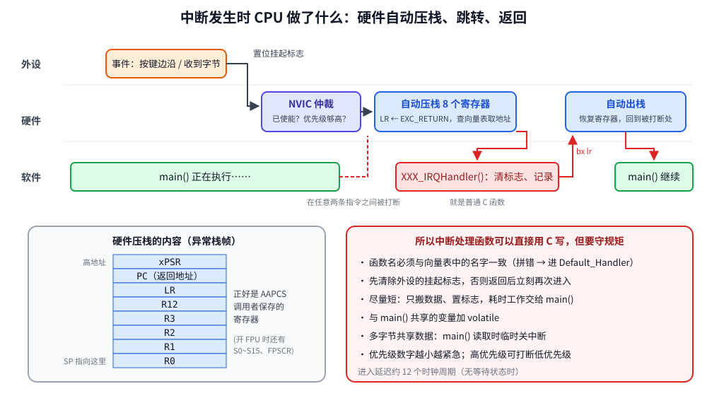
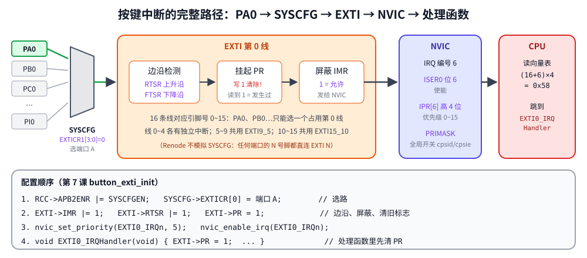

# 第 7 章　中断：NVIC 与 EXTI

## 本章目标

- 理解中断的硬件流程：挂起、仲裁、压栈、跳转、返回
- 掌握 NVIC 的使能和优先级配置
- 用 EXTI 外部中断响应按键，让 CPU 平时睡眠
- 正确处理中断和主程序共享的数据：`volatile`、临界区

## 7.1 为什么需要中断

第 5 章的轮询方式有两个问题：CPU 一直忙着检查按键，没法睡眠省电；如果主循环在做别的事，可能错过短暂的事件。中断让外设在事件发生时 **主动打断** CPU：CPU 暂停当前工作，执行一段处理函数，然后回到原处继续。

## 7.2 中断发生时 CPU 做了什么



1. **外设置位挂起标志**：比如按键产生上升沿，EXTI 的 PR 寄存器第 0 位变 1
2. **NVIC 仲裁**：这个中断使能了吗？优先级比当前正在执行的高吗？全局中断（PRIMASK）打开了吗？
3. **硬件自动压栈**：把 R0~R3、R12、LR、PC、xPSR 共 8 个寄存器压入当前栈（开了 FPU 还会预留 S0~S15、FPSCR）
4. **LR 装入特殊值 EXC_RETURN**（如 `0xFFFFFFF9`），PC 装入向量表中对应的处理函数地址
5. **执行处理函数**：就是一个普通的 C 函数
6. **返回**：函数末尾 `bx lr` 跳到 EXC_RETURN 这个“假地址”，硬件识别后自动出栈，恢复被打断的现场

压栈的 8 个寄存器恰好是 ARM 调用约定（AAPCS）规定由“调用者保存”的寄存器，所以中断处理函数可以直接用普通的 C 函数编写，不需要 `__attribute__((interrupt))` 之类的特殊标记。这是 Cortex-M 相比很多老架构的一大优点。

## 7.3 NVIC：嵌套向量中断控制器

NVIC 是内核的一部分，管理所有外设中断（IRQ 0~81）：

| 寄存器 | 作用 |
|--------|------|
| `ISER[n]` | 写 1 使能中断（每位一个 IRQ，写 0 无效） |
| `ICER[n]` | 写 1 禁止中断 |
| `ISPR/ICPR` | 手动设置/清除挂起 |
| `IP[irq]` | 每个 IRQ 一个字节的优先级，STM32 只实现高 4 位（16 级） |

```c
static inline void nvic_enable_irq(IRQn_Type irq)
{
    NVIC->ISER[(uint32_t)irq >> 5] = 1u << ((uint32_t)irq & 31u);
}

/* STM32F4 implements the top 4 bits of each priority byte; 0 is the most urgent. */
static inline void nvic_set_priority(IRQn_Type irq, uint8_t priority)
{
    NVIC->IP[(uint32_t)irq] = (uint8_t)(priority << 4);
}
```

**优先级规则**：数字越小越紧急。正在执行优先级 5 的处理函数时，来了优先级 2 的中断会立即打断它（嵌套）；来了优先级 6 的中断则要等它执行完。

**全局开关 PRIMASK**：`cpsid i` 关闭所有可屏蔽中断，`cpsie i` 打开。

## 7.4 EXTI：外部中断



GPIO 引脚本身不能直接产生中断，要经过 EXTI（外部中断/事件控制器）：

1. **SYSCFG_EXTICR**：选择哪个端口的引脚连到 EXTI 线。EXTI 线 n 只能连接 **某一个** 端口的 n 号引脚（PA0、PB0……PI0 中选一个连到 EXTI0）
2. **RTSR/FTSR**：上升沿/下降沿触发
3. **PR**：挂起寄存器，边沿发生时置 1，**写 1 清零**
4. **IMR**：屏蔽寄存器，1 = 允许送给 NVIC

EXTI 线 0~4 各有独立的 IRQ（EXTI0 = IRQ 6），线 5~9 共用 `EXTI9_5_IRQHandler`，线 10~15 共用 `EXTI15_10_IRQHandler`。

## 7.5 例子代码

[`examples/07-exti-interrupt/main.c`](../examples/07-exti-interrupt/main.c)：

```c
static void button_exti_init(void)
{
    board_init_button();

    /* 1. Route PA0 to EXTI line 0. EXTICR1 bits [3:0] select the port: 0 = A. */
    RCC->APB2ENR |= RCC_APB2ENR_SYSCFGEN;
    SYSCFG->EXTICR[0] = (SYSCFG->EXTICR[0] & ~0xFu) | 0x0u;

    /* 2. EXTI: unmask line 0, trigger on the rising edge only. */
    EXTI->IMR  |= BIT(0);
    EXTI->RTSR |= BIT(0);
    EXTI->FTSR &= ~BIT(0);
    EXTI->PR    = BIT(0);                 /* clear any stale pending flag */

    /* 3. NVIC: priority then enable. Lower number = more urgent. */
    nvic_set_priority(EXTI0_IRQn, 5);
    nvic_enable_irq(EXTI0_IRQn);
}

void EXTI0_IRQHandler(void)
{
    /* Clear first. PR is write-1-to-clear; forgetting this re-enters forever. */
    EXTI->PR = BIT(0);

    g_raw_edges++;

    uint32_t now = millis();
    if (g_presses != 0 && (uint32_t)(now - g_last_press_ms) < DEAD_TIME_MS) {
        return;                            /* bounce: ignore */
    }

    g_last_press_ms = now;
    g_presses++;
    led_toggle(LED_BLUE);
    g_event_pending = 1;
}
```

- **先清标志**：PR 不清零，处理函数返回后 NVIC 看到挂起位仍为 1，会立刻再次进入，主程序永远得不到执行
- **`EXTI->PR = BIT(0)` 而不是 `|=`**：写 1 清零的寄存器用 `|=` 会把其他已经挂起的线也一起清掉
- **消抖**：中断方式下用“死区时间”消抖：确认一次按下后 50 ms 内的边沿都忽略
- **处理函数里不调用 `printf`**：`printf` 很慢，而且不可重入。只记录事件，让主循环去打印

主循环：

```c
for (;;) {
    /* Snapshot shared state with interrupts masked so the values match. */
    uint32_t primask = irq_save();
    uint8_t pending = g_event_pending;
    uint32_t presses = g_presses;
    uint32_t edges = g_raw_edges;
    uint32_t when = g_last_press_ms;
    g_event_pending = 0;
    irq_restore(primask);

    if (pending) {
        printf("t=%4lu ms  press #%lu  (interrupts so far: %lu)\n",
               (unsigned long)when, (unsigned long)presses, (unsigned long)edges);
    }

    wait_for_interrupt();
}
```

## 7.6 共享数据：volatile 与临界区

中断可以在主程序的 **任意两条指令之间** 发生。两件事要注意：

**1. volatile**：`g_presses` 等变量在中断里被修改。没有 `volatile`，编译器可能把它缓存在寄存器里，主循环永远看不到新值。

**2. 原子性**：主循环要读 4 个相关变量。如果读完 `g_presses`、还没读 `g_raw_edges` 时来了中断，两个值就对不上了。解决办法是读之前关中断、读完恢复，这段代码叫 **临界区**：

```c
static inline uint32_t irq_save(void)
{
    uint32_t primask;
    __asm__ volatile("mrs %0, primask\n cpsid i" : "=r"(primask) :: "memory");
    return primask;
}

static inline void irq_restore(uint32_t primask)
{
    __asm__ volatile("msr primask, %0" :: "r"(primask) : "memory");
}
```

`irq_save` 保存原来的 PRIMASK 再关中断，`irq_restore` 恢复原值（而不是无条件打开），这样临界区可以嵌套使用。`"memory"` 告诉编译器不要把内存访问移到临界区外面。临界区要尽量短，否则会推迟中断响应。

> 32 位对齐的单个变量读写在 Cortex-M 上本身是原子的。只读一个 `uint32_t` 不需要临界区；读 `uint64_t`、读多个相关变量、或做“读-改-写”时才需要。

**3. 检查-睡眠竞争**：主循环最后执行 `WFI`。如果中断恰好发生在 `irq_restore` 之后、`WFI` 之前，事件要等到下一次中断才会被打印。本例中 SysTick 每 1 ms 都会唤醒 CPU，所以最多延迟 1 ms。

## 7.7 运行

`stimulus.resc` 依次模拟：一次干净的按键、一次带 3 次弹跳的按键、再一次干净的按键。

```bash
cd examples/07-exti-interrupt
make run
```

本机实际输出：

```
gpioPortD.BlueLED: LED state changed to True
gpioPortD.BlueLED: LED state changed to False
gpioPortD.BlueLED: LED state changed to True

----- USART2 output -----
EXTI0 ready: IMR=0x1 RTSR=0x1, NVIC ISER0=0x00000040
main() sleeps in WFI; the button wakes it up
t= 100 ms  press #1  (interrupts so far: 1)
t= 400 ms  press #2  (interrupts so far: 2)
t= 704 ms  press #3  (interrupts so far: 6)
```

- `ISER0=0x00000040`：第 6 位 = IRQ 6 = EXTI0 已使能
- 第二次按键产生了 4 个上升沿（中断计数 2→5），死区时间过滤掉了后 3 个，所以只算一次按下
- 第三次按键时中断计数是 6

## 练习

1. 改成下降沿触发（松开按键时触发），预测输出再验证。
2. 同时打开上升沿和下降沿，在处理函数里读 IDR 判断是按下还是松开。
3. 去掉处理函数里的 `EXTI->PR = BIT(0);`，运行会怎样？（主程序再也打印不出东西：CPU 一直在重复进入中断）
4. 把 SysTick 的优先级（`SCB->SHP[11]`，即系统异常 15 的优先级字节）设为最低，EXTI0 设为最高，思考 `millis()` 在 EXTI 处理函数里读到的值是否可靠。

## 常见坑

- **处理函数名字拼错**：例如写成 `EXTI0_IRQhandler`，链接器不报错，中断进入 `Default_Handler` 死循环。
- **忘记清挂起标志**：中断反复进入，主程序被“饿死”。
- **在中断里做耗时操作**：`printf`、长延时、等待串口……会让其他中断得不到响应。
- **共享变量没加 volatile** 或者 **读多个变量没有保护**。
- **EXTI 线冲突**：PA0 和 PB0 不能同时用作外部中断，它们共用 EXTI0。
- Renode 不模拟 SYSCFG 的端口选择（任何端口的 N 号引脚都直接连到 EXTI N），所以 EXTICR 配错了在模拟器上看不出来。

---

上一章：[第 6 章　时钟树与 SysTick](06-clock-systick.md)　｜　下一章：[第 8 章　UART 串口与 printf](08-uart.md)
