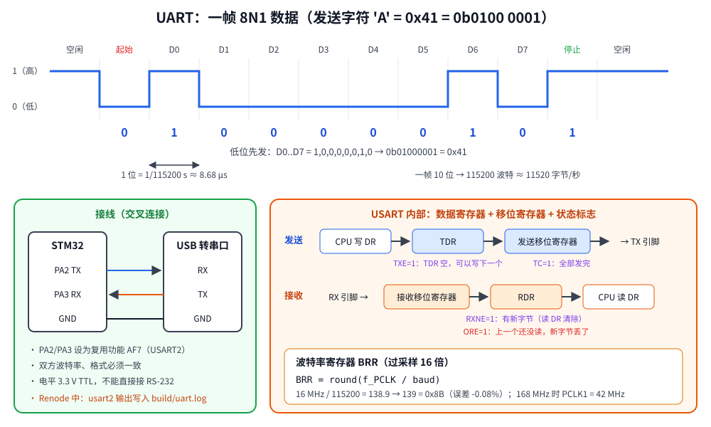

# 第 8 章　UART 串口与 printf

## 本章目标

- 理解异步串行通信：帧格式、波特率、TX/RX 接线
- 从零写一个 USART 驱动：引脚复用、波特率计算、状态标志
- 把 newlib 的 `printf` 接到串口上
- 从串口读取一行输入

## 8.1 串口是什么

UART（Universal Asynchronous Receiver/Transmitter）是最简单、最常用的通信接口，几乎每个嵌入式项目都会用一个串口输出调试信息。STM32 上叫 USART（多了一个“同步”模式，本教程不用）。

**异步**：没有时钟线，收发双方事先约定好速度（波特率），各自按自己的时钟采样。



一帧 8N1 数据（8 位数据、无校验、1 位停止位）：

1. 空闲时线路保持高电平
2. **起始位**：拉低 1 位时间，告诉接收方“数据来了”
3. **8 个数据位**：**低位先发**
4. **停止位**：高电平 1 位时间

115200 波特 = 每秒 115200 位，1 位约 8.68 µs。一帧 10 位，所以每秒最多传 11520 字节。

接线是 **交叉** 的：MCU 的 TX 接对方的 RX，MCU 的 RX 接对方的 TX，并且要 **共地**。STM32 引脚是 3.3 V TTL 电平，可以直接接 USB 转串口模块，但不能直接接电脑上老式的 RS-232 接口（±12 V）。

## 8.2 USART 的寄存器

| 寄存器 | 偏移 | 作用 |
|--------|------|------|
| SR | 0x00 | 状态：TXE、TC、RXNE、ORE…… |
| DR | 0x04 | 数据：写 = 发送，读 = 接收 |
| BRR | 0x08 | 波特率分频 |
| CR1 | 0x0C | UE 总使能、TE 发送使能、RE 接收使能、中断使能、字长、校验 |
| CR2 | 0x10 | 停止位等 |
| CR3 | 0x14 | 流控、DMA 等 |

关键状态位：

| 位 | 含义 | 何时清零 |
|----|------|---------|
| TXE（bit 7） | 发送数据寄存器空，可以写下一个字节 | 写 DR |
| TC（bit 6） | 发送完成：最后一个字节的停止位已经离开引脚 | 读 SR 再写 DR |
| RXNE（bit 5） | 接收寄存器非空，有新字节 | 读 DR |
| ORE（bit 3） | 溢出：上一个字节还没读，新字节又来了，数据丢失 | 读 SR 再读 DR |

DR 背后其实是两个寄存器：写入的进 TDR，再由硬件搬进发送移位寄存器一位一位移出；接收的从移位寄存器搬进 RDR 供读取。所以 TXE=1 只表示 TDR 空了，移位寄存器可能还在发送；关机或切换波特率前要等 TC=1。

## 8.3 波特率计算

USART 使用 16 倍过采样时（默认）：

```
USARTDIV = f_PCLK / (16 × baud)
BRR = USARTDIV 的 12.4 定点数表示（高 12 位整数，低 4 位小数 × 16）
```

两者合起来正好是：**`BRR = round(f_PCLK / baud)`**。

以 16 MHz、115200 为例：`16000000 / 115200 = 138.89`，取整 139 = `0x8B`。实际波特率 = 16000000 / 139 ≈ 115107，误差 -0.08%。一般误差在 ±2% 以内都能正常通信。

## 8.4 驱动代码

[`examples/08-uart-printf/main.c`](../examples/08-uart-printf/main.c) 把 `common/drivers/uart.c` 隐藏的细节全部展开：

```c
static void usart2_init(uint32_t pclk_hz, uint32_t baud)
{
    /* 1. Clocks: GPIOA on AHB1, USART2 on APB1. */
    RCC->AHB1ENR |= RCC_AHB1ENR_GPIOAEN;
    RCC->APB1ENR |= RCC_APB1ENR_USART2EN;

    /* 2. PA2 = TX, PA3 = RX: alternate function mode, AF7 (USART1..3). */
    GPIOA->MODER  = (GPIOA->MODER & ~((3u << 4) | (3u << 6))) | (2u << 4) | (2u << 6);
    GPIOA->AFR[0] = (GPIOA->AFR[0] & ~((0xFu << 8) | (0xFu << 12))) | (7u << 8) | (7u << 12);
    GPIOA->PUPDR  = (GPIOA->PUPDR & ~(3u << 6)) | (1u << 6);   /* idle-high RX: pull-up */

    /* 3. Baud rate: USARTDIV = pclk / (16 * baud), stored as 12.4 fixed point,
     *    which is the same as round(pclk / baud). */
    USART2->BRR = (pclk_hz + baud / 2u) / baud;

    /* 4. Frame format 8N1 is the reset default (CR1.M=0, CR1.PCE=0, CR2.STOP=00).
     *    Enable transmitter, receiver, then the USART itself. */
    USART2->CR1 = USART_CR1_TE | USART_CR1_RE | USART_CR1_UE;
}
```

**引脚复用（Alternate Function）**：PA2/PA3 要交给 USART2 控制，需要两步：

1. MODER 设为 `10`（复用功能模式）
2. AFR 选择复用到哪个外设。每个引脚 4 位，AFR[0] 管引脚 0~7，AFR[1] 管 8~15。USART1~3 都是 AF7

一个引脚能复用成哪些功能，查 **数据手册 DS8626 的表 9 “Alternate function mapping”**（不在参考手册里）。例如 PA2 行：AF1 = TIM2_CH3，AF3 = TIM9_CH1，AF7 = USART2_TX……

收发：

```c
static void usart2_write_byte(uint8_t byte)
{
    while ((USART2->SR & USART_SR_TXE) == 0) {   /* wait: data register empty */
    }
    USART2->DR = byte;                           /* hardware moves it to the shift register */
}

static uint8_t usart2_read_byte(void)
{
    while ((USART2->SR & USART_SR_RXNE) == 0) {  /* wait: a byte has arrived */
    }
    return (uint8_t)USART2->DR;                  /* reading DR clears RXNE */
}
```

## 8.5 让 printf 输出到串口

newlib 的 `printf` 格式化后调用 `_write(fd, buf, len)`（第 3 章的 `syscalls.c`），`_write` 再逐字节调用 `__io_putchar`。我们只需提供 `__io_putchar`：

```
printf("x=%d\n", x)
   └─ vfprintf（newlib，格式化）
        └─ _write(1, "x=5\n", 4)        common/syscalls.c
             └─ __io_putchar('x') ...     本课 / drivers/uart.c
                  └─ usart2_write_byte
```

```c
int __io_putchar(int ch)
{
    if (ch == '\n') {
        usart2_write_byte('\r');     /* 终端需要 CR LF 才会回到行首 */
    }
    usart2_write_byte((uint8_t)ch);
    return ch;
}
```

`syscalls.c` 里的 `__io_putchar` 是弱符号，这里的强符号覆盖它。

**缓冲问题**：newlib 默认对 stdout 做行缓冲，遇到 `\n` 才真正调用 `_write`。如果打印一个不带换行的提示符 `"type a line> "` 然后等待输入，提示符会一直留在缓冲区里不显示。所以本课在开头关掉缓冲：

```c
setvbuf(stdout, NULL, _IONBF, 0);
```

**浮点**：newlib-nano 的 `printf` 默认不支持 `%f`（为了省约 10 KB Flash）。需要时可以在链接选项里加 `-u _printf_float`，或者像本课一样用定点数打印：

```c
int temperature_centi = -1234;   /* -12.34 C */
printf("fixed point: %d.%02d C\n", temperature_centi / 100,
       (temperature_centi < 0 ? -temperature_centi : temperature_centi) % 100);
```

## 8.6 运行

`stimulus.resc` 在 100 ms 和 200 ms 时分别往串口输入一行：

```
emulation RunFor "0.1"
sysbus.usart2 WriteLine "hello stm32"
emulation RunFor "0.1"
sysbus.usart2 WriteLine "renode"
emulation RunFor "0.1"
```

```bash
cd examples/08-uart-printf
make run
```

本机实际输出：

```
USART2 up: BRR=0x008b CR1=0x200c

BRR for PCLK1 = 16000000 Hz (oversampling 16)
  baud     BRR     mantissa.fraction  actual baud  error
  9600     0x0683   104.3              9598         -0.02%
  115200   0x008b     8.11             115107       -0.08%
  921600   0x0011     1.1              941176       +2.12%

printf formats (newlib-nano, no float by default):
  %d  -42   %u  42   %x  0x0000beef   %s  text   %c  A
  fixed point: -12.34 C

type a line> hello stm32
got 11 chars, upper case: HELLO STM32

type a line> renode
got 6 chars, upper case: RENODE

bye
```

- `CR1=0x200c`：bit 13（UE）、bit 3（TE）、bit 2（RE）
- BRR 表：`0x8B` 的高 12 位 = 8（整数部分），低 4 位 = 11（小数 11/16），即 USARTDIV = 8.6875，8.6875 × 16 × 115200 ≈ 16 MHz
- 16 MHz 下 921600 波特误差达 +2.12%，已经处于可靠通信的边缘。这就是为什么常用 168 MHz 配置（PCLK2 = 84 MHz）的 USART1 来跑高波特率
- 输入的字符被回显，然后转成大写输出

## 练习

1. 把波特率改成 9600，`make run` 输出还正常吗？（Renode 不模拟传输时间和波特率失配。在真板上两端波特率必须一致）
2. 实现 `__io_getchar`，然后用 `scanf("%d", &x)` 读一个整数。
3. 计算 PCLK1 = 42 MHz 时 115200 和 921600 的 BRR 及误差（第 14 章的 `static_assert` 里有答案）。
4. 在链接选项里加上 `-u _printf_float`，打印 `%.2f`，比较 `make size` 的变化。

## 常见坑

- **TX/RX 接反**、**没共地**：最常见的“串口没输出”原因。
- **忘了配复用功能**：MODER 设了 `10`，但 AFR 没设 AF7，引脚不会连到 USART。
- **PCLK 填错**：切换到 168 MHz 后 USART2 的时钟是 42 MHz，USART1 是 84 MHz。
- **只换行不回车**：终端显示成阶梯状。在 `__io_putchar` 里把 `\n` 转换成 `\r\n`。
- **在中断里 printf**：轮询发送一个字节约 87 µs，一行文字就要几毫秒。
- **ORE 溢出**：接收轮询不够及时就会丢字节。下一章用中断解决。

---

上一章：[第 7 章　中断](07-interrupts-exti.md)　｜　下一章：[第 9 章　串口中断与命令行](09-uart-interrupt-cli.md)
