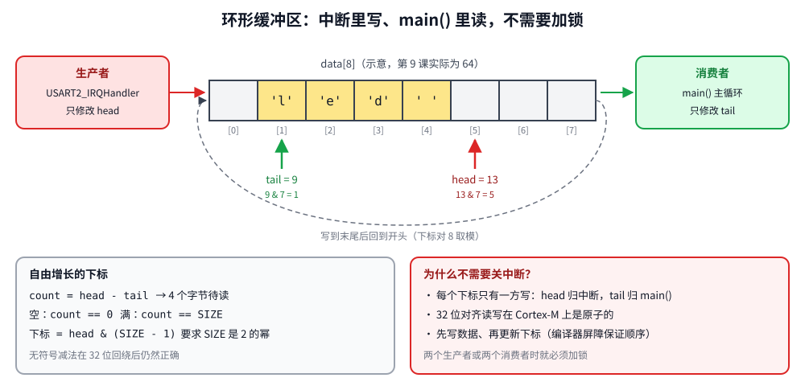

# 第 9 章　串口中断与命令行

## 本章目标

- 用 RXNE 中断接收串口数据，不再轮询
- 实现一个无锁的单生产者/单消费者环形缓冲区
- 把“中断里搬数据、主循环里处理”的模式用到一个小命令行（CLI）上
- 用 `make sim` 和固件实时交互

## 9.1 为什么接收要用中断

第 8 章的 `usart2_read_byte()` 一直等待 RXNE。等待期间 CPU 什么也干不了；而如果 CPU 在忙别的，115200 波特下每 87 µs 就来一个字节，稍慢一点 RDR 就会被覆盖（ORE 溢出），数据丢失。

改用中断：每收到一个字节，硬件触发 `USART2_IRQHandler`，处理函数把字节放进缓冲区就返回，整个过程不到 1 µs。主循环有空时再从缓冲区取出处理。

## 9.2 环形缓冲区



[`examples/09-uart-irq-cli/ringbuf.h`](../examples/09-uart-irq-cli/ringbuf.h)：

```c
#define RINGBUF_SIZE 64u
_Static_assert((RINGBUF_SIZE & (RINGBUF_SIZE - 1u)) == 0, "size must be a power of two");

typedef struct {
    uint8_t data[RINGBUF_SIZE];
    volatile uint32_t head;   /* next slot to write (producer) */
    volatile uint32_t tail;   /* next slot to read  (consumer) */
} ringbuf_t;

/* Free-running indices: head - tail is the fill level even after wrap-around. */
static inline uint32_t ringbuf_count(const ringbuf_t *rb)
{
    return rb->head - rb->tail;
}

static inline bool ringbuf_put(ringbuf_t *rb, uint8_t byte)
{
    if (ringbuf_count(rb) == RINGBUF_SIZE) {
        return false;                                  /* full: drop the byte */
    }
    rb->data[rb->head & (RINGBUF_SIZE - 1u)] = byte;
    __asm__ volatile("" ::: "memory");                 /* data before index */
    rb->head++;
    return true;
}

static inline bool ringbuf_get(ringbuf_t *rb, uint8_t *byte)
{
    if (ringbuf_count(rb) == 0) {
        return false;
    }
    *byte = rb->data[rb->tail & (RINGBUF_SIZE - 1u)];
    __asm__ volatile("" ::: "memory");
    rb->tail++;
    return true;
}
```

设计要点：

- **自由增长的下标**：`head` 和 `tail` 一直加，不回绕到 0；用的时候 `& (SIZE-1)` 取模。这样 `head - tail` 就是元素个数，“空”和“满”可以区分（很多实现为此浪费一个槽位）。32 位无符号减法在溢出后依然正确。
- **SIZE 必须是 2 的幂**：才能用 `&` 代替 `%`，并保证下标溢出时取模结果连续。
- **为什么不用关中断**：中断只写 `head`，主循环只写 `tail`，每个变量只有一个写者；32 位对齐访问是原子的。唯一的要求是 **先写数据、再更新下标**，否则消费者可能读到还没写好的槽位。`__asm__ volatile("" ::: "memory")` 是编译器屏障，禁止编译器调换这两步的顺序。单核 Cortex-M4 上不需要 CPU 级别的内存屏障。
- 如果有两个生产者（比如两个不同优先级的中断都往里写），这个设计就不安全了，需要加锁。

## 9.3 中断处理函数

[`examples/09-uart-irq-cli/main.c`](../examples/09-uart-irq-cli/main.c)：

```c
void USART2_IRQHandler(void)
{
    uint32_t sr = USART2->SR;

    if (sr & (USART_SR_RXNE | USART_SR_ORE)) {
        /* Reading DR clears RXNE, and (after the SR read above) ORE too. */
        uint8_t byte = (uint8_t)USART2->DR;
        if (sr & USART_SR_ORE) {
            g_rx_overruns++;
        }
        if (!ringbuf_put(&g_rx, byte)) {
            g_rx_dropped++;
        }
    }
}

static void uart_rx_irq_init(void)
{
    USART2->CR1 |= USART_CR1_RXNEIE;       /* 收到字节时产生中断 */
    nvic_set_priority(USART2_IRQn, 6);
    nvic_enable_irq(USART2_IRQn);
}
```

注意 ORE 的处理：RXNEIE 使能后，ORE 也会触发同一个中断。ORE 的清除方式是“先读 SR、再读 DR”。如果只判断 RXNE 而不处理 ORE，一旦发生溢出，ORE 位一直为 1，中断不停地进入，程序卡死。这是 STM32 串口最经典的坑之一。

## 9.4 命令行

主循环从缓冲区取字符，拼成一行，遇到回车就解析执行：

```c
for (;;) {
    uint8_t c;
    ...
    if (!ringbuf_get(&g_rx, &c)) {
        wait_for_interrupt();          /* nothing to do until the next byte */
        continue;
    }

    if (c == '\r' || c == '\n') {
        if (len == 0) {
            continue;
        }
        line[len] = '\0';
        printf("\n");
        execute(line);
        len = 0;
        printf("> ");
    } else if ((c == '\b' || c == 0x7F) && len > 0) {
        len--;
        printf("\b \b");               /* 退格：光标左移、空格覆盖、再左移 */
    } else if (c >= ' ' && len + 1 < sizeof line) {
        line[len++] = (char)c;
        uart_putc((char)c);            /* echo */
    }
}
```

`execute()` 用 `strtok` 拆分命令和参数，支持 `help`、`led <颜色> <on|off|toggle>`、`status`、`uptime`。

## 9.5 运行（脚本模式）

`stimulus.resc` 依次输入 6 条命令：

```bash
cd examples/09-uart-irq-cli
make run
```

本机实际输出：

```
gpioPortD.RedLED: LED state changed to True
gpioPortD.BlueLED: LED state changed to True

----- USART2 output -----

STM32 CLI. Type 'help'.
> help
commands:
  help                         this text
  led <green|orange|red|blue> <on|off|toggle>
  status                       LED states and UART statistics
  uptime                       milliseconds since boot
> led red on
red is on
> led blue toggle
blue is on
> status
LEDs: green=0 orange=0 red=1 blue=1
RX buffer: peak 1/64 bytes, dropped 0, overruns 0
> uptime
301 ms
> reboot
unknown command 'reboot', try 'help'
>
```

`peak 1/64`：缓冲区里最多同时只有 1 个字节，说明主循环处理得足够快。如果主循环里有耗时操作（例如一次几十毫秒的计算），这个数字会上升。

## 9.6 运行（交互模式）

```bash
make sim
```

在另一个终端：

```bash
nc localhost 3456
```

回到 Renode 终端输入 `start`，然后在 `nc` 终端里输入命令并回车，就能实时控制虚拟板上的 LED。Renode 终端里会显示 LED 状态的变化。

> `nc` 默认是行模式：整行输入完按回车才会发送，所以退格键在 `nc` 本地处理。想体验逐字符回显，可以用 `stty -icanon -echo && nc localhost 3456`（退出后 `stty sane` 恢复）。

## 练习

1. 增加命令 `blink <颜色> <次数>`，用 `delay_ms` 实现闪烁。闪烁期间输入的字符会丢吗？为什么？
2. 在 `status` 后面执行一个故意很慢的循环（比如 200 ms 的空循环），连续输入长字符串，观察 `peak` 和 `dropped`。
3. 把发送也改成中断驱动：`printf` 把字节放进发送缓冲区，打开 TXEIE，在中断里发送；缓冲区空时关闭 TXEIE。
4. 支持上箭头调出上一条命令（终端发送的是 `ESC [ A` 三个字节）。

## 常见坑

- **不处理 ORE**：中断风暴，程序卡死。
- **在中断里解析命令或 printf**：中断执行时间过长，其他中断被延迟，甚至丢失串口字节。
- **缓冲区下标不是 volatile**：主循环读不到中断更新的 `head`。
- **先更新下标再写数据**：消费者可能读到旧数据。
- **缓冲区大小不是 2 的幂**：`&` 取模出错。编译期断言能防止这个错误。

---

上一章：[第 8 章　UART 串口](08-uart.md)　｜　下一章：[第 10 章　定时器与 PWM](10-timers-pwm.md)
