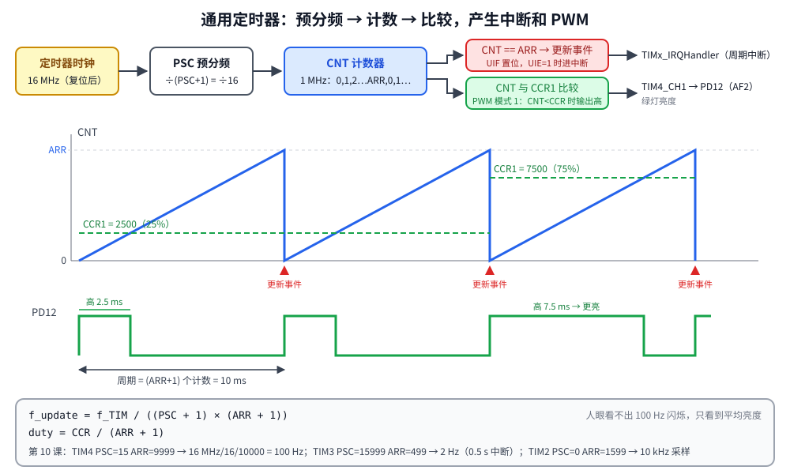

# 第 10 章　定时器与 PWM

## 本章目标

- 理解通用定时器的三个核心寄存器：PSC、ARR、CCR
- 用定时器更新中断产生精确的周期事件
- 用 PWM 输出控制 LED 亮度（呼吸灯）
- 学会根据目标频率计算分频参数

## 10.1 定时器概览

SysTick 只有一个，而且通常留给“系统节拍”。STM32F407 另有 14 个定时器：

| 类型 | 定时器 | 位宽 | 特点 |
|------|--------|------|------|
| 基本 | TIM6、TIM7 | 16 | 只能计数和中断，常用来触发 DAC |
| 通用 | TIM2、TIM5 | **32** | 4 个通道：PWM、输入捕获、编码器 |
| 通用 | TIM3、TIM4 | 16 | 同上 |
| 通用 | TIM9~TIM14 | 16 | 1~2 个通道 |
| 高级 | TIM1、TIM8 | 16 | 互补输出、死区，用于电机控制 |

本课用 TIM2、TIM3、TIM4，它们都在 APB1 上。复位后 APB1 不分频，定时器时钟 = 16 MHz。

## 10.2 工作原理



```
定时器时钟 ──► PSC 预分频 ──► CNT 计数器 ──► CNT == ARR ? ──► 更新事件（UIF，可触发中断），CNT 回到 0
  16 MHz       ÷(PSC+1)       0,1,…,ARR        │
                                               └──► 与 CCRx 比较 ──► 通道输出（PWM）
```

- **PSC（预分频器）**：把定时器时钟分频后作为计数时钟，`f_CNT = f_TIM / (PSC + 1)`
- **ARR（自动重装值）**：计数到 ARR 后产生“更新事件”并归零，周期 = ARR + 1 个计数
- **CCRx（捕获/比较寄存器）**：每个通道一个，PWM 模式下决定高电平时间

```
f_update = f_TIM / ((PSC + 1) × (ARR + 1))
duty     = CCR / (ARR + 1)              （PWM 模式 1，向上计数）
```

为什么寄存器里存的是 “值 − 1”？因为计数从 0 开始，0~ARR 共 ARR+1 个状态。

**参数怎么选**：先用 PSC 把计数时钟降到一个整数频率（比如 1 kHz 或 1 MHz），再用 ARR 定周期。16 位定时器的 PSC 和 ARR 都不能超过 65535。

## 10.3 周期中断：TIM3 每 500 ms 一次

[`examples/10-timer-pwm/main.c`](../examples/10-timer-pwm/main.c)：

```c
static void tim3_init_2hz(void)
{
    RCC->APB1ENR |= RCC_APB1ENR_TIM3EN;

    TIM3->PSC = TIMER_CLK_HZ / 1000u - 1u;   /* 16 MHz / 16000 = 1 kHz counter */
    TIM3->ARR = 500u - 1u;                   /* 500 counts = 500 ms */
    TIM3->EGR = TIM_EGR_UG;                  /* load PSC/ARR now, not at the first overflow */
    TIM3->SR = 0;                            /* UG also set UIF: clear it */
    TIM3->DIER = TIM_DIER_UIE;
    nvic_set_priority(TIM3_IRQn, 4);
    nvic_enable_irq(TIM3_IRQn);
    TIM3->CR1 = TIM_CR1_CEN;
}

void TIM3_IRQHandler(void)
{
    if (TIM3->SR & TIM_SR_UIF) {
        TIM3->SR = ~TIM_SR_UIF;              /* rc_w0: write 0 to clear, 1 leaves others */
        g_tim3_ticks++;
        led_toggle(LED_BLUE);
    }
}
```

两个细节：

- **EGR = UG**：PSC 是带缓冲的（“影子寄存器”），写入后要等下一次更新事件才生效。手动产生一次更新事件让它立即生效。副作用是 UIF 也被置 1，所以紧接着清掉 SR，否则一使能中断就会多进一次。
- **SR 的清除方式是 `rc_w0`（写 0 清零）**：和 EXTI 的 PR（写 1 清零）正好相反。`TIM3->SR = ~TIM_SR_UIF` 只把 UIF 写 0，其他位写 1（写 1 无影响）。如果写成 `TIM3->SR &= ~TIM_SR_UIF`，读-改-写期间硬件刚置位的其他标志会被误清。

## 10.4 PWM：TIM4 通道 1 控制绿灯亮度

PWM（脉宽调制）是用数字信号模拟模拟量：以固定频率快速开关，通过改变“高电平占一个周期的比例”（占空比）来控制平均功率。100 Hz 的闪烁人眼看不出来，只能感觉到平均亮度。

查数据手册的复用功能表：**PD12 的 AF2 = TIM4_CH1**。所以绿灯可以直接由 TIM4 硬件驱动，不需要 CPU 参与。

```c
#define PWM_PERIOD 10000u                    /* 1 MHz / 10000 = 100 Hz */

static void tim4_pwm_init(void)
{
    RCC->AHB1ENR |= RCC_AHB1ENR_GPIODEN;
    RCC->APB1ENR |= RCC_APB1ENR_TIM4EN;
    gpio_set_af(GPIOD, LED_GREEN, GPIO_AF2_TIM4);   /* PD12 交给 TIM4 */

    TIM4->PSC = TIMER_CLK_HZ / 1000000u - 1u;    /* 1 MHz counter: 1 count = 1 us */
    TIM4->ARR = PWM_PERIOD - 1u;
    TIM4->CCR[0] = 0;

    /* PWM mode 1: output high while CNT < CCR1, low afterwards. OC1PE buffers
     * CCR1 so a new duty takes effect at the next period boundary. */
    TIM4->CCMR1 = (TIM_OCMODE_PWM1 << TIM_CCMR1_OC1M_Pos) | TIM_CCMR1_OC1PE;
    TIM4->CCER = TIM_CCER_CC1E;                  /* 打开通道 1 输出 */
    TIM4->CR1 = TIM_CR1_ARPE;                    /* ARR 也使用缓冲 */
    TIM4->EGR = TIM_EGR_UG;
    TIM4->CR1 |= TIM_CR1_CEN;
}

static void pwm_set_percent(uint32_t percent)
{
    TIM4->CCR[0] = PWM_PERIOD * percent / 100u;
}
```

| 寄存器 | 字段 | 值 | 含义 |
|--------|------|----|------|
| CCMR1 | OC1M[6:4] | `110` | PWM 模式 1：CNT < CCR1 时输出有效电平（高） |
| CCMR1 | OC1PE（bit 3） | 1 | CCR1 预装载：新值在下一个周期开始时生效，避免一个周期内出现毛刺 |
| CCER | CC1E（bit 0） | 1 | 使能通道 1 输出到引脚 |
| CR1 | ARPE（bit 7） | 1 | ARR 预装载 |

## 10.5 用另一个定时器测量占空比

为了在模拟器里 **验证** PWM 确实按设定工作，TIM2 以 10 kHz 的频率中断，每次采样 PD12 的电平（GPIO 在复用模式下 IDR 依然可读）：

```c
void TIM2_IRQHandler(void)
{
    TIM2->SR = ~TIM_SR_UIF;
    g_samples++;
    if (GPIOD->IDR & BIT(LED_GREEN)) {
        g_samples_high++;
    }
}
```

200 ms 内采样 2000 次，高电平样本的比例就是实测占空比。TIM2 优先级设为 2，比 TIM3（4）高，保证采样不被耽误。

## 10.6 运行

```bash
cd examples/10-timer-pwm
make run
```

`stimulus.resc` 把绿灯的日志级别调高（PWM 每秒切换 200 次，日志会刷屏），然后运行 1.5 秒。本机实际输出：

```
gpioPortD.BlueLED: LED state changed to True
gpioPortD.BlueLED: LED state changed to False
gpioPortD.BlueLED: LED state changed to True

----- USART2 output -----
TIM4 PWM: PSC=15 ARR=9999 -> 100 Hz
duty set 10%  CCR1= 1000  measured 10%  (t=220 ms)
duty set 25%  CCR1= 2500  measured 25%  (t=440 ms)
duty set 50%  CCR1= 5000  measured 50%  (t=660 ms)
duty set 75%  CCR1= 7500  measured 75%  (t=880 ms)
duty set 90%  CCR1= 9000  measured 90%  (t=1100 ms)
TIM3 interrupts so far: 2 (one per 500 ms)
breathing...
```

- 测得的占空比与设定值完全一致
- 打印时（1.1 秒）TIM3 中断了 2 次（500 ms、1000 ms）；1.5 秒的运行时间内蓝灯共翻转 3 次（500、1000、1500 ms），都来自 TIM3
- 最后进入呼吸灯循环：占空比每 20 ms 变化 5%

## 练习

1. 把 PWM 频率改为 1 kHz（保持 1 MHz 计数，ARR = 999），占空比仍可以 1% 精度调节吗？10 kHz 呢？
2. 把橙灯 PD13（TIM4_CH2）也配成 PWM，与绿灯反相呼吸。需要配置 CCMR1 的 OC2M/OC2PE 和 CCER 的 CC2E。
3. 用 32 位的 TIM2 实现一个微秒计时器：PSC = 15（1 MHz），ARR = 0xFFFFFFFF，直接读 CNT。
4. 改用 PWM 模式 2（OC1M = `111`），占空比的含义有什么变化？

## 常见坑

- **忘记 UG**：第一个周期按旧的 PSC（0）计数，时间不对。
- **用 `&=` 清 SR**：可能误清刚产生的其他标志。按 `rc_w0` 的规则写。
- **忘记 CCER.CCxE**：定时器在计数，但引脚上没有波形。
- **引脚复用号错误**：TIM1/2 是 AF1，TIM3/4/5 是 AF2，TIM8~11 是 AF3。查数据手册表 9。
- **定时器时钟算错**：168 MHz 配置下 APB1 分频为 4，TIM2~7 的时钟是 84 MHz（不是 42 MHz）。
- Renode 的定时器比较通道使用构造时设定的频率（`board.repl` 里的 16 MHz）。在模拟器中切换系统时钟后，PWM 通道的时间基准不会跟着变；真芯片没有这个问题。另外 Renode 不模拟 OC1PE，`make run V=1` 会看到相应警告，不影响结果。

---

上一章：[第 9 章　串口中断与命令行](09-uart-interrupt-cli.md)　｜　下一章：[第 11 章　CMSIS](11-cmsis.md)
