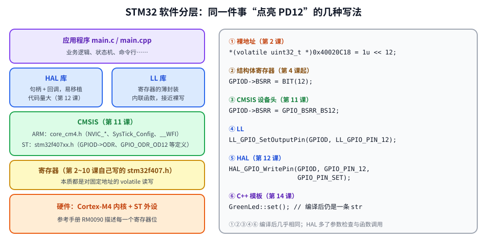

# 第 11 章　CMSIS：官方头文件与启动文件

## 本章目标

- 了解 CMSIS 是什么，ARM 和 ST 各提供了什么
- 用 ST 官方的设备头文件、启动文件和 `system_stm32f4xx.c` 替换我们自己写的版本
- 熟悉官方的寄存器和位定义命名规则
- 使用 CMSIS-Core 的内核函数：`NVIC_*`、`SysTick_Config`、内建指令

## 11.1 软件分层



前 10 章我们只用了自己写的 `stm32f407.h`（约 360 行），它只定义了用到的少数寄存器。真实项目里没有人这样做：ST 提供了根据芯片描述文件（SVD）自动生成的完整头文件，覆盖每一个外设、每一个位。

**CMSIS**（Cortex Microcontroller Software Interface Standard）是 ARM 制定的标准，分两部分：

| 部分 | 提供者 | 文件 | 内容 |
|------|--------|------|------|
| CMSIS-Core | ARM | `core_cm4.h`、`cmsis_gcc.h` | 内核外设（NVIC、SysTick、SCB、DWT、FPU）的结构体和函数，内建指令 `__WFI()`、`__REV()`…… |
| 设备支持 | ST | `stm32f4xx.h` → `stm32f407xx.h` | 所有外设寄存器的结构体、基地址、位定义，`IRQn_Type` |
| | ST | `startup_stm32f407xx.s` | 向量表和 `Reset_Handler`（汇编） |
| | ST | `system_stm32f4xx.c` | `SystemInit()`、`SystemCoreClock` 变量、`SystemCoreClockUpdate()` |

因为 NVIC、SysTick 是 ARM 定义的，所有厂家的 Cortex-M4 芯片都可以用同样的 `NVIC_EnableIRQ()`；GPIO、USART 是 ST 定义的，换厂家就要换头文件。

## 11.2 获取官方文件

```bash
cd examples/third_party
./fetch.sh
```

得到：

```
third_party/
├── cmsis-core/Include/           core_cm4.h, cmsis_gcc.h, cmsis_compiler.h, ...
├── cmsis-device-f4/
│   ├── Include/                  stm32f4xx.h, stm32f407xx.h, system_stm32f4xx.h
│   └── Source/Templates/
│       ├── system_stm32f4xx.c
│       └── gcc/startup_stm32f407xx.s
└── stm32f4xx-hal-driver/         第 12 章用
```

## 11.3 Makefile 的变化

[`examples/11-cmsis/Makefile`](../examples/11-cmsis/Makefile)：

```make
TP := ../third_party

STARTUP := $(TP)/cmsis-device-f4/Source/Templates/gcc/startup_stm32f407xx.s
SRCS := main.c $(TP)/cmsis-device-f4/Source/Templates/system_stm32f4xx.c

# The Discovery board has an 8 MHz crystal; ST's default assumption is 25 MHz.
CPPFLAGS += -DHSE_VALUE=8000000u \
            -I$(TP)/cmsis-core/Include \
            -I$(TP)/cmsis-device-f4/Include

include ../common/lesson.mk
```

- `STARTUP` 换成 ST 的汇编启动文件，它做的事和我们的 `startup.c` 一样：定义向量表（弱符号处理函数）、复制 `.data`、清零 `.bss`、调用 `SystemInit`、`__libc_init_array`、`main`。它使用的链接脚本符号名（`_sidata`、`_sdata`、`_estack`……）和我们的链接脚本一致，所以链接脚本不用改。
- `-DSTM32F407xx`（在 `lesson.mk` 里）让 `stm32f4xx.h` 选择 `stm32f407xx.h`。
- `HSE_VALUE`：`SystemCoreClockUpdate()` 用它计算频率。ST 模板默认 25 MHz，Discovery 板是 8 MHz，不改的话算出来的时钟是错的。

## 11.4 命名规则

官方头文件的命名非常规律，掌握后基本不用查：

| 形式 | 例子 | 含义 |
|------|------|------|
| `外设->寄存器` | `GPIOD->BSRR`、`RCC->AHB1ENR` | 与参考手册的寄存器名一致 |
| `外设_寄存器_位` | `RCC_AHB1ENR_GPIODEN` | 位掩码 |
| `…_Pos` / `…_Msk` | `GPIO_AFRL_AFSEL2_Pos` = 8 | 位置 / 掩码 |
| `…_0`、`…_1` | `GPIO_MODER_MODER12_0` | 多位字段的第 0 位、第 1 位 |
| `外设_寄存器_字段_取值` | `SYSCFG_EXTICR1_EXTI0_PA` | 字段的具名取值 |
| `xxx_IRQn` | `EXTI0_IRQn` = 6 | 中断号 |

对比同一件事的两种写法：

```c
/* 第 7 章，自己的头文件 */
RCC->APB2ENR |= RCC_APB2ENR_SYSCFGEN;
SYSCFG->EXTICR[0] = (SYSCFG->EXTICR[0] & ~0xFu) | 0x0u;
EXTI->IMR  |= BIT(0);
EXTI->RTSR |= BIT(0);

/* 本章，官方头文件 */
RCC->APB2ENR |= RCC_APB2ENR_SYSCFGEN;
SYSCFG->EXTICR[0] = (SYSCFG->EXTICR[0] & ~SYSCFG_EXTICR1_EXTI0) | SYSCFG_EXTICR1_EXTI0_PA;
EXTI->IMR |= EXTI_IMR_MR0;
EXTI->RTSR |= EXTI_RTSR_TR0;
```

## 11.5 CMSIS-Core 函数

[`examples/11-cmsis/main.c`](../examples/11-cmsis/main.c) 里用到的内核接口：

```c
SystemCoreClockUpdate();                     /* 根据 RCC 寄存器重算 SystemCoreClock */
SysTick_Config(SystemCoreClock / 1000u);     /* 设置 LOAD、VAL、CTRL，并把 SysTick 设为最低优先级 */

NVIC_SetPriorityGrouping(3);                 /* 4 位抢占优先级，0 位子优先级 */
NVIC_SetPriority(EXTI0_IRQn, NVIC_EncodePriority(NVIC_GetPriorityGrouping(), 5, 0));
NVIC_EnableIRQ(EXTI0_IRQn);

__WFI();                                     /* 内建指令 */
__RBIT(1u);  __REV(0x11223344u);  __CLZ(0x00010000u);
```

**优先级分组**：每个中断的 4 位优先级可以拆成“抢占优先级”和“子优先级”。只有抢占优先级高的中断能打断正在执行的中断；子优先级只决定同时挂起时谁先执行。`NVIC_SetPriorityGrouping(3)`（PRIGROUP = 3，HAL 里叫 `NVIC_PRIORITYGROUP_4`）表示 4 位全部用作抢占优先级，最直观，也是 FreeRTOS 要求的设置。

**DWT 周期计数器**：Cortex-M4 的调试单元里有一个按 CPU 时钟计数的 32 位计数器，是测量代码耗时的标准方法：

```c
CoreDebug->DEMCR |= CoreDebug_DEMCR_TRCENA_Msk;
DWT->CYCCNT = 0;
DWT->CTRL |= DWT_CTRL_CYCCNTENA_Msk;

uint32_t start = DWT->CYCCNT;
uint32_t s = sum_to(1000);
uint32_t cycles = DWT->CYCCNT - start;
```

Renode 不模拟 DWT，读出来是 0，例子会打印提示；真芯片上能得到实际周期数。

**BSRR 的一个技巧**：同一个引脚的置位和复位位同时为 1 时，置位优先。所以下面一次写入就能“熄灭 PD12~14 再点亮其中一个”：

```c
GPIOD->BSRR = GPIO_BSRR_BR12 | GPIO_BSRR_BR13 | GPIO_BSRR_BR14 |
              (GPIO_BSRR_BS12 << (i % 3));
```

## 11.6 运行

```bash
cd examples/11-cmsis
make run
```

本机实际输出：

```
CMSIS: SystemCoreClock = 16000000 Hz
CPUID = 0x410fc240, implementer 0x41, part 0xc24
SysTick LOAD = 15999, EXTI0 priority = 5
sum_to(1000) = 500500 in 0 cycles (DWT is not modelled by Renode; real silicon counts here)
__RBIT(1) = 0x80000000, __REV(0x11223344) = 0x44332211, __CLZ(0x00010000) = 15
button presses seen by EXTI0: 2 (t=601 ms)
```

- `SystemCoreClock` 是 16 MHz：当前版本 ST 的 `SystemInit()` 只打开 FPU（以及可选的向量表重定位、外部存储器），**不配置 PLL**，芯片仍运行在复位后的 HSI 上。CubeMX 生成的工程会在 `main` 里调用 `SystemClock_Config()` 配置时钟（第 12 章）
- `__RBIT` 位反转、`__REV` 字节反转（大小端转换）、`__CLZ` 前导零计数，都编译成单条指令
- 运行期间按了 2 次键，蓝灯（PD15）由 EXTI0 中断翻转；PD12~14 由主循环轮流点亮

## 练习

1. 用 `NVIC_SetPendingIRQ(EXTI0_IRQn)` 在软件里触发一次 EXTI0 中断，观察 `g_presses` 的变化。
2. 把第 6 章的 168 MHz 时钟配置用官方位定义重写（`RCC_CR_HSEON`、`RCC_PLLCFGR_PLLM_Pos`、`FLASH_ACR_LATENCY_5WS`……），然后调用 `SystemCoreClockUpdate()` 并打印 `SystemCoreClock`。
3. 打开 `stm32f407xx.h`，找到 `TIM_TypeDef` 和 `USART_TypeDef`，与我们自己写的版本对比。
4. 打开 `startup_stm32f407xx.s`，找到 `Reset_Handler`、`.data` 复制循环和向量表，和 `common/startup.c` 一一对应。

## 常见坑

- **忘记定义 `STM32F407xx`**：`stm32f4xx.h` 报错 “Please select first the target STM32F4xx device”。
- **`HSE_VALUE` 不对**：`SystemCoreClock` 计算错误，进而导致波特率和 SysTick 全错。
- **两个启动文件同时链接**：`startup.c` 和 `startup_stm32f407xx.s` 都定义了 `Reset_Handler` 和向量表，链接报重复定义。
- **混用自己的头文件和官方头文件**：两者都定义了 `GPIO_TypeDef`、`GPIOD` 等，冲突。

---

上一章：[第 10 章　定时器与 PWM](10-timers-pwm.md)　｜　下一章：[第 12 章　HAL 库](12-hal.md)
