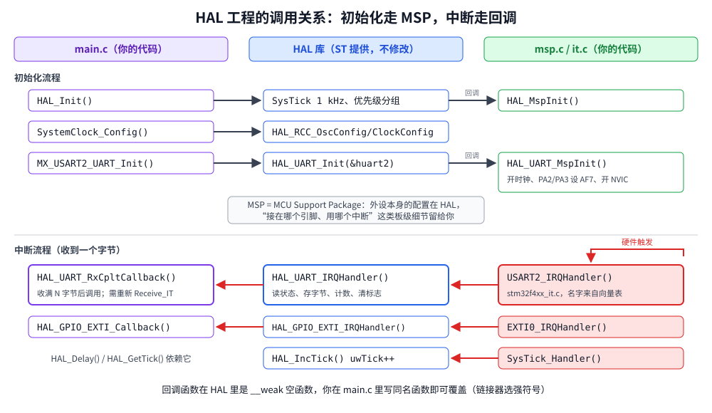

# 第 12 章　HAL 库

## 本章目标

- 了解 STM32 HAL 库的结构，以及 CubeMX 生成的工程长什么样
- 理解 HAL 的三个关键机制：句柄（Handle）、MSP 回调、弱符号回调
- 用 HAL 重写时钟配置、GPIO、按键中断和串口中断接收
- 能读懂 HAL 源码，并清楚它和寄存器写法的取舍

## 12.1 HAL 是什么

HAL（Hardware Abstraction Layer）是 ST 官方的外设驱动库，**CubeMX/CubeIDE 生成的代码全部基于 HAL**，网上的大部分 STM32 例程也是 HAL 写的。它在 CMSIS 头文件之上，用结构体参数代替直接写寄存器：

```c
/* 寄存器写法 */
RCC->AHB1ENR |= RCC_AHB1ENR_GPIODEN;
GPIOD->MODER = (GPIOD->MODER & ~(3u << 24)) | (1u << 24);

/* HAL 写法 */
__HAL_RCC_GPIOD_CLK_ENABLE();
GPIO_InitTypeDef gpio = {0};
gpio.Pin = GPIO_PIN_12;
gpio.Mode = GPIO_MODE_OUTPUT_PP;
HAL_GPIO_Init(GPIOD, &gpio);
```

HAL 的价值在于复杂外设：USB、以太网、SD 卡、带 DMA 的 UART，几百行寄存器操作被封装成几个函数；同一套 API 还能在 STM32F1/F4/L4/H7 之间移植。ST 另有一套 **LL（Low Layer）** 库，几乎是寄存器操作的一对一内联函数，可以和 HAL 混用。

## 12.2 工程结构

本课完全按 CubeMX 生成的布局组织：

```
12-hal/
├── main.c                  main()、SystemClock_Config()、MX_GPIO_Init()、MX_USART2_UART_Init()、回调
├── main.h                  引脚宏：LED_GREEN_Pin、BUTTON_Pin……
├── stm32f4xx_hal_msp.c     HAL_MspInit()、HAL_UART_MspInit()：时钟、引脚、NVIC
├── stm32f4xx_it.c          中断处理函数，转发给 HAL
├── stm32f4xx_hal_conf.h    选择编译哪些 HAL 模块、HSE_VALUE、TICK_INT_PRIORITY……
└── Makefile                列出要编译的 HAL 源文件
```

[`stm32f4xx_hal_conf.h`](../examples/12-hal/stm32f4xx_hal_conf.h) 通过宏开关模块：

```c
#define HAL_MODULE_ENABLED
#define HAL_DMA_MODULE_ENABLED
#define HAL_FLASH_MODULE_ENABLED
#define HAL_GPIO_MODULE_ENABLED
#define HAL_EXTI_MODULE_ENABLED
#define HAL_PWR_MODULE_ENABLED
#define HAL_RCC_MODULE_ENABLED
#define HAL_UART_MODULE_ENABLED
#define HAL_CORTEX_MODULE_ENABLED
/* #define HAL_I2C_MODULE_ENABLED */   ……其余注释掉
```

[`Makefile`](../examples/12-hal/Makefile) 里要列出对应的 `.c` 文件，并定义 `USE_HAL_DRIVER`：

```make
SRCS := main.c stm32f4xx_hal_msp.c stm32f4xx_it.c \
        $(TP)/cmsis-device-f4/Source/Templates/system_stm32f4xx.c \
        $(HAL)/Src/stm32f4xx_hal.c \
        $(HAL)/Src/stm32f4xx_hal_cortex.c \
        $(HAL)/Src/stm32f4xx_hal_rcc.c \
        $(HAL)/Src/stm32f4xx_hal_rcc_ex.c \
        $(HAL)/Src/stm32f4xx_hal_gpio.c \
        $(HAL)/Src/stm32f4xx_hal_dma.c \
        $(HAL)/Src/stm32f4xx_hal_pwr.c \
        $(HAL)/Src/stm32f4xx_hal_flash.c \
        $(HAL)/Src/stm32f4xx_hal_uart.c

CPPFLAGS += -DUSE_HAL_DRIVER -DHSE_VALUE=8000000u ...
```

## 12.3 调用流程



### 初始化：HAL_Init 和 SystemClock_Config

```c
int main(void)
{
    HAL_Init();              /* Flash 预取/缓存、NVIC 分组 4、SysTick 1 kHz、调用 HAL_MspInit() */
    SystemClock_Config();    /* 168 MHz，并按新频率重新配置 SysTick */
    MX_GPIO_Init();
    MX_USART2_UART_Init();
    ...
}
```

`SystemClock_Config()` 用结构体描述第 6 章手写的那套时钟树：

```c
static void SystemClock_Config(void)
{
    RCC_OscInitTypeDef osc = {0};
    RCC_ClkInitTypeDef clk = {0};

    __HAL_RCC_PWR_CLK_ENABLE();
    __HAL_PWR_VOLTAGESCALING_CONFIG(PWR_REGULATOR_VOLTAGE_SCALE1);

    osc.OscillatorType = RCC_OSCILLATORTYPE_HSE;
    osc.HSEState = RCC_HSE_ON;
    osc.PLL.PLLState = RCC_PLL_ON;
    osc.PLL.PLLSource = RCC_PLLSOURCE_HSE;
    osc.PLL.PLLM = 8;                 /* 8 MHz / 8 = 1 MHz */
    osc.PLL.PLLN = 336;               /* × 336 = 336 MHz */
    osc.PLL.PLLP = RCC_PLLP_DIV2;     /* / 2 = 168 MHz */
    osc.PLL.PLLQ = 7;                 /* / 7 = 48 MHz (USB) */
    if (HAL_RCC_OscConfig(&osc) != HAL_OK) {
        Error_Handler();
    }

    clk.ClockType = RCC_CLOCKTYPE_HCLK | RCC_CLOCKTYPE_SYSCLK | RCC_CLOCKTYPE_PCLK1 | RCC_CLOCKTYPE_PCLK2;
    clk.SYSCLKSource = RCC_SYSCLKSOURCE_PLLCLK;
    clk.AHBCLKDivider = RCC_SYSCLK_DIV1;
    clk.APB1CLKDivider = RCC_HCLK_DIV4;   /* 42 MHz */
    clk.APB2CLKDivider = RCC_HCLK_DIV2;   /* 84 MHz */
    if (HAL_RCC_ClockConfig(&clk, FLASH_LATENCY_5) != HAL_OK) {
        Error_Handler();
    }
}
```

`HAL_RCC_OscConfig` 内部做的正是第 6 章的那些步骤：打开 HSE、等待 HSERDY（带超时）、配置 PLLCFGR、打开 PLL、等待 PLLRDY。`HAL_RCC_ClockConfig` 先增加 Flash 等待周期，再切换时钟源和分频器，最后更新 `SystemCoreClock` 并重新配置 SysTick。所有 HAL 函数都返回 `HAL_StatusTypeDef`（`HAL_OK`、`HAL_ERROR`、`HAL_BUSY`、`HAL_TIMEOUT`），出错时 CubeMX 的惯例是调用 `Error_Handler()`。

### 句柄（Handle）和 MSP

每个外设实例对应一个句柄结构体，里面有寄存器基地址、配置参数和运行状态（例如中断接收进行到哪个字节）：

```c
UART_HandleTypeDef huart2;

static void MX_USART2_UART_Init(void)
{
    huart2.Instance = USART2;
    huart2.Init.BaudRate = 115200;
    huart2.Init.WordLength = UART_WORDLENGTH_8B;
    huart2.Init.StopBits = UART_STOPBITS_1;
    huart2.Init.Parity = UART_PARITY_NONE;
    huart2.Init.Mode = UART_MODE_TX_RX;
    huart2.Init.HwFlowCtl = UART_HWCONTROL_NONE;
    huart2.Init.OverSampling = UART_OVERSAMPLING_16;
    if (HAL_UART_Init(&huart2) != HAL_OK) {
        Error_Handler();
    }
}
```

`HAL_UART_Init()` 只负责 USART 本身的寄存器（它会调用 `HAL_RCC_GetPCLK1Freq()` 自动计算 BRR），**和板子相关的部分**（时钟使能、用哪两个引脚、中断优先级）通过回调 `HAL_UART_MspInit()` 交给用户。MSP 即 MCU Support Package：

```c
void HAL_UART_MspInit(UART_HandleTypeDef *huart)
{
    GPIO_InitTypeDef gpio = {0};

    if (huart->Instance == USART2) {
        __HAL_RCC_USART2_CLK_ENABLE();
        __HAL_RCC_GPIOA_CLK_ENABLE();

        /* PA2 -> USART2_TX, PA3 -> USART2_RX */
        gpio.Pin = GPIO_PIN_2 | GPIO_PIN_3;
        gpio.Mode = GPIO_MODE_AF_PP;
        gpio.Pull = GPIO_PULLUP;
        gpio.Speed = GPIO_SPEED_FREQ_VERY_HIGH;
        gpio.Alternate = GPIO_AF7_USART2;
        HAL_GPIO_Init(GPIOA, &gpio);

        HAL_NVIC_SetPriority(USART2_IRQn, 6, 0);
        HAL_NVIC_EnableIRQ(USART2_IRQn);
    }
}
```

所有 UART 实例共用这一个 MSP 函数，用 `huart->Instance` 区分。

### 中断：处理函数转发，回调通知

```c
/* stm32f4xx_it.c */
void SysTick_Handler(void)   { HAL_IncTick(); }
void EXTI0_IRQHandler(void)  { HAL_GPIO_EXTI_IRQHandler(BUTTON_Pin); }
void USART2_IRQHandler(void) { HAL_UART_IRQHandler(&huart2); }
```

HAL 的中断处理函数检查并清除标志位，然后调用 **回调函数**。HAL 里所有回调都是 `__weak` 定义的空函数，应用程序定义同名函数即可覆盖（链接器优先选强符号）：

```c
void HAL_GPIO_EXTI_Callback(uint16_t GPIO_Pin)
{
    if (GPIO_Pin == BUTTON_Pin) {
        g_presses++;
        HAL_GPIO_TogglePin(GPIOD, LED_BLUE_Pin);
    }
}

void HAL_UART_RxCpltCallback(UART_HandleTypeDef *huart)
{
    if (huart->Instance == USART2) {
        ... 把 g_rx_byte 拼进一行 ...
        HAL_UART_Receive_IT(&huart2, &g_rx_byte, 1);   /* re-arm for the next byte */
    }
}
```

`HAL_UART_Receive_IT(&huart2, buf, N)` 的语义是“用中断接收 **N 个字节**，收满后调用一次 `RxCpltCallback`”，然后接收就停止了。要连续接收，必须在回调里再次调用它。这是 HAL 新手最常遇到的“只收到第一个字节”问题。

> 回调在中断上下文中执行，第 7 章关于中断的所有规则（短小、`volatile`、不 printf）依然适用。

### HAL_Delay 和 HAL_GetTick

`HAL_IncTick()` 每 1 ms 把 `uwTick` 加 1；`HAL_GetTick()` 返回它。`HAL_Delay(ms)` 的实现：

```c
void HAL_Delay(uint32_t Delay)
{
  uint32_t tickstart = HAL_GetTick();
  uint32_t wait = Delay;
  if (wait < HAL_MAX_DELAY)
  {
    wait += (uint32_t)(uwTickFreq);   /* 多等 1 个 tick，保证至少延时 Delay 毫秒 */
  }
  while ((HAL_GetTick() - tickstart) < wait) { }
}
```

调用时可能刚好处于一个 tick 的末尾，所以 HAL 多等 1 ms 来保证 **最少** 延时。下面输出里间隔是 101 ms 就是这个原因。

HAL 内部的超时（如等待 HSE 起振）也依赖 `HAL_GetTick()`，所以 **SysTick 中断优先级不能低于调用 HAL 函数的中断**，否则在中断里调用带超时的 HAL 函数会死等。

## 12.4 运行

```bash
cd examples/12-hal
make run
```

`stimulus.resc` 在 250 ms 按一次键，约 400 ms 时输入一行 `hello HAL`。本机实际输出：

```
gpioPortD.OrangeLED: LED state changed to True
gpioPortD.OrangeLED: LED state changed to False
...
gpioPortD.BlueLED: LED state changed to True
...

----- USART2 output -----

HAL v1.8.5
SYSCLK 168000000 Hz, HCLK 168000000 Hz, PCLK1 42000000 Hz, PCLK2 84000000 Hz
tick 0 at 0 ms, orange LED on
tick 1 at 101 ms, orange LED off
tick 2 at 202 ms, orange LED on
tick 3 at 303 ms, orange LED off
tick 4 at 404 ms, orange LED on
received line: "hello HAL"
tick 5 at 505 ms, orange LED off
tick 6 at 606 ms, orange LED on
tick 7 at 707 ms, orange LED off
button presses: 1
```

- `HAL_RCC_Get*Freq()` 报告的时钟与第 6 章手写配置完全一致
- `HAL_Delay(100)` 实际间隔 101 ms
- 串口一行数据由中断逐字节接收，主循环在下一次 tick 时打印

## 12.5 HAL 还是寄存器？

同样的功能（时钟 + GPIO + 按键中断 + 串口），各课固件大小（`arm-none-eabi-size`，text 段）：

| 课 | 写法 | Flash（text） |
|----|------|---------------|
| 11 | CMSIS 寄存器 | 8.2 KB |
| 12 | HAL | 13.9 KB |

两者都包含约 6 KB 的 newlib printf/stdio 代码。HAL 版本多出约 6 KB，换来可读性和可移植性；每次调用多一些参数检查和状态机开销。

实际项目里的常见做法：

- 用 CubeMX + HAL 完成初始化（时钟树、引脚分配这类最容易出错的工作）
- 对时间敏感的代码（高频中断、GPIO 翻转）用寄存器或 LL 库
- **任何时候都要能读懂 HAL 源码**：出问题时打开 `stm32f4xx_hal_uart.c`，你会发现里面就是你在第 8、9 章写过的那些寄存器操作

## 练习

1. 用 HAL 实现第 10 章的 PWM 呼吸灯：`TIM_HandleTypeDef`、`HAL_TIM_PWM_Init`、`HAL_TIM_PWM_MspInit`、`HAL_TIM_PWM_Start`、`__HAL_TIM_SET_COMPARE`。需要在 `hal_conf.h` 打开 `HAL_TIM_MODULE_ENABLED`，并在 Makefile 加入 `stm32f4xx_hal_tim.c` 和 `stm32f4xx_hal_tim_ex.c`。
2. 改用 `HAL_UARTEx_ReceiveToIdle_IT` 接收不定长数据。
3. 在 `stm32f4xx_hal_uart.c` 里找到 `UART_SetConfig`，看 HAL 怎么计算 BRR；找到 `HAL_UART_IRQHandler`，看它怎么处理 ORE。
4. 如果有 Windows/Linux 图形环境，安装 STM32CubeMX，为 STM32F407VG 生成一个 Makefile 工程，与本课的结构对比。

## 常见坑

- **只收到第一个字节**：忘了在回调里再次调用 `HAL_UART_Receive_IT`。
- **回调没被调用**：函数名或参数拼错，链接器默默使用了弱定义的空函数。没有任何报错。
- **忘了在 `stm32f4xx_it.c` 里转发中断**：HAL 的中断状态机不会运行。
- **`hal_conf.h` 里没打开模块**，或 Makefile 里没加 `.c`：编译报未定义或链接报 undefined reference。
- **在中断里调用 `HAL_Delay`**：如果当前中断优先级高于或等于 SysTick，`uwTick` 不再增加，永远等下去。
- **`HSE_VALUE` 与板子不符**：HAL 计算出的 BRR 和 SysTick 全部错误。

---

上一章：[第 11 章　CMSIS](11-cmsis.md)　｜　下一章：[第 13 章　调试与 HardFault](13-debugging.md)
