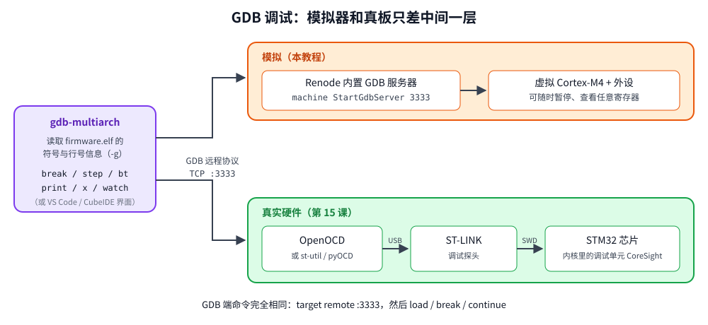
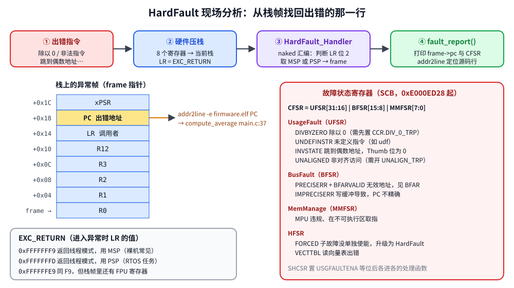

# 第 13 章　调试与 HardFault

## 本章目标

- 用 GDB 连接 Renode（以及真板）进行源码级调试
- 掌握嵌入式调试常用的 GDB 命令：断点、单步、查看内存与外设寄存器
- 理解 Cortex-M 的故障异常：HardFault、UsageFault、BusFault、MemManage
- 写一个故障处理函数，从异常栈帧中找出出错的代码行

## 13.1 调试架构



真板上，GDB 通过 TCP 连接 **GDB 服务器**（OpenOCD 或 ST-Link GDB Server），服务器通过 USB 驱动 **ST-Link 调试器**，调试器再通过 **SWD**（两根线：SWDIO、SWCLK）访问芯片内核的调试单元。调试单元可以随时暂停 CPU、读写寄存器和整个地址空间、设置硬件断点（Cortex-M4 有 6 个）。

Renode 内置了 GDB 服务器，GDB 的使用方式与真板 **完全相同**：都是 `target remote :3333`。

编译选项对调试很重要：

- `-g3`：生成包括宏定义在内的完整调试信息（只占 ELF 空间，不进 Flash）
- `-Og`：只做不影响调试的优化。`-O2` 下变量常被优化掉（`<optimized out>`），单步时会在源码行之间跳来跳去。本课的 Makefile 用 `OPT := -Og`

## 13.2 交互式调试

需要两个终端：

```bash
# 终端 1：启动模拟器（暂停状态），GDB 服务器监听 3333 端口
cd examples/13-debug-fault
make sim FAULT=1
```

```bash
# 终端 2：启动 GDB 并连接
cd examples/13-debug-fault
make gdb FAULT=1
```

`make gdb` 实际执行 `gdb-multiarch -q build/fault1/firmware.elf -ex "target remote :3333"`。连接后 CPU 停在 `Reset_Handler`。然后：

```
(gdb) break main
(gdb) continue
(gdb) next
...
```

### 常用命令

| 命令 | 缩写 | 作用 |
|------|------|------|
| `break main.c:37` / `break func` | `b` | 断点 |
| `tbreak` | | 一次性断点 |
| `watch g_valid_count` | | 数据断点：变量被写时停下 |
| `info breakpoints` / `delete 2` | `i b` / `d` | 查看/删除断点 |
| `continue` | `c` | 继续运行 |
| `next` / `step` | `n` / `s` | 单步（跳过/进入函数） |
| `finish` | | 运行到当前函数返回 |
| `stepi` / `nexti` | `si` / `ni` | 单步一条机器指令 |
| `backtrace` | `bt` | 调用栈 |
| `info args` / `info locals` | | 参数 / 局部变量 |
| `print expr` / `print/x expr` | `p` | 打印表达式（`/x` 十六进制） |
| `print arr[0]@4` | | 打印从 arr[0] 开始的 4 个元素 |
| `x/6xw 0x40020C00` | | 以 32 位字为单位、十六进制显示 6 个内存单元 |
| `info registers` | `i r` | 所有 CPU 寄存器 |
| `display/i $pc` | | 每次停下都显示当前指令 |
| `disassemble` | | 反汇编当前函数 |
| `monitor <命令>` | | 把命令发给 GDB 服务器（Renode / OpenOCD） |
| `load` | | 把 ELF 烧写到目标（真板） |

外设寄存器就是内存，所以可以直接用 `x` 读。因为 `-g3` 和 CMSIS 风格的头文件，也可以用结构体语法：`print/x ((GPIO_TypeDef *)0x40020C00)->MODER`。读外设寄存器建议总用 `x/xw` 按 32 位读：有些外设不支持 8/16 位访问，而 GDB 打印整个结构体时可能按字节读。

> 注意：读某些寄存器有副作用。例如在 GDB 里读 USART 的 DR 会清掉 RXNE，导致程序丢一个字节。

### 自动演示

`make gdb-demo` 用脚本 [`debug.gdb`](../examples/13-debug-fault/debug.gdb) 自动完成一次调试会话（它自己启动和关闭 Renode）：

```bash
make gdb-demo FAULT=1
```

本机实际输出：

```
Reset_Handler () at ../common/startup.c:239
239	{

### 1. Stop in compute_average and look around
Breakpoint 1 at 0x8001ba8: file main.c, line 34.

Breakpoint 1, compute_average (samples=samples@entry=0x20000060 <g_samples>, count=0) at main.c:34
34	    for (uint32_t i = 0; i < count; i++) {
#0  compute_average (samples=samples@entry=0x20000060 <g_samples>, count=0) at main.c:34
#1  0x08001c28 in process () at main.c:59
#2  0x08001d96 in main () at main.c:153
samples = 0x20000060 <g_samples>
count = 0
$1 = {12, 15, 11, 14, 13, 16, 12, 15}
$2 = {12, 15, 11, 14}
$3 = 0x8001ba8

### 2. Peripheral registers are memory: read them as 32-bit words
0x40020c00:	0x55000000	0x00000000	0x00000000	0x00000000
0x40020c10:	0x00000000	0x00000000
$4 = 0x55000000
Renode monitor commands work from GDB too:
False

### 3. Arm a breakpoint on the fault report, then step into the bug
Breakpoint 2 at 0x8001c38: file main.c, line 89.
37	    return sum / (int32_t)count;     /* count == 0 -> SDIV by zero */
sum = 0

Breakpoint 2, fault_report (frame=0x2001ffc8, exc_return=4294967289) at main.c:89
89	{

### 4. Inside fault_report: who faulted, and where?
#0  fault_report (frame=0x2001ffc8, exc_return=4294967289) at main.c:89
#1  <signal handler called>
#2  compute_average (samples=samples@entry=0x20000060 <g_samples>, count=0) at main.c:37
#3  0x08001c28 in process () at main.c:59
#4  0x08001d96 in main () at main.c:153
$5 = {r0 = 0x20000060, r1 = 0x0, r2 = 0x0, r3 = 0x0, r12 = 0x18, lr = 0x8001c29, pc = 0x8001bc8, xpsr = 0x61000000}
compute_average + 32 in section .text
Line 37 of "main.c" starts at address 0x8001bc8 <compute_average+32> and ends at 0x8001bce.
False
[Inferior 1 (Remote target) killed]
```

逐段解读：

1. 停在 `compute_average`，调用栈显示它从 `process()` 第 59 行调用，参数 `count=0`，这就是 bug
2. `0x40020C00` 是 GPIOD：MODER = `0x55000000`，即 PD12~15 都是输出模式（每个引脚 `01`）。`monitor gpioPortD.RedLED State` 是 Renode 的命令，经 GDB 转发执行
3. `next` 执行到除法那一行，再 `continue` 就触发了故障，停在故障处理函数里
4. GDB 能“穿过”异常继续回溯（`<signal handler called>`），直接显示出错位置 `main.c:37`。`*frame` 是硬件压栈的寄存器，其中 `pc = 0x8001bc8` 就是出错的指令

## 13.3 故障异常

当 CPU 遇到无法执行的情况，就会进入故障异常：

| 异常 | 编号 | 典型原因 |
|------|------|---------|
| HardFault | 3 | 其他故障未使能时都升级到这里；异常处理中再出错 |
| MemManage | 4 | 违反 MPU 规则、从 XN 区域取指 |
| BusFault | 5 | 访问不存在的地址、外设时钟没开时访问（部分芯片）、栈溢出到非法区域 |
| UsageFault | 6 | 未定义指令、非法状态（Thumb 位为 0）、除零（需使能）、非对齐访问（需使能） |

复位后只有 HardFault 是开启的，其余三个故障都会 **升级（escalate）** 为 HardFault。在 `SCB->SHCSR` 中分别使能后，它们会进入各自的处理函数，更容易区分原因：

```c
SCB->SHCSR |= SCB_SHCSR_USGFAULTENA | SCB_SHCSR_BUSFAULTENA | SCB_SHCSR_MEMFAULTENA;
SCB->CCR |= SCB_CCR_DIV_0_TRP;   /* integer division by zero traps instead of returning 0 */
```

注意：Cortex-M 的整数除零默认 **不报错，结果为 0**。打开 `DIV_0_TRP` 后才会触发 UsageFault。

### 异常栈帧



进入任何异常时，硬件自动把 8 个寄存器压到当前栈上（R0~R3、R12、LR、PC、xPSR），并把一个特殊值 **EXC_RETURN** 写进 LR：

| EXC_RETURN | 含义 |
|------------|------|
| `0xFFFFFFF9` | 返回线程模式，使用 MSP（主栈）。裸机程序通常是这个 |
| `0xFFFFFFFD` | 返回线程模式，使用 PSP（进程栈）。RTOS 任务里出错时是这个 |
| `0xFFFFFFF1` | 返回处理模式（异常嵌套） |
| `0xFFFFFFE9` / `…ED` / `…E1` | 同上，但栈帧包含 FPU 寄存器 |

栈帧里的 **PC** 就是出错时正在执行（或即将执行）的指令地址，**LR** 是出错函数的返回地址（即调用者的位置）。

### 故障处理函数

处理函数必须在 **碰栈之前** 取得栈指针，所以写成 `naked`（编译器不生成任何入口/出口代码）：

```c
__attribute__((naked)) void HardFault_Handler(void)
{
    __asm__ volatile(
        "tst   lr, #4      \n"   /* EXC_RETURN bit 2: 0 = MSP, 1 = PSP */
        "ite   eq          \n"
        "mrseq r0, msp     \n"   /* r0 = 栈帧地址（第一个参数） */
        "mrsne r0, psp     \n"
        "mov   r1, lr      \n"   /* r1 = EXC_RETURN（第二个参数） */
        "b     fault_report\n");
}

void UsageFault_Handler(void) __attribute__((naked, alias("HardFault_Handler")));
void BusFault_Handler(void) __attribute__((naked, alias("HardFault_Handler")));
void MemManage_Handler(void) __attribute__((naked, alias("HardFault_Handler")));
```

`fault_report(const exception_frame_t *frame, uint32_t exc_return)` 是普通 C 函数，打印栈帧、`SCB->ICSR` 里的当前异常号、以及故障状态寄存器：

| 寄存器 | 地址 | 内容 |
|--------|------|------|
| CFSR | 0xE000ED28 | 可配置故障状态：低 8 位 MMFSR、中 8 位 BFSR、高 16 位 UFSR |
| HFSR | 0xE000ED2C | HardFault 状态：FORCED（bit 30）表示由其他故障升级而来 |
| MMFAR | 0xE000ED34 | MemManage 出错地址（MMARVALID=1 时有效） |
| BFAR | 0xE000ED38 | BusFault 出错地址（BFARVALID=1 时有效） |

CFSR 中常见的位：

| 位 | 名称 | 含义 |
|----|------|------|
| 0 | IACCVIOL | 取指违反 MPU |
| 1 | DACCVIOL | 数据访问违反 MPU |
| 8 | IBUSERR | 取指总线错误 |
| 9 | PRECISERR | 精确数据总线错误，BFAR 有效 |
| 10 | IMPRECISERR | 不精确数据总线错误（写缓冲导致，PC 不准） |
| 12 | STKERR | 异常压栈时出错（通常是栈溢出） |
| 16 | UNDEFINSTR | 未定义指令 |
| 17 | INVSTATE | 非法状态：试图执行 ARM 指令（地址最低位为 0） |
| 18 | INVPC | EXC_RETURN 非法 |
| 19 | NOCP | 协处理器不可用（FPU 没打开就用浮点） |
| 24 | UNALIGNED | 非对齐访问（需 `CCR.UNALIGN_TRP`） |
| 25 | DIVBYZERO | 除零（需 `CCR.DIV_0_TRP`） |

## 13.4 四种故障实验

[`examples/13-debug-fault/main.c`](../examples/13-debug-fault/main.c) 用 `FAULT=n` 选择埋入的 bug：

```c
__attribute__((noinline)) static int32_t compute_average(const int32_t *samples, uint32_t count)
{
    int32_t sum = 0;
    for (uint32_t i = 0; i < count; i++) {
        sum += samples[i];
    }
    return sum / (int32_t)count;     /* count == 0 -> SDIV by zero */      // 第 37 行
}

__attribute__((noinline)) static void process(void)
{
    callback_t cb = report;

#if FAULT_KIND == 1 || FAULT_KIND == 4
    g_valid_count = 0;               /* bug: "no valid samples" */
#elif FAULT_KIND == 2
    cb = (callback_t)((uintptr_t)report & ~1u);   /* bug: Thumb bit lost */
#elif FAULT_KIND == 3
    __asm__ volatile("udf #0");      /* bug: an undefined instruction */     // 第 56 行
#endif

    int32_t avg = compute_average(g_samples, g_valid_count);                // 第 59 行
    cb(avg);                                                                // 第 60 行
}
```

每个变体使用单独的构建目录（`build/fault1/` 等），切换 `FAULT` 时会自动重新编译。

### FAULT=0：正常

```bash
make run FAULT=0
```

```
lesson 13, FAULT_KIND=0
average = 13
finished without a fault
```

### FAULT=1：除零

```bash
make run FAULT=1
```

```
*** UsageFault (exception 6) ***
  r0  = 0x20000060  r1 = 0x00000000  r2 = 0x00000000  r3 = 0x00000000
  r12 = 0x00000018  lr = 0x08001c29  pc = 0x08001bc8  xpsr = 0x61000000
  EXC_RETURN = 0xfffffff9 (main stack)
  CFSR = 0x02000000: DIVBYZERO
  HFSR = 0x00000000
  find the line: arm-none-eabi-addr2line -f -e build/fault1/firmware.elf 0x08001bc8
```

按提示查找源码行：

```bash
$ arm-none-eabi-addr2line -f -e build/fault1/firmware.elf 0x08001bc8
compute_average
.../main.c:38
```

addr2line 报告的是第 38 行（函数的右大括号），而除法在第 37 行。这是因为编译器把两行的代码合并在同一个地址，行号表里两条记录指向同一个 PC，addr2line 取了后一条。GDB 的 `info line *0x08001bc8` 给出更准确的结果：`Line 37 ... starts at address 0x8001bc8`。**经验：addr2line 指向的行附近几行都要看。** 也可以用 `make disasm` 生成带源码的反汇编，直接找到地址 `8001bc8` 上的 `sdiv` 指令。

`lr = 0x08001c29`：返回地址，指向 `process()` 里 `bl compute_average` 的 **下一条** 指令（最低位 1 表示 Thumb）。addr2line 查它得到 `process main.c:60`，也就是调用语句（第 59 行）的下一行。要精确看到调用语句，用 GDB 的 `backtrace`（它会显示 `process () at main.c:59`）。

### FAULT=2：函数指针丢失 Thumb 位

```
CFSR = 0x00020000: INVSTATE
pc = 0x08001be2   lr = 0x08001be5
```

Cortex-M 只支持 Thumb 指令集，跳转目标地址的最低位必须为 1。函数指针最低位被清掉后，`blx` 试图切换到 ARM 状态，触发 INVSTATE。反汇编（`make disasm FAULT=2`）一目了然：

```
 8001bde:	f024 0401 	bic.w	r4, r4, #1      @ 清掉 Thumb 位：bug
 8001be2:	47a0      	blx	r4               @ 跳到 0x08001c2c（report），T=0
 8001be4:	bd10      	pop	{r4, pc}
```

```bash
$ arm-none-eabi-addr2line -f -e build/fault2/firmware.elf 0x08001be2
process
.../main.c:60
```

> 模拟器与真芯片的差异：Renode 在 `blx` 指令本身报错，栈帧 PC = `0x08001be2`（就是 `cb(avg)` 这一行）。真芯片上 `blx` 会执行完，在下一次取指时出错，栈帧 PC 是 **跳转目标** `0x08001c2c`（`report` 的地址，最低位为 0），这时要靠 LR（`0x08001be5`，调用之后的位置）找到调用点。两种情况下 LR 都指向调用点之后。

这类故障在实际项目中通常来自：函数指针被内存越界覆盖、跳转到未初始化的指针、手写汇编或 bootloader 跳转时忘记 `| 1`。

### FAULT=3：未定义指令

```
CFSR = 0x00010000: UNDEFINSTR
pc = 0x08001c1a   lr = 0x08001d93   xpsr = 0x21000000
```

addr2line 指向 `process main.c:56`，正是 `udf` 那一行。实际项目中常见原因：跳转到 Flash 中被擦除的区域（0xFFFF 不是合法指令）、栈被破坏后返回到垃圾地址。

### FAULT=4：故障升级为 HardFault

与 FAULT=1 相同的除零，但没有在 SHCSR 中使能 UsageFault：

```
*** HardFault (exception 3) ***
  ...（寄存器与 FAULT=1 相同）
  CFSR = 0x02000000: DIVBYZERO
  HFSR = 0x40000000: FORCED (escalated)
```

HFSR 的 FORCED 位说明这是升级来的，**真正原因仍然记录在 CFSR 里**。所以哪怕只实现一个 HardFault 处理函数，也一定要打印 CFSR。

## 13.5 故障排查流程

1. 打印（或用 GDB 查看）栈帧中的 **PC、LR** 和 **CFSR、HFSR**
2. 用 CFSR 确定故障类型；若 BFARVALID / MMARVALID 置位，查看出错的数据地址
3. `addr2line` / `info line *PC` 找到出错行，用 LR 找到调用者
4. 如果是 IMPRECISERR，PC 不准确：可以临时设置 `SCnSCB->ACTLR |= DISDEFWBUF`（关闭写缓冲）让它变成精确错误
5. 如果 PC/LR 都是乱的，很可能是栈溢出或栈被破坏：检查数组越界、大的局部数组、递归

## 练习

1. 增加 `FAULT=5`：读地址 `0x30000000`（不存在的内存）。真芯片上会产生 BusFault、PRECISERR，BFAR = 0x30000000；Renode 对未映射地址只打印警告并返回 0（用 `V=1` 能看到），这个实验需要在真板上做。
2. 增加 `FAULT=6`：打开 `CCR.UNALIGN_TRP`，然后通过 `uint32_t *` 读一个奇数地址。
3. 在交互式 GDB 里对 `g_valid_count` 设置 `watch`，找出是哪一行把它改成了 0。
4. 在 GDB 中用 `set var g_valid_count = 8` 修改变量，让 FAULT=1 的程序正常结束。
5. 用 `make disasm FAULT=1` 生成反汇编，找出 `compute_average` 中的 `sdiv` 指令。

## 常见坑

- **故障处理函数不是 naked**：编译器生成的入口代码先修改了 SP，算出来的栈帧地址就错了。
- **在故障处理函数里使用大量栈**：栈溢出引起的故障里再溢出一次，会锁死（Lockup）。产品代码通常只保存关键信息到一块保留的 RAM，然后复位。
- **用 `-O2` 调试**：变量 `<optimized out>`，行号跳跃。调试时改用 `-Og`。
- **以为除零会报错**：默认结果为 0，不会报错。
- **只看 HardFault 不看 CFSR**：HFSR=FORCED 本身不说明任何原因。

---

上一章：[第 12 章　HAL 库](12-hal.md)　｜　下一章：[第 14 章　用 C++ 写嵌入式](14-cpp.md)
