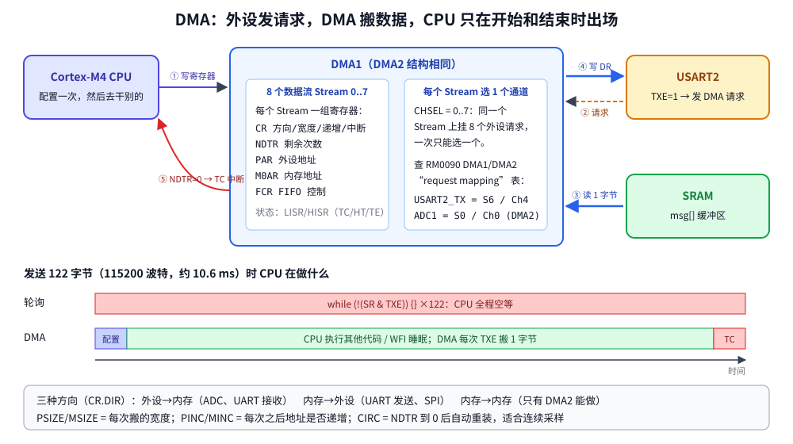

# 第 16 章　DMA：让数据自己搬家

## 本章目标

- 理解 DMA 控制器的结构：数据流（Stream）、通道（Channel）、请求映射
- 配置一次内存到内存的块拷贝，用传输完成中断（TC）得知结束
- 让 USART2 通过 DMA 发送一整行字符串，CPU 在此期间去做别的事
- 认识 `NDTR`、`PSIZE/MSIZE`、`PINC/MINC`、FIFO 和直接模式

## 16.0 从这一章开始的工程结构

第 16~25 章都基于 ST 官方 CMSIS 头文件（第 11 章），并共用一组很小的驱动，避免每课重复写 GPIO 和串口初始化：

```
examples/common/
├── cmsis.mk               CMSIS 课程的 Makefile 片段：启动文件、system_stm32f4xx.c、头文件路径
└── cmsis-drivers/
    ├── board.h            LED 引脚、gpio_set_mode/af/pull、led_on/off/toggle
    ├── uart.c/.h          USART2 轮询收发，printf 经 __io_putchar 输出
    └── tick.c/.h          SysTick 1 kHz：millis()、delay_ms()（内部用 WFI 睡眠）
```

每课的 Makefile 只有几行：

```make
SRCS := main.c
RUN_TIME := 0.2

include ../common/cmsis.mk
```

`board.repl` 也为这些章节加了外设：ADC1、Si7021 温湿度传感器（I2C1 上）、MT25Q SPI Flash（SPI2 上）、一个用 Python 写的 DAC 模型，以及 USART2 和 ADC1 的 DMA 请求连线。

## 16.1 为什么需要 DMA

第 8 章用轮询发送一个字节要等 `TXE`；115200 波特下一个字节约 87 µs，CPU 在 168 MHz 下能执行一万多条指令，全浪费在 `while` 里。第 9 章用中断收数据好一些，但每个字节仍然要进一次中断。

**DMA**（Direct Memory Access，直接存储器访问）是芯片里的第二个“总线主人”：CPU 告诉它“从哪搬到哪、搬几次、每次多宽”，之后外设每准备好一次就向 DMA 发一个**请求**，DMA 自己完成读写，全部搬完再用一个中断通知 CPU。



## 16.2 Stream、Channel 与请求映射

STM32F407 有两个 DMA 控制器，各 8 个数据流（Stream 0~7），每个数据流有一组独立的寄存器：

| 寄存器 | 作用 |
|--------|------|
| `CR` | 通道选择 `CHSEL`、方向 `DIR`、宽度 `PSIZE/MSIZE`、地址递增 `PINC/MINC`、循环 `CIRC`、优先级 `PL`、中断使能 `TCIE/HTIE/TEIE`、启动 `EN` |
| `NDTR` | 还剩多少个**数据项**（不是字节）；每搬一次减 1，到 0 结束 |
| `PAR` | 外设地址（如 `&USART2->DR`）；内存到内存时是源地址 |
| `M0AR` | 内存地址 |
| `FCR` | FIFO 控制；`DMDIS=0` 为直接模式 |

状态标志在 `LISR`（Stream 0~3）和 `HISR`（Stream 4~7）里，每个 Stream 有 TCIF（完成）、HTIF（过半）、TEIF（传输错误）、DMEIF、FEIF 五个标志，写 `LIFCR/HIFCR` 对应位清除。

**哪个外设能用哪个 Stream 是固定的。** 每个 Stream 有 8 个通道输入，RM0090 的 DMA 章节有两张“request mapping”表列出所有对应关系，例如：

| 外设请求 | 控制器 | Stream | Channel |
|----------|--------|--------|---------|
| USART2_TX | DMA1 | 6 | 4 |
| USART2_RX | DMA1 | 5 | 4 |
| ADC1 | DMA2 | 0（或 4） | 0 |
| SPI1_TX | DMA2 | 3（或 5） | 3 |

另外，**只有 DMA2 能做内存到内存**传输。

## 16.3 第一部分：内存到内存拷贝

[`examples/16-dma/main.c`](../examples/16-dma/main.c)：

```c
static void dma_m2m_copy(const uint32_t *src, uint32_t *dst, uint32_t words)
{
    DMA_Stream_TypeDef *s = DMA2_Stream1;

    s->CR &= ~DMA_SxCR_EN;
    while (s->CR & DMA_SxCR_EN) {          /* wait until the stream really stops */
    }
    DMA2->LIFCR = DMA_LIFCR_CTCIF1 | DMA_LIFCR_CHTIF1 | DMA_LIFCR_CTEIF1 |
                  DMA_LIFCR_CDMEIF1 | DMA_LIFCR_CFEIF1;

    s->PAR = (uint32_t)src;                /* in M2M mode PAR is the source */
    s->M0AR = (uint32_t)dst;
    s->NDTR = words;                       /* number of data items, not bytes */
    s->FCR = DMA_SxFCR_DMDIS | DMA_SxFCR_FTH;   /* M2M needs the FIFO */
    s->CR = (0u << DMA_SxCR_CHSEL_Pos)
          | DMA_SxCR_DIR_1                 /* 10: memory to memory */
          | DMA_SxCR_PINC | DMA_SxCR_MINC  /* advance both addresses */
          | DMA_SxCR_PSIZE_1 | DMA_SxCR_MSIZE_1   /* 32-bit items */
          | DMA_SxCR_PL_1                  /* priority high */
          | DMA_SxCR_TCIE;                 /* interrupt on transfer complete */
    s->CR |= DMA_SxCR_EN;
}

void DMA2_Stream1_IRQHandler(void)
{
    if (DMA2->LISR & DMA_LISR_TCIF1) {
        DMA2->LIFCR = DMA_LIFCR_CTCIF1;
        g_m2m_done = 1;
    }
}
```

配置 DMA 的固定套路：

1. **先停下数据流并等 `EN` 真正变 0**。正在运行的 Stream 的寄存器是只读的。
2. **清掉旧标志**。上次留下的 TCIF 不清，一使能就会立刻进中断。
3. 写地址、数量、FIFO，最后写 `CR`，再单独置 `EN`。

`main()` 里等待时用 `__WFI()` 睡眠，TC 中断会把 CPU 叫醒。

## 16.4 第二部分：DMA 驱动的串口发送

```c
static void uart_dma_init(void)
{
    RCC->AHB1ENR |= RCC_AHB1ENR_DMA1EN;
    USART2->CR3 |= USART_CR3_DMAT;         /* USART asks DMA for each TX byte */
    NVIC_SetPriority(DMA1_Stream6_IRQn, 5);
    NVIC_EnableIRQ(DMA1_Stream6_IRQn);
}

static void uart_dma_send(const char *buf, uint32_t len)
{
    DMA_Stream_TypeDef *s = DMA1_Stream6;
    /* ... stop the stream, clear HIFCR flags as above ... */
    s->PAR = (uint32_t)&USART2->DR;        /* fixed peripheral address */
    s->M0AR = (uint32_t)buf;
    s->NDTR = len;
    s->FCR = 0;                            /* direct mode: one byte per request */
    s->CR = (4u << DMA_SxCR_CHSEL_Pos)     /* channel 4 = USART2_TX */
          | DMA_SxCR_DIR_0                 /* 01: memory to peripheral */
          | DMA_SxCR_MINC                  /* walk the buffer, keep PAR fixed */
          | DMA_SxCR_TCIE;                 /* 8-bit sizes are the 00 default */

    g_tx_done = 0;
    USART2->SR &= ~USART_SR_TC;
    s->CR |= DMA_SxCR_EN;
}
```

要点：

- `USART_CR3_DMAT` 让 USART 在每次 `TXE=1` 时向 DMA 发请求；接收用 `DMAR`。
- 外设地址不递增（`PINC=0`），内存地址递增（`MINC=1`），宽度都是 8 位。
- **TC 中断只表示 DMA 搬完了最后一个字节到 `DR`**，那个字节还在移位寄存器里往外发。要关串口或进低功耗前，还得等 USART 的 `TC` 标志（`uart_flush()`）。

## 16.5 运行

```bash
cd examples/16-dma
make run
```

本机实际输出：

```
lesson 16: DMA
M2M: copied 256 words, NDTR now 0, buffers match
     g_dst[1] = 0x01010101, g_dst[255] = 0xffffffff
DMA: this whole line is pushed into USART2 by DMA1 stream 6,
     one byte per TXE request, while the CPU counts below.
TX: 122 bytes done after 0 ms (on silicon 115200 baud needs 10.6 ms), CPU looped 1 times meanwhile
```

- 256 个字拷贝完成后 `NDTR` 减到 0，两个缓冲区一致。
- 中间两行是 DMA 发出去的。**在真芯片上**，122 字节需要约 10.6 ms，这期间 `spins++` 会执行几万次；Renode 的 UART 没有传输时间，DMA 瞬间搬完，所以显示 0 ms、1 次。这是模拟器和硬件的典型差别：**功能对，时序不对**。

## 16.6 循环模式与双缓冲

`CR.CIRC=1` 时 NDTR 到 0 后自动重装，DMA 永不停止，适合 ADC 连续采样、UART 不定长接收。配合 **HT（半传输）中断**可以做“乒乓”：DMA 写后半段时，CPU 处理前半段；TC 时反过来。F4 还支持硬件双缓冲（`DBM`，两个内存地址 `M0AR/M1AR` 轮流）。

Renode 1.17 的 STM32 DMA 模型不重装循环模式的 NDTR，也不产生 HT 标志，所以本章和第 19 章都只用普通模式；这两个功能请在真板子上练习。

## 练习

1. 把内存到内存拷贝改成 8 位宽度（`PSIZE=MSIZE=00`），`NDTR` 应该写多少？
2. 在 `uart_dma_send()` 之后、等待 TC 之前点亮橙色 LED，TC 中断里熄灭；在真板子上用示波器或逻辑分析仪看 LED 亮了多久。
3. 用 DMA1 Stream 5 Channel 4 实现 USART2 的 DMA 接收：固定收 8 个字节后在 TC 中断里打印。（Renode 中用 `sysbus.usart2 WriteLine "12345678"` 送数据。）
4. 查 RM0090 的请求映射表：SPI2_TX 和 SPI2_RX 分别在哪个 Stream、哪个 Channel？

## 常见坑

- **Stream 没停就改寄存器**：写入被忽略，配置“看起来对”却不工作。
- **忘了清旧标志**：一使能就进中断，或者中断永远不来。
- **用错 Stream/Channel 组合**：DMA 不报错，只是永远等不到请求。
- **内存到内存用了 DMA1**：DMA1 的外设端口没有接到总线矩阵，做不了内存到内存传输，必须用 DMA2。
- **缓冲区在栈上**：函数返回后 DMA 还在读写那块内存。DMA 缓冲区用全局或 `static`。
- **TC 一到就关串口**：最后一个字节被截断，要再等 USART 的 `TC`。
- **数据缓存**：F407 没有 D-Cache，不用管；F7/H7 上 DMA 缓冲区要做 cache 清理/失效或放在非缓存区。

---

上一章：[第 15 章　走向真实硬件](15-real-hardware.md)　｜　下一章：[第 17 章　I2C 总线](17-i2c.md)
