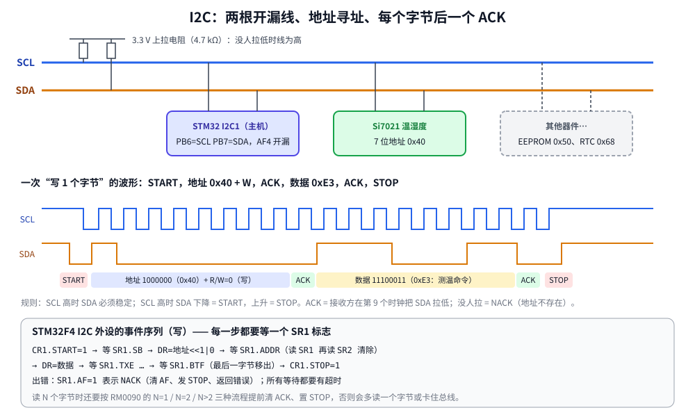

# 第 17 章　I2C 总线：读一个温湿度传感器

## 本章目标

- 理解 I2C 的电气特性（开漏 + 上拉）、地址、START/STOP、ACK/NACK
- 掌握 STM32F4 I2C 外设的事件序列：每一步等哪个标志
- 写一个带超时和 NACK 处理的阻塞式驱动：写、读、探测
- 扫描总线，读 Si7021 的器件 ID，测量温度和湿度

## 17.1 I2C 是什么

I2C（Inter-Integrated Circuit，读作 “I-squared-C”）只用两根线就能把几十个器件挂在一起：

- **SCL** 时钟，由主机产生
- **SDA** 数据，双向

两根线都是**开漏**（open-drain）：每个器件只能把线**拉低**或者**放开**，放开时由上拉电阻拉到高电平。所以任何一个器件拉低，整根线就是低——这让“多个器件共用一根线”不会短路，也让从机可以通过拉住 SCL 来**时钟延展**（clock stretching，“等一下，我还没准备好”）。

每个从机有一个 7 位地址（Si7021 是 `0x40`）。主机每次通信先发地址，只有地址匹配的从机回应。



一次传输的基本单位：

| 元素 | 线上的样子 | 谁发 |
|------|-----------|------|
| START | SCL 高时 SDA 从高变低 | 主机 |
| 地址字节 | 7 位地址 + 1 位 R/W（0 写 1 读） | 主机 |
| ACK / NACK | 第 9 个时钟时 SDA 被拉低 = ACK；保持高 = NACK | 接收方 |
| 数据字节 | 8 位，高位在前 | 写时主机发，读时从机发 |
| STOP | SCL 高时 SDA 从低变高 | 主机 |

**读的时候主机用 NACK 告诉从机“够了”**：主机收最后一个字节后不拉 SDA，从机就停止发送。

## 17.2 STM32F4 的 I2C 外设

F4 的 I2C 是比较老的一代设计（F0/F3/F7/G4/H7 等换成了新 I2C），驱动它要按严格的**事件序列**来：每发一步，等 `SR1` 里一个对应的标志。

| 步骤 | 软件动作 | 等待 |
|------|---------|------|
| 起始 | `CR1.START = 1` | `SR1.SB`：起始条件已发出 |
| 地址 | `DR = (addr << 1) \| rw` | `SR1.ADDR`：从机应答了地址；**读 SR1 再读 SR2 才能清除** |
| 发数据 | `DR = byte` | `SR1.TXE`：数据寄存器空了，可以写下一个 |
| 发完 | — | `SR1.BTF`：最后一个字节已完全移出 |
| 收数据 | — | `SR1.RXNE`：读 `DR` |
| 结束 | `CR1.STOP = 1` | 硬件发出 STOP 后自动清 `STOP` 位 |
| 出错 | — | `SR1.AF`：NACK；`SR1.BERR`、`ARLO`：总线错误、仲裁丢失 |

时钟配置（标准模式 100 kHz）：

- `CR2.FREQ` = APB1 时钟的 MHz 数（16）
- `CCR` = PCLK1 / (2 × 100 kHz) = 80：SCL 高、低各 80 个 PCLK 周期
- `TRISE` = 最大上升时间 1000 ns / T<sub>PCLK</sub> + 1 = 17

## 17.3 驱动代码

[`examples/17-i2c/i2c.c`](../examples/17-i2c/i2c.c)。所有等待都通过一个函数，它在 NACK 或超时时发 STOP 并返回错误码：

```c
#define TIMEOUT 100000u

static int wait_sr1(uint32_t flag)
{
    for (uint32_t n = 0; n < TIMEOUT; n++) {
        uint32_t sr1 = I2C1->SR1;
        if (sr1 & flag) {
            return I2C_OK;
        }
        if (sr1 & I2C_SR1_AF) {
            I2C1->SR1 = ~I2C_SR1_AF;          /* rc_w0 */
            I2C1->CR1 |= I2C_CR1_STOP;
            return I2C_ERR_NACK;
        }
    }
    I2C1->CR1 |= I2C_CR1_STOP;
    return I2C_ERR_TIMEOUT;
}
```

初始化：PB6/PB7 设为 AF4、**开漏**、上拉，复位一次外设清掉可能卡住的状态，再写时钟参数：

```c
    for (uint32_t pin = 6; pin <= 7; pin++) {
        gpio_set_af(GPIOB, pin, 4);
        GPIOB->OTYPER |= 1u << pin;
        gpio_set_pull(GPIOB, pin, GPIO_PULL_UP);
    }

    I2C1->CR1 = I2C_CR1_SWRST;               /* clear any stuck state */
    I2C1->CR1 = 0;
    uint32_t mhz = pclk1_hz / 1000000u;
    I2C1->CR2 = mhz;                          /* FREQ: APB1 clock in MHz */
    I2C1->CCR = pclk1_hz / (2u * 100000u);    /* SCL high = low = CCR x Tpclk */
    I2C1->TRISE = mhz + 1u;                   /* 1000 ns max rise time / Tpclk + 1 */
    I2C1->CR1 = I2C_CR1_PE;
```

写操作：START、地址、清 ADDR、逐字节写、等 BTF、STOP：

```c
int i2c1_write(uint8_t addr7, const uint8_t *data, size_t len)
{
    int rc = start(addr7, 0);
    if (rc) {
        return rc;
    }
    clear_addr();
    for (size_t i = 0; i < len; i++) {
        if ((rc = wait_sr1(I2C_SR1_TXE)) != I2C_OK) {
            return rc;
        }
        I2C1->DR = data[i];
    }
    rc = wait_sr1(I2C_SR1_BTF);               /* last byte fully shifted out */
    I2C1->CR1 |= I2C_CR1_STOP;
    return rc;
}
```

**探测**（`i2c1_probe`）只发地址，看有没有 ACK：这就是总线扫描的原理。

### 读：最容易出错的部分

主机只要 `CR1.ACK=1` 就会在每个字节后应答，从机就会一直发。所以必须在**最后一个字节还在线上时**清掉 ACK 并请求 STOP。F4 的参考手册在 I2C 章节 “master receiver” 一节给了三种流程：

- **N = 1**：发地址前先清 ACK；清 ADDR 后立刻置 STOP；等 RXNE 读出。
- **N = 2**：置 `ACK` 和 `POS`（POS 让 ACK/NACK 作用于**下一个**字节）；清 ADDR 后清 ACK；等 BTF（字节 1 在 DR、字节 2 在移位寄存器）；置 STOP；连读两次 DR。
- **N > 2**：正常收到只剩 3 个字节；等 BTF；清 ACK；读第 N-2 个；置 STOP；读第 N-1 个；等 RXNE 读第 N 个。

```c
    I2C1->CR1 |= I2C_CR1_ACK;
    if ((rc = start(addr7, 1)) != I2C_OK) {
        return rc;
    }
    clear_addr();
    size_t i = 0;
    for (; i < len - 3; i++) {                /* all but the last three bytes */
        if ((rc = wait_sr1(I2C_SR1_RXNE)) != I2C_OK) {
            return rc;
        }
        data[i] = (uint8_t)I2C1->DR;
    }
    if ((rc = wait_sr1(I2C_SR1_BTF)) != I2C_OK) {   /* N-2 in DR, N-1 in shift reg */
        return rc;
    }
    I2C1->CR1 &= ~I2C_CR1_ACK;                /* byte N will be NACKed */
    data[i++] = (uint8_t)I2C1->DR;            /* N-2 */
    I2C1->CR1 |= I2C_CR1_STOP;
    data[i++] = (uint8_t)I2C1->DR;            /* N-1 */
    if ((rc = wait_sr1(I2C_SR1_RXNE)) != I2C_OK) {
        return rc;
    }
    data[i] = (uint8_t)I2C1->DR;              /* N */
```

（HAL 的 `HAL_I2C_Master_Receive()` 内部就是这三段代码。）

## 17.4 Si7021 传感器

[`examples/17-i2c/main.c`](../examples/17-i2c/main.c)。Si7021 的用法很典型：**先写一个命令字节，再读结果**。

| 命令 | 含义 | 返回 |
|------|------|------|
| `0xE3` | 测温度（hold master：转换期间拉住 SCL） | 2 字节 + 可选 CRC |
| `0xE5` | 测湿度 | 2 字节 + 可选 CRC |
| `0xFC 0xC9` | 读电子 ID 后半部分 | 第 1 字节是器件类型，`0x15` = Si7021 |

```c
static int32_t si7021_measure(uint8_t cmd)
{
    uint8_t buf[2];
    if (i2c1_write(SI7021_ADDR, &cmd, 1) != I2C_OK) {
        return -1;
    }
    /* "Hold master" commands: the sensor stretches SCL until the result is ready. */
    if (i2c1_read(SI7021_ADDR, buf, sizeof buf) != I2C_OK) {
        return -1;
    }
    return (int32_t)((buf[0] << 8) | buf[1]);
}

/* Datasheet formulas in hundredths (no float in printf), rounded to nearest:
 *   T  = 175.72 * code / 65536 - 46.85
 *   RH = 125 * code / 65536 - 6            */
static int32_t temp_centi(int32_t code) { return (17572 * code + 32768) / 65536 - 4685; }
static int32_t rh_centi(int32_t code)   { return (12500 * code + 32768) / 65536 - 600; }
```

只读 2 字节时，主机在第 2 个字节后发 NACK，传感器就不会再发 CRC 字节。用整数“百分之一度”计算，避免把浮点 `printf` 拉进固件（第 8 章）。

[`stimulus.resc`](../examples/17-i2c/stimulus.resc) 在运行中途修改模拟传感器的读数：

```
i2c1.si7021 Temperature 23.5
i2c1.si7021 Humidity 45
RunFor 0.15
i2c1.si7021 Temperature -5.25
i2c1.si7021 Humidity 80
RunFor 0.35
```

## 17.5 运行

```bash
cd examples/17-i2c
make run
```

本机实际输出：

```
lesson 17: I2C1 at 100 kHz (FREQ=16, CCR=80, TRISE=17)
bus scan: 0x40  (1 device)
Si70xx device type: 0x15 (Si7021)
t= 35 ms  temperature 23.50 C   humidity 45.00 %RH
t=136 ms  temperature 23.50 C   humidity 45.00 %RH
t=236 ms  temperature -5.25 C   humidity 80.00 %RH
t=336 ms  temperature -5.25 C   humidity 80.00 %RH
probe 0x50 (nothing there): NACK
```

- 扫描 0x08~0x77 只有 0x40 应答。
- 第 3 次测量开始读数跟着脚本变了，负温度的格式化也正确。
- 探测一个不存在的地址得到 NACK，驱动正确地返回错误而不是卡死。

## 17.6 Renode 与真实硬件的差别

- Renode 的 STM32F1 风格 I2C 模型（F4 用的也是它）**不会自动清除 `CR1.STOP`**。真芯片在 STOP 发出后几微秒清零，在这之前置 START 会被忽略。`start()` 里先有限次地等 STOP 清零，再手动清掉它：

  ```c
  for (uint32_t n = 0; (I2C1->CR1 & I2C_CR1_STOP) && n < 1000u; n++) {
  }
  I2C1->CR1 = (I2C1->CR1 & ~I2C_CR1_STOP) | I2C_CR1_START;
  ```

  这段代码在真芯片上同样正确。
- `CCR`、`TRISE`、`SWRST` 在模型里不起作用（读回 0），时序不模拟；`OTYPER` 写入会有警告（`V=1` 可见）。
- 模拟的 Si7021 不发送 CRC 字节，所以 CRC 校验放到练习里在真硬件上做。

## 练习

1. 改成读 3 个字节并校验 CRC-8（多项式 x⁸+x⁵+x⁴+1，即 0x31，初值 0），在真传感器上验证。
2. 把 I2C 时钟改成 400 kHz 快速模式：`CCR` 需要置 `F/S` 位并选择占空比 `DUTY`，`TRISE` 按 300 ns 计算；APB1 时钟至少要多少 MHz？
3. 在 `i2c1_read` 的 N>2 流程里，如果把“清 ACK”移到等 BTF 之前，会多读还是少读一个字节？在真硬件上用逻辑分析仪看看。
4. 读 HAL 的 `HAL_I2C_Master_Receive()` 源码（`stm32f4xx_hal_i2c.c`），找到和本章三种流程对应的代码。

## 常见坑

- **忘了开漏或没有上拉**：线永远拉不高（推挽会和从机“打架”），或者扫描什么都找不到。内部上拉约 40 kΩ 太弱，真实电路要外接 2.2~10 kΩ。
- **地址左移**：数据手册写的 7 位地址 0x40，线上的地址字节是 `0x80`（写）/`0x81`（读）。有的手册直接写 8 位形式，注意区分。
- **ADDR 不清除**：必须读 SR1 再读 SR2，否则 SCL 一直被拉低，总线卡死。
- **没有超时**：任何一个 `while (!(SR1 & x))` 都可能因为接线、从机复位而永远等下去。
- **总线卡死**：主机在传输中途复位，从机可能还拉着 SDA。恢复办法：把 SCL 临时配成 GPIO，手动打 9 个时钟脉冲再发 STOP。
- **读流程不对**：多读一个字节、收不到 STOP，或第二次传输失败。严格照参考手册的 N=1/2/>2 流程。

---

上一章：[第 16 章　DMA](16-dma.md)　｜　下一章：[第 18 章　SPI 总线](18-spi.md)
