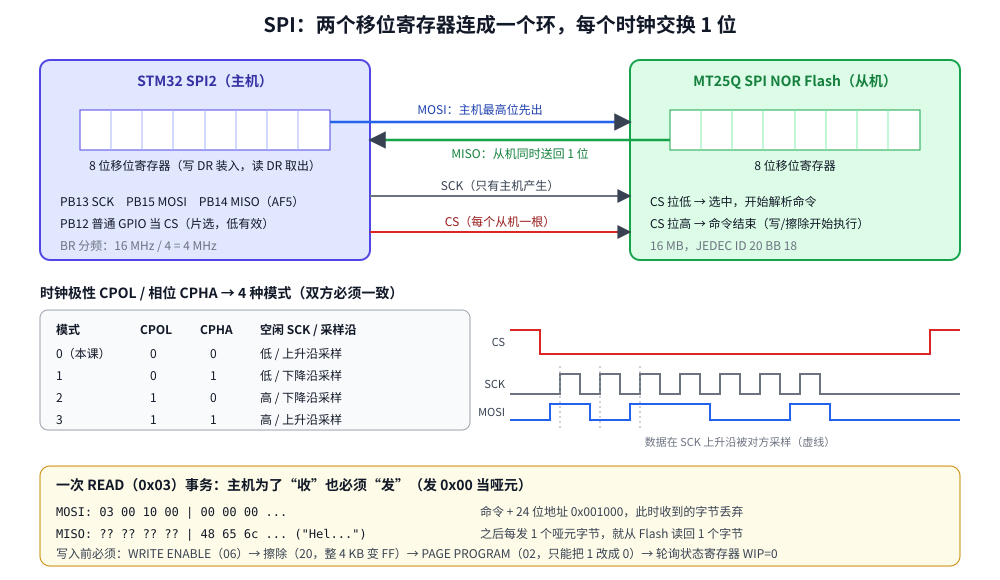

# 第 18 章　SPI 总线：读写一片外部 Flash

## 本章目标

- 理解 SPI 的四根线、全双工移位、片选，以及 CPOL/CPHA 四种模式
- 配置 SPI2 为主机模式，写一个收发一个字节的函数
- 掌握 SPI NOR Flash 的命令集：读 ID、读状态、写使能、擦除、页编程、读
- 理解 Flash 的“只能把 1 写成 0”和“擦除以扇区为单位”

## 18.1 SPI 是什么

SPI（Serial Peripheral Interface）比 I2C 简单粗暴：没有地址、没有应答，每个从机一根单独的片选线，速度可以到几十 MHz。

| 线 | 方向 | 作用 |
|----|------|------|
| SCK | 主 → 从 | 时钟，只有主机产生 |
| MOSI | 主 → 从 | Master Out Slave In |
| MISO | 从 → 主 | Master In Slave Out |
| CS（NSS） | 主 → 从 | 片选，低电平选中；每个从机一根 |

核心是**两个 8 位移位寄存器首尾相连成一个环**：每个时钟主机移出 1 位到 MOSI，同时从 MISO 移入 1 位。8 个时钟后两边的字节**交换**了。所以 SPI 永远是全双工的：**想收 1 个字节，必须发 1 个字节**（通常发 `0xFF` 或 `0x00` 当哑元）。



**CPOL/CPHA** 决定时钟空闲电平和在哪个边沿采样，组合成模式 0~3。主从双方必须一致，否则读到的每个字节都错位一位。绝大多数 SPI Flash 支持模式 0 和 3。

## 18.2 SPI2 的配置

Discovery 板上 SPI2 的引脚：PB13 = SCK、PB14 = MISO、PB15 = MOSI，复用功能 AF5。片选用普通 GPIO PB12，由软件控制。

[`examples/18-spi/main.c`](../examples/18-spi/main.c)：

```c
static void spi2_init(void)
{
    RCC->AHB1ENR |= RCC_AHB1ENR_GPIOBEN;
    RCC->APB1ENR |= RCC_APB1ENR_SPI2EN;

    gpio_set_af(GPIOB, 13, 5);
    gpio_set_af(GPIOB, 14, 5);
    gpio_set_af(GPIOB, 15, 5);
    GPIOB->BSRR = 1u << CS_PIN;              /* deselect before driving the pin */
    gpio_set_mode(GPIOB, CS_PIN, GPIO_MODE_OUTPUT);

    /* Master, mode 0 (CPOL=0, CPHA=0), MSB first, 8-bit, f_PCLK/4 = 4 MHz.
     * SSM+SSI: NSS is managed in software, so the hardware NSS pin is unused. */
    SPI2->CR1 = SPI_CR1_MSTR | SPI_CR1_BR_0 | SPI_CR1_SSM | SPI_CR1_SSI;
    SPI2->CR1 |= SPI_CR1_SPE;
}
```

| `CR1` 位 | 含义 |
|----------|------|
| `MSTR` | 主机模式 |
| `BR[2:0]` | 波特率 = f<sub>PCLK</sub> / 2^(BR+1)；`001` 是 /4 |
| `CPOL`、`CPHA` | 都为 0：模式 0 |
| `SSM`、`SSI` | 软件管理 NSS，并把内部 NSS 置高；否则主机会以为有别的主机在用总线，自动切回从机模式（`MODF` 错误） |
| `DFF` | 0 = 8 位帧，1 = 16 位帧 |
| `LSBFIRST` | 0 = 高位在前 |
| `SPE` | 使能；配置完最后再置 |

收发一个字节：

```c
static uint8_t spi2_transfer(uint8_t out)
{
    while ((SPI2->SR & SPI_SR_TXE) == 0) {
    }
    *(volatile uint8_t *)&SPI2->DR = out;    /* 8-bit access keeps the frame 8 bits */
    while ((SPI2->SR & SPI_SR_RXNE) == 0) {
    }
    return *(volatile uint8_t *)&SPI2->DR;
}

static void cs_low(void) { GPIOB->BSRR = 1u << (CS_PIN + 16u); }

static void cs_high(void)
{
    while (SPI2->SR & SPI_SR_BSY) {          /* last bit must leave before CS rises */
    }
    GPIOB->BSRR = 1u << CS_PIN;
}
```

**每发一个字节都要读一次 `DR`**，即使不需要收到的数据：否则下一个字节到来时 `OVR`（溢出）置位。拉高 CS 之前要等 `BSY=0`，否则最后一个字节的尾巴被截断。

## 18.3 SPI NOR Flash 命令集

外部 SPI Flash（Micron MT25Q、Winbond W25Q、Macronix MX25……）用法几乎一样：CS 拉低，发一个命令字节，可能跟 3 字节地址，然后收发数据，CS 拉高结束。

| 命令 | 名称 | 之后 |
|------|------|------|
| `9F` | READ ID | 读 3 字节：厂商、类型、容量（2^n 字节） |
| `05` | READ STATUS | 读 1 字节：bit0 `WIP` 正在写，bit1 `WEL` 写使能 |
| `06` | WRITE ENABLE | 无；置 `WEL`，每次擦/写前必须发 |
| `20` | SECTOR ERASE 4 KB | 3 字节地址；CS 拉高后开始擦，整块变成 `FF` |
| `02` | PAGE PROGRAM | 3 字节地址 + 最多 256 字节数据 |
| `03` | READ | 3 字节地址，之后每发 1 个哑元字节读回 1 个数据 |

NOR Flash 的物理规律：

- **编程只能把 1 变成 0**。想写入新数据，先擦除（全部变 1），再编程。
- **擦除以扇区（4 KB）为单位**，页编程不能跨 256 字节页边界（会回卷到页首）。
- 擦写需要时间（4 KB 擦除典型几十毫秒），期间 `WIP=1`，要轮询状态寄存器。

```c
static void flash_erase_4k(uint32_t addr)
{
    flash_write_enable();
    cs_low();
    flash_cmd_addr(CMD_ERASE_4K, addr);
    cs_high();                               /* erase starts when CS goes high */
    flash_wait_ready();
}

static void flash_read(uint32_t addr, uint8_t *buf, size_t len)
{
    cs_low();
    flash_cmd_addr(CMD_READ, addr);
    for (size_t i = 0; i < len; i++) {
        buf[i] = spi2_transfer(0xFF);        /* dummy byte out, data byte in */
    }
    cs_high();
}
```

## 18.4 运行

```bash
cd examples/18-spi
make run
```

本机实际输出：

```
lesson 18: SPI2 master, mode 0, 4000000 Hz
JEDEC ID: manufacturer 0x20, type 0xbb, capacity 0x18 (16 MB)
status: 0x00
after WRITE ENABLE: 0x02 (WEL=1)
after erase:   ff ff ff ff ff ff ff ff ff ff ff ff ff ff ff ff
after program: 48 65 6c 6c 6f 2c 20 53 50 49 21 00 ff ff ff ff
as text: "Hello, SPI!"
program 0xf0 then 0x3c without erase -> read 0x3c (real NOR flash: 0xf0 & 0x3c = 0x30)
```

- `0x20` 是 Micron 的厂商码，`0x18` 表示 2^24 = 16 MB。
- 写使能后 `WEL` 位变 1；擦除和编程完成后芯片自动清掉它。
- 擦除后全是 `FF`；编程写入 12 字节（含结尾 `\0`），后面仍是 `FF`。
- 最后一行是 Renode 和真芯片的差别：Renode 的 MT25Q 模型直接覆盖写入，**真的 NOR Flash 得到的是两次数据按位与**（`0xF0 & 0x3C = 0x30`）。这就是为什么必须先擦后写。
- `V=1 make run` 会看到一条 “Transmission finished in the unexpected state” 警告：出现在第一次拉高 CS 时（还没发过任何命令），无害。

## 18.5 DMA 和更快的 SPI

`spi2_transfer()` 每个字节都要 CPU 等两次标志。读一整页时可以用 DMA：SPI2_RX 用 DMA1 Stream 3、SPI2_TX 用 Stream 4（都是 Channel 0），`CR2.RXDMAEN/TXDMAEN` 打开请求；TX 的内存地址指向一个哑元字节且 `MINC=0`。注意**必须同时开 RX 和 TX 两个 DMA**：SPI 主机只有在发送时才产生时钟。

速度上，SPI2 在 APB1（最高 42 MHz）上最快 21 MHz；SPI1 在 APB2 上最快 42 MHz。Flash 的 `03` 命令有最高频率限制（常见 50 MHz 左右），更快要用带哑周期的 `0B` FAST READ，或四线 QSPI。

## 练习

1. 写 `flash_write(addr, data, len)`：自动按 256 字节页边界拆成多次页编程。
2. 实现一个简单的“掉电保存配置”：把一个结构体写到 Flash 的 0x000000，开机读出并校验一个魔数。
3. 把 SPI 改成模式 3（`CPOL=1, CPHA=1`），在真硬件上验证 Flash 仍然能读 ID；再改成模式 1，看看读到的 ID 变成什么。
4. 用 DMA 实现 `flash_read()`，读 256 字节。

## 常见坑

- **没有 `SSM/SSI`**：主机模式下 NSS 引脚浮空，`MODF` 置位，SPI 自动变成从机，什么都不发。
- **只发不读**：`RXNE` 一直置着，`OVR` 溢出，之后读到的是旧数据。
- **用 32 位方式写 `DR`**：`DR` 是 16 位寄存器，有的系列（F0/F3/F7）按访问宽度决定帧长，用 8 位指针访问最稳妥。
- **CS 拉高太早**：没等 `BSY=0`，最后一个字节没发完。
- **擦写前忘发 `06`**：命令被芯片静默忽略，读回来还是旧数据。
- **页编程跨页**：超出部分回卷覆盖页首。
- **不等 `WIP`**：上一次擦写还没完成就发下一条命令，被忽略。

---

上一章：[第 17 章　I2C 总线](17-i2c.md)　｜　下一章：[第 19 章　ADC 与 DAC](19-adc-dac.md)
