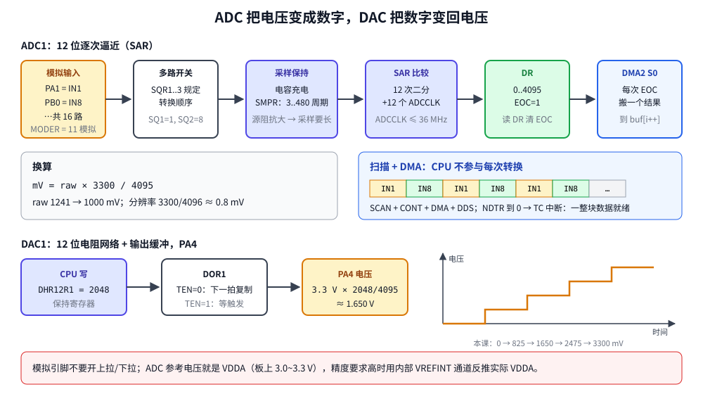

# 第 19 章　ADC 与 DAC：模拟世界的入口和出口

## 本章目标

- 理解 SAR 型 ADC 的工作过程：采样保持、逐次逼近、分辨率、参考电压
- 单次转换：软件触发、轮询 `EOC`、换算成毫伏
- 扫描多个通道并用 DMA 自动把结果搬进数组
- 用 DAC 输出指定电压
- 学会在 Renode 里给 ADC“喂”数据，以及自己写一个简单的外设模型

## 19.1 ADC 是怎么把电压变成数字的



STM32F407 有 3 个 12 位 **SAR**（Successive Approximation Register，逐次逼近）型 ADC，每个最多 16 个外部通道。一次转换分两步：

1. **采样**：内部开关把输入接到一个小电容上充电，持续 `SMPR` 设定的周期数（3~480 个 ADCCLK）。信号源内阻越大，电容充得越慢，采样时间就要越长。
2. **转换**：开关断开，内部 DAC 和比较器做 12 次二分查找，从最高位开始逐位确定，需要 12 个 ADCCLK。

结果是 0~4095 之间的整数，与参考电压的比例关系：

\[ V_{in} = \frac{raw}{4095} \times V_{REF} \]

Discovery 板上 V<sub>REF+</sub> 接 VDDA（约 3.0 V，取决于板子的供电），本章按 3.3 V 计算。分辨率约 0.8 mV。

ADCCLK = PCLK2 / `ADCPRE`（2/4/6/8），最高 36 MHz。

## 19.2 寄存器速览

| 寄存器 | 作用 |
|--------|------|
| `ADC->CCR` | 三个 ADC 共用：`ADCPRE` 分频、温度传感器/VREFINT 使能 |
| `CR1` | `RES` 分辨率（12/10/8/6 位）、`SCAN` 扫描模式、`EOCIE` 中断 |
| `CR2` | `ADON` 上电、`SWSTART` 软件启动、`CONT` 连续、`DMA`/`DDS` DMA 请求、`EXTEN/EXTSEL` 外部触发（定时器） |
| `SMPR1/2` | 每个通道的采样时间 |
| `SQR1~3` | 规则序列：`L` = 转换个数 - 1，`SQ1..SQ16` = 依次转换哪个通道 |
| `SR` | `EOC` 转换结束、`OVR` 溢出 |
| `DR` | 结果；读 `DR` 自动清 `EOC` |

## 19.3 单次转换

[`examples/19-adc-dac/main.c`](../examples/19-adc-dac/main.c)：

```c
static void adc_init(void)
{
    RCC->AHB1ENR |= RCC_AHB1ENR_GPIOAEN | RCC_AHB1ENR_GPIOBEN;
    RCC->APB2ENR |= RCC_APB2ENR_ADC1EN;
    gpio_set_mode(GPIOA, 1, GPIO_MODE_ANALOG);   /* analog mode disconnects the digital input */
    gpio_set_mode(GPIOB, 0, GPIO_MODE_ANALOG);

    ADC->CCR = ADC_CCR_ADCPRE_0;                  /* ADCCLK = PCLK2 / 4 = 4 MHz (max 36 MHz) */
    ADC1->CR1 = 0;                                /* 12-bit resolution */
    ADC1->CR2 = 0;
    /* Sampling time 84 cycles for IN1 and IN8: longer suits high source impedance. */
    ADC1->SMPR2 = (4u << ADC_SMPR2_SMP1_Pos) | (4u << ADC_SMPR2_SMP8_Pos);
    ADC1->SQR1 = 0;                               /* configure the sequence, then power up */
    ADC1->SQR3 = 1;
    ADC1->CR2 |= ADC_CR2_ADON;
}

static uint32_t adc_read_single(uint32_t channel)
{
    ADC1->SQR1 = 0;                               /* L = 0: one conversion */
    ADC1->SQR3 = channel;                         /* SQ1 = channel */
    ADC1->CR2 |= ADC_CR2_SWSTART;
    while ((ADC1->SR & ADC_SR_EOC) == 0) {
    }
    return ADC1->DR;                              /* reading DR clears EOC */
}
```

一次转换耗时 (84 + 12) / 4 MHz = 24 µs。PA1 是 ADC1 的通道 1、PB0 是通道 8；引脚和通道的对应关系查数据手册的引脚表（“ADC123_IN1”表示三个 ADC 的通道 1 都能用这个引脚）。

## 19.4 扫描 + DMA

要定时采集多个通道时，逐个启动、轮询太浪费。让 ADC 自动按序列转换，每转换完一个就发一个 DMA 请求：

```c
static void adc_scan_dma_start(void)
{
    RCC->AHB1ENR |= RCC_AHB1ENR_DMA2EN;
    DMA_Stream_TypeDef *s = DMA2_Stream0;
    /* ... stop the stream ... */
    s->PAR = (uint32_t)&ADC1->DR;
    s->M0AR = (uint32_t)g_samples;
    s->NDTR = SCAN_ROUNDS * SCAN_CHANNELS;
    s->CR = (0u << DMA_SxCR_CHSEL_Pos)            /* channel 0 = ADC1 */
          | DMA_SxCR_MINC                         /* peripheral -> memory (DIR = 00) */
          | DMA_SxCR_PSIZE_1 | DMA_SxCR_MSIZE_1   /* 32-bit items: whole DR register */
          | DMA_SxCR_TCIE;
    NVIC_SetPriority(DMA2_Stream0_IRQn, 5);
    NVIC_EnableIRQ(DMA2_Stream0_IRQn);
    s->CR |= DMA_SxCR_EN;

    ADC1->SQR1 = (SCAN_CHANNELS - 1u) << ADC_SQR1_L_Pos;   /* L = number of conversions - 1 */
    ADC1->SQR3 = (1u << ADC_SQR3_SQ1_Pos) | (8u << ADC_SQR3_SQ2_Pos);
    ADC1->CR1 |= ADC_CR1_SCAN;                    /* convert the whole sequence */
    ADC1->CR2 |= ADC_CR2_DMA | ADC_CR2_DDS        /* one DMA request per conversion */
               | ADC_CR2_CONT;                    /* restart the sequence when it ends */
    ADC1->CR2 |= ADC_CR2_SWSTART;
}

void DMA2_Stream0_IRQHandler(void)
{
    if (DMA2->LISR & DMA_LISR_TCIF0) {
        DMA2->LIFCR = DMA_LIFCR_CTCIF0;
        ADC1->CR2 &= ~(ADC_CR2_CONT | ADC_CR2_DMA | ADC_CR2_DDS);   /* block captured: stop */
        g_block_done = 1;
    }
}
```

结果在数组里交错排列：IN1、IN8、IN1、IN8……收满 8 个数后 TC 中断停止 ADC。

产品里常见的做法是**定时器触发 + DMA 循环模式**：`EXTEN/EXTSEL` 选一个定时器的 TRGO 作为启动信号，得到精确的采样率；DMA 用 `CIRC` 和 HT/TC 中断做双缓冲（第 16 章）。Renode 不支持 DMA 循环模式，本章用普通模式演示原理。

## 19.5 DAC

DAC 正好相反：写一个 12 位数，引脚输出对应电压。F407 有 2 路 DAC，输出在 PA4（通道 1）和 PA5（通道 2）。

```c
static void dac_init(void)
{
    RCC->APB1ENR |= RCC_APB1ENR_DACEN;
    gpio_set_mode(GPIOA, 4, GPIO_MODE_ANALOG);    /* PA4 = DAC_OUT1 */
    DAC->CR = DAC_CR_EN1;                         /* no trigger: DHR -> DOR right away */
}

static void dac_set_mv(uint32_t mv)
{
    DAC->DHR12R1 = (mv * 4095u + VREF_MV / 2u) / VREF_MV;
}
```

软件写的是**保持寄存器** `DHR12R1`（12 位右对齐；还有左对齐和 8 位的版本）。没开触发（`TEN1=0`）时，下一个 APB 时钟它就被复制到**输出寄存器** `DOR1`，引脚电压随之变化。开了触发（定时器或软件 `SWTRIGR`）就等触发再复制——配合 DMA 可以输出任意波形；DAC 还内置三角波和噪声发生器。

## 19.6 在 Renode 里模拟模拟量

**ADC**：Renode 的 `STM32_ADC` 模型不会自己产生电压，要用 `FeedSample` 把结果排进每个通道的队列：

```
# FeedSample <value> <channel> <repeat>: queue raw 12-bit results for a channel.
sysbus.adc1 FeedSample 1241 1 1
sysbus.adc1 FeedSample 2482 1 1
sysbus.adc1 FeedSample 4095 1 1
...
sysbus.adc1 FeedSample 3000 8 1
```

（见 [`stimulus.resc`](../examples/19-adc-dac/stimulus.resc)。也可以用 `FeedSamplesFromFile` 从文件读一长串样本。）

**DAC**：Renode 1.17 没有 STM32 DAC 模型。`board.repl` 里用 Renode 的 `PythonPeripheral` 写了一个 20 行的简化模型：一个寄存器字典，在写 `CR`、`DHR12R1` 或 `SWTRIGR` 时按真实规则把 DHR 复制到 DOR，并打印输出电压：

```python
elif request.IsWrite:
    off = request.Offset
    val = request.Value
    if off == 0x04:                                   # SWTRIGR
        if (val & 1) and (regs.get(0x00, 0) & 1):
            regs[0x2C] = regs.get(0x08, 0) & 0xFFF    # DOR1 = DHR12R1
            self.InfoLog("DAC1 out = %d (%.3f V)" % (regs[0x2C], regs[0x2C] * 3.3 / 4095))
    else:
        regs[off] = val
        cr = regs.get(0x00, 0)
        if off in (0x00, 0x08) and (cr & 1) and not (cr & 4):   # EN1 and not TEN1
            ...
```

这说明了模拟器的一个重要能力：**缺什么外设，可以自己补一个够用的模型**。

## 19.7 运行

```bash
cd examples/19-adc-dac
make run
```

本机实际输出（前几行来自 Renode 日志，由 Makefile 里的 `LOG_FILTER := DAC1 out` 筛出）：

```
[INFO] dac: DAC1 out = 0 (0.000 V)
[INFO] dac: DAC1 out = 0 (0.000 V)
[INFO] dac: DAC1 out = 1024 (0.825 V)
[INFO] dac: DAC1 out = 2048 (1.650 V)
[INFO] dac: DAC1 out = 3071 (2.475 V)
[INFO] dac: DAC1 out = 4095 (3.300 V)
----- USART2 output -----
lesson 19: ADC1 12-bit, Vref = 3300 mV
single IN1: raw 1241 -> 1000 mV  (t=0 ms)
single IN1: raw 2482 -> 2000 mV  (t=50 ms)
single IN1: raw 4095 -> 3300 mV  (t=100 ms)
scan IN1, IN8 x 4 rounds by DMA: done, NDTR = 0
buffer: IN1=1000 IN8=3000 IN1=1100 IN8=2900 IN1=1200 IN8=2800 IN1=1300 IN8=2700
DAC: request    0 mV -> DHR12R1 =    0, DOR1 =    0
DAC: request  825 mV -> DHR12R1 = 1024, DOR1 = 1024
DAC: request 1650 mV -> DHR12R1 = 2048, DOR1 = 2048
DAC: request 2475 mV -> DHR12R1 = 3071, DOR1 = 3071
DAC: request 3300 mV -> DHR12R1 = 4095, DOR1 = 4095
```

- 单次转换读到的正是脚本喂进去的值，换算出 1000/2000/3300 mV。
- DMA 数组里 IN1 递增、IN8 递减，交错排列，说明扫描顺序和 DMA 搬运都正确。
- DAC 日志的第一行 0 V 来自 `DAC->CR = EN1`（使能时 DHR 的初值 0 被复制），第二行来自写 `DHR12R1 = 0`。

## 19.8 Renode 模型的几个限制（真芯片上不存在）

- `DR` 只支持 32 位读，所以 DMA 用 32 位宽度、数组是 `uint32_t`（真芯片上常用 16 位以省内存）。
- 规则序列在 `ADON` 置位时锁定，所以 `adc_init()` 先写 `SQR` 再上电。
- 扫描时必须置 `DDS`，否则模型在第一个 DMA 请求后停住。
- 不支持 DMA 循环模式的重装和 HT 标志。

## 练习

1. 打开内部温度传感器（`ADC->CCR.TSVREFE`，ADC1 通道 16，采样时间至少 10 µs），按 RM0090 给的公式换算成摄氏度（Renode 里用 `FeedSample` 喂一个值）。
2. 用 VREFINT（通道 17，典型 1.21 V）反推实际 VDDA：`VDDA = 1.21 V × 4095 / raw_vrefint`。
3. 用 TIM2 的 TRGO（更新事件）每 1 ms 触发一次 ADC 转换（`EXTEN=01`，`EXTSEL` 选 TIM2_TRGO），收 100 个样本后打印平均值。
4. 用 DAC 输出一个 10 级的阶梯波，每级 10 ms。

## 常见坑

- **引脚没设成模拟模式**：数字输入的施密特触发器还接着，读数不准且增加功耗。
- **采样时间太短**：信号源内阻大（比如 100 kΩ 分压电阻）时读数偏低。按数据手册的公式算，或者加一个缓冲运放/电容。
- **ADC 时钟超过 36 MHz**：精度下降。PCLK2 = 84 MHz 时至少 /4。
- **读 `DR` 太慢导致 `OVR`**：连续或扫描模式下没用 DMA，下一个结果覆盖了上一个，`OVR` 置位后 ADC 停止，要清标志重启。
- **以为参考电压是精确的 3.3 V**：实际 VDDA 随供电变化，精确测量用 VREFINT 校准。
- **DAC 引脚上还开着别的功能**：PA4 也是 SPI1_NSS 等引脚，要确认没有冲突。

---

上一章：[第 18 章　SPI 总线](18-spi.md)　｜　下一章：[第 20 章　RTC 与看门狗](20-rtc-watchdog.md)
