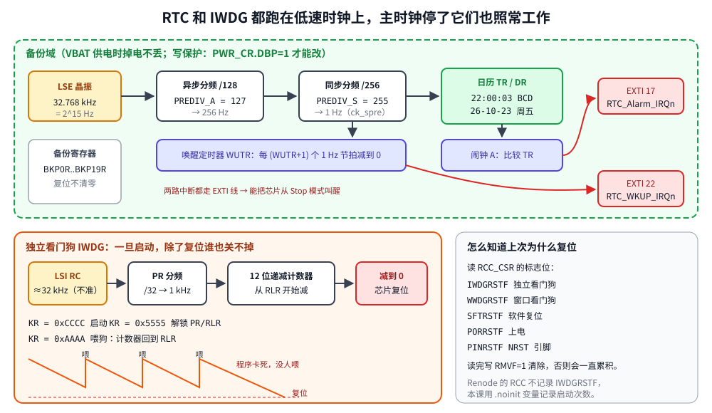

# 第 20 章　RTC 与看门狗

## 本章目标

- 了解 STM32 的几个时钟源，特别是给 RTC 和看门狗用的低速时钟 LSE、LSI
- 理解备份域：为什么 RTC 在复位后还在走，为什么写它要先“解锁”
- 设置日历（BCD 格式）、周期唤醒中断和闹钟中断
- 用独立看门狗（IWDG）在程序卡死时自动复位芯片
- 复位后判断“我为什么重启了”，并在 RAM 里保留跨复位的数据

## 20.1 原理



**RTC**（Real-Time Clock）是一个带日历的计数器，通常由 32.768 kHz 的外部晶振 **LSE** 驱动。32768 = 2<sup>15</sup>，经过两级分频正好得到 1 Hz：

\[ f_{ck\_spre} = \frac{32768}{(PREDIV\_A + 1)(PREDIV\_S + 1)} = \frac{32768}{128 \times 256} = 1\ \text{Hz} \]

RTC 和它的 20 个备份寄存器 `BKP0R..BKP19R` 位于**备份域**：

- 复位（包括看门狗复位）不会清除它们，有纽扣电池接在 VBAT 时，主电源断开它们也能保持。
- 为了防止跑飞的程序意外改写，备份域默认写保护：先置 `PWR_CR.DBP`，再往 `RTC_WPR` 写 0xCA、0x53 两个密钥。

**IWDG**（Independent Watchdog）是一个 12 位**递减计数器**，由片内约 32 kHz 的 **LSI** RC 振荡器驱动，与主时钟完全独立——即使主时钟坏了它也照样计数。程序必须定期往 `KR` 写 0xAAAA（“喂狗”）把它重装为 `RLR`；一旦减到 0，芯片复位。IWDG 一旦启动，**除了复位没有办法停下来**。

F407 还有一个**窗口看门狗 WWDG**，由 APB1 时钟驱动，喂得太早也会复位，用来发现“跑得太快”的错误（比如跳过了某段代码）。本章只讲 IWDG。

## 20.2 设置 RTC

[`examples/20-rtc-watchdog/main.c`](../examples/20-rtc-watchdog/main.c)：

```c
static void rtc_init(void)
{
    RCC->APB1ENR |= RCC_APB1ENR_PWREN;
    PWR->CR |= PWR_CR_DBP;                   /* allow writes to the backup domain */

    RCC->BDCR |= RCC_BDCR_LSEON;             /* 32.768 kHz crystal */
    while ((RCC->BDCR & RCC_BDCR_LSERDY) == 0) {
    }
    RCC->BDCR = (RCC->BDCR & ~RCC_BDCR_RTCSEL) | RCC_BDCR_RTCSEL_0;   /* RTCCLK = LSE */
    RCC->BDCR |= RCC_BDCR_RTCEN;

    rtc_unlock();
    RTC->ISR |= RTC_ISR_INIT;                /* stop the calendar to set it */
    while ((RTC->ISR & RTC_ISR_INITF) == 0) {
    }
    /* 32768 Hz / (127 + 1) / (255 + 1) = 1 Hz calendar tick */
    RTC->PRER = (127u << RTC_PRER_PREDIV_A_Pos) | (255u << RTC_PRER_PREDIV_S_Pos);
    RTC->TR = (bcd(22) << RTC_TR_HU_Pos) | (bcd(0) << RTC_TR_MNU_Pos) | (bcd(0) << RTC_TR_SU_Pos);
    RTC->DR = (bcd(26) << RTC_DR_YU_Pos) | (bcd(10) << RTC_DR_MU_Pos) | (bcd(23) << RTC_DR_DU_Pos) |
              (5u << RTC_DR_WDU_Pos);        /* 2026-10-23, Friday (1 = Monday) */
    RTC->CR &= ~RTC_CR_FMT;                  /* 24-hour format */
    RTC->ISR &= ~RTC_ISR_INIT;               /* run */
}
```

几个要点：

- **BCD**：时间寄存器的每个十进制位单独占 4 位，22 点存成 0x22。转换函数很简单：

  ```c
  static uint32_t bcd(uint32_t v)     { return ((v / 10u) << 4) | (v % 10u); }
  static uint32_t from_bcd(uint32_t b) { return (b >> 4) * 10u + (b & 0xFu); }
  ```

- **初始化模式**：置 `INIT` 并等 `INITF`，日历停止后才能写 `TR/DR/PRER`。
- **读的顺序**：读 `TR` 会把 `DR` 锁住，直到读了 `DR`，保证时间和日期是同一时刻的。所以总是先读 `TR` 再读 `DR`。
- **产品代码里**要先检查 RTC 是否已经设置过（比如看 `ISR.INITS` 或备份寄存器里的标记），已设置就跳过 `rtc_init()`，否则每次复位都会把时间改回去。

## 20.3 周期唤醒和闹钟

RTC 的中断不直接连到 NVIC，而是先经过 **EXTI**：闹钟走 EXTI 17，唤醒定时器走 EXTI 22（这样它们才能把芯片从 Stop 模式唤醒，见第 21 章）。所以清中断要清两处。

```c
static void rtc_wakeup_every_second(void)
{
    RTC->CR &= ~RTC_CR_WUTE;
    while ((RTC->ISR & RTC_ISR_WUTWF) == 0) {   /* wait until WUTR may be written */
    }
    RTC->WUTR = 0;                           /* ck_spre (1 Hz) / (0 + 1) */
    RTC->CR = (RTC->CR & ~RTC_CR_WUCKSEL) | RTC_CR_WUCKSEL_2;   /* 10x: 1 Hz clock */
    RTC->CR |= RTC_CR_WUTIE | RTC_CR_WUTE;

    EXTI->IMR |= EXTI_IMR_MR22;              /* the RTC reaches the NVIC through EXTI */
    EXTI->RTSR |= EXTI_RTSR_TR22;
    NVIC_EnableIRQ(RTC_WKUP_IRQn);
}

static void rtc_alarm_at(uint32_t h, uint32_t m, uint32_t s)
{
    RTC->CR &= ~RTC_CR_ALRAE;
    while ((RTC->ISR & RTC_ISR_ALRAWF) == 0) {
    }
    /* MSK4 = 1: ignore the date, match hours, minutes and seconds. */
    RTC->ALRMAR = RTC_ALRMAR_MSK4 | (bcd(h) << RTC_ALRMAR_HU_Pos) |
                  (bcd(m) << RTC_ALRMAR_MNU_Pos) | (bcd(s) << RTC_ALRMAR_SU_Pos);
    RTC->CR |= RTC_CR_ALRAIE | RTC_CR_ALRAE;

    EXTI->IMR |= EXTI_IMR_MR17;
    EXTI->RTSR |= EXTI_RTSR_TR17;
    NVIC_EnableIRQ(RTC_Alarm_IRQn);
}

void RTC_WKUP_IRQHandler(void)
{
    RTC->ISR &= ~RTC_ISR_WUTF;               /* clear in the RTC ... */
    EXTI->PR = EXTI_PR_PR22;                 /* ... and in EXTI */
    g_wakeups++;
}
```

`ALRMAR` 的 4 个 `MSKx` 位决定比较哪些字段：`MSK4=1` 表示不管日期，每天 22:00:03 都触发；四个都置 1 就是每秒触发。

唤醒定时器的时钟由 `WUCKSEL` 选择：`0xx` 是 RTCCLK/16、/8、/4、/2（高分辨率，第 21 章用 RTCCLK/16 = 2048 Hz 做 100 ms 唤醒），`10x` 是 1 Hz 的 ck_spre。

## 20.4 独立看门狗

```c
static void iwdg_start(uint32_t timeout_ms)
{
    IWDG->KR = 0xCCCC;                       /* start: from now on it cannot be stopped */
    IWDG->KR = 0x5555;                       /* unlock PR and RLR */
    IWDG->PR = 3;                            /* LSI / 32 -> 1 kHz, 1 count = 1 ms */
    IWDG->RLR = timeout_ms - 1u;             /* 12 bits: up to 4096 ms at this prescaler */
    while (IWDG->SR != 0) {                  /* wait for the values to reach the LSI domain */
    }
    IWDG->KR = 0xAAAA;                       /* reload the counter */
}

static void iwdg_feed(void) { IWDG->KR = 0xAAAA; }
```

`KR` 的四个密钥：0xCCCC 启动、0x5555 解锁 `PR/RLR`、0xAAAA 喂狗，其他值重新上锁。`PR/RLR` 工作在 LSI 时钟域，写入后要等 `SR` 的 `PVU/RVU` 清零才真正生效。

**LSI 不准**：数据手册给出的范围是 17~47 kHz，所以“500 ms”实际可能是 340~940 ms。超时要按最坏情况留余量。

**喂狗放在哪里**：不要放在定时器中断里——主循环卡死了，中断照样喂狗，看门狗就失去了意义。正确做法是在主循环（或 RTOS 里每个任务都报到之后）喂。

## 20.5 复位之后：我为什么重启了？

`RCC_CSR` 的高位记录了上次复位的原因：`LPWRRSTF`（低功耗）、`WWDGRSTF`、`IWDGRSTF`、`SFTRSTF`（软件复位，`NVIC_SystemReset`）、`PORRSTF`（上电/掉电）、`PINRSTF`（NRST 引脚）、`BORRSTF`（欠压）。这些标志会一直保留，读完要写 `RMVF` 清掉，否则下次分不清。

想在复位后知道更多（比如重启了几次、死前在做什么），可以把变量放进 `.noinit` 段——启动代码既不从 Flash 复制也不清零它，复位后 RAM 里的值原样保留（断电则丢失）。[`stm32f407-sections.ld`](../examples/common/stm32f407-sections.ld) 里专门留了这个段：

```
    /* Neither copied nor zeroed by Reset_Handler: survives a reset (not a power cycle). */
    .noinit (NOLOAD) : {
        . = ALIGN(4);
        *(.noinit)
        *(.noinit*)
        . = ALIGN(4);
    } > RAM
```

```c
#define BOOT_MAGIC 0xB007C0DEu
__attribute__((section(".noinit"))) static uint32_t g_boot_magic;
__attribute__((section(".noinit"))) static uint32_t g_boot_count;

    uint32_t csr = RCC->CSR;
    RCC->CSR |= RCC_CSR_RMVF;                /* clear the reset flags for next time */
    if (g_boot_magic != BOOT_MAGIC) {        /* power-on: RAM holds garbage */
        g_boot_magic = BOOT_MAGIC;
        g_boot_count = 0;
    }
    g_boot_count++;
```

上电时 RAM 内容是随机的，所以要用一个“魔数”判断数据是否有效。更可靠的做法是加一个 CRC，或者用 RTC 备份寄存器（第 21 章就用 `BKP0R` 传递数据）。

## 20.6 运行

```bash
cd examples/20-rtc-watchdog
make run
```

程序流程：设置时钟 → 看 4 次每秒唤醒（第 3 秒闹钟触发）→ 启动 500 ms 看门狗，每 300 ms 喂一次，喂 5 次 → 停止喂狗，“假装卡死” → 看门狗复位 → 第二次启动发现自己是被复位的，亮红灯。

本机实际输出：

```
lesson 20, boot #1, RCC_CSR = 0x0e000000 POR PIN
RTC set to 2026-10-23 22:00:00
wakeup 1: 2026-10-23 22:00:01
wakeup 2: 2026-10-23 22:00:02
wakeup 3: 2026-10-23 22:00:03  <- alarm A fired
wakeup 4: 2026-10-23 22:00:04
IWDG started, timeout 500 ms
fed the watchdog at t=4301 ms
fed the watchdog at t=4601 ms
fed the watchdog at t=4901 ms
fed the watchdog at t=5201 ms
fed the watchdog at t=5501 ms
simulating a hang: no more feeding
  still alive 100 ms after the last feed
  still alive 200 ms after the last feed
  still alive 300 ms after the last feed
  still alive 400 ms after the last feed
lesson 20, boot #2, RCC_CSR = 0x0e000000 POR PIN
restarted after boot #1 stopped feeding the watchdog
```

- 最后一次喂狗后约 500 ms，芯片复位了（“still alive 400 ms”之后没有 500 ms）。
- `g_boot_count` 在复位后变成 2，说明 `.noinit` 里的数据保留了下来。
- **Renode 的限制**：`RCC_CSR` 在模型里固定读出 0x0e000000（`PORRSTF|PINRSTF|BORRSTF`），不会置 `IWDGRSTF`。真芯片上，第一次启动清除标志后，看门狗复位会读到 `IWDGRSTF|PINRSTF`（0x24000000，内部复位也会拉低 NRST 引脚），程序会打印 `IWDG PIN`。这正是本例同时用 `.noinit` 计数的原因。
- 第一次启动的唤醒间隔约 1 s，`t=4301` 前的 4 s 就是 4 次唤醒。

## 练习

1. 把 RTC 改成只在第一次上电时设置：用 `BKP0R` 存一个魔数，存在则跳过 `rtc_init()` 里的设置时间部分。
2. 实现一个简单的命令：从串口接收 `2026-10-23 22:00:00` 格式的字符串并设置 RTC。
3. 把喂狗改到 SysTick 中断里，然后让主循环卡死——看门狗还会复位吗？这说明了什么？
4. 用 `DBGMCU->APB1FZ` 的 `DBG_IWDG_STOP` 位让调试器暂停时看门狗也暂停（否则单步调试时芯片会被复位）。

## 常见坑

- **忘了 `PWR_CR.DBP`**：写 `RCC_BDCR` 和 RTC 寄存器全部无效，也不报错。
- **LSE 起振慢或不起振**：晶振可能要几百毫秒到几秒才稳定，等 `LSERDY` 要加超时，失败时退回 LSI。
- **时间写进去不是 BCD**：写 59 秒得到的是 0x3B，日历乱掉。
- **只读 `DR` 不读 `TR`**（或顺序反了）：影子寄存器被锁住，后面读到的日期不再更新。
- **看门狗超时设得太紧**：没考虑 LSI 的误差和最长的正常操作时间（比如擦除 Flash 一个扇区要 1~2 s，第 23 章）。
- **调试时芯片莫名复位**：断点停住时看门狗还在计数，用 `DBGMCU` 冻结它。
- **IWDG 也可以由选项字节设成“硬件看门狗”**：上电就自动启动，代码里不启动也会复位。

---

上一章：[第 19 章　ADC 与 DAC](19-adc-dac.md)　｜　下一章：[第 21 章　低功耗](21-low-power.md)
