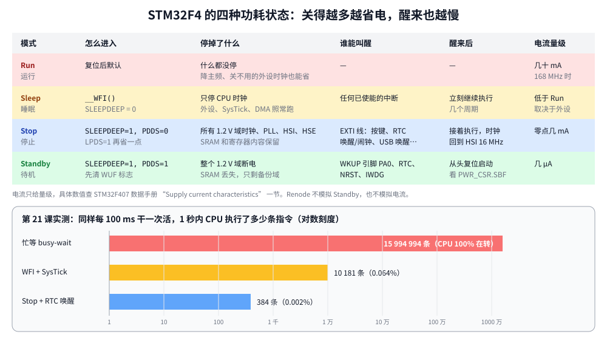

# 第 21 章　低功耗

## 本章目标

- 知道 STM32F4 的四种功耗状态：Run、Sleep、Stop、Standby，以及各自停掉了什么、谁能唤醒
- 用 `WFI` 进入 Sleep，用 `SLEEPDEEP` 进入 Stop，用 RTC 唤醒定时器定时醒来
- 了解 Run 模式下的省电手段：降频、关外设时钟、模拟模式的引脚
- 在模拟器里用“执行了多少条指令”代替电流表，直观比较三种写法

## 21.1 功耗从哪里来

CMOS 电路的功耗主要有两部分：

- **动态功耗** \(P \approx C \cdot V^2 \cdot f\)：每次翻转都给电容充放电。时钟停了，这部分就没了。
- **静态功耗（漏电）**：只要有电压就存在，只有断电才能消除。

所以省电的思路就两条：**停时钟**（降低 f，或者干脆为 0）和**断电**（V 为 0）。STM32 的低功耗模式就是这两种手段的不同组合。



| 模式 | 停掉的 | 电流量级 | 醒来 |
|------|--------|----------|------|
| Run | 无 | 几十 mA | — |
| Sleep | 只有 CPU 时钟 | 低于 Run | 任何中断，几个周期 |
| Stop | 1.2 V 域所有时钟（PLL、HSI、HSE） | 零点几 mA | EXTI 线，几 µs，时钟回到 HSI |
| Standby | 1.2 V 域断电 | 几 µA | WKUP 引脚、RTC、NRST、IWDG，等同复位 |

具体数值查数据手册“Supply current characteristics”一节，和主频、电压、开了哪些外设都有关。

## 21.2 Sleep：`WFI`

前面的章节里你已经用过它了：`delay_ms()` 在等待时执行 `__WFI()`（Wait For Interrupt），CPU 时钟停下来，直到任何一个已使能的中断到来。外设、DMA、SysTick 都照常工作。

```c
static void busy_wait_ms(uint32_t ms)
{
    uint32_t start = millis();
    while (millis() - start < ms) {             /* no WFI: the core never rests */
    }
}
```

和 `delay_ms()` 比，忙等的 CPU 一直在执行指令。两者的区别就在于有没有 `WFI`。

`SCB->SCR` 里还有一个 `SLEEPONEXIT` 位：置位后，中断处理函数返回时不回主程序，直接再睡。对于“所有工作都在中断里做”的程序，主循环可以只剩一条 `WFI`。

## 21.3 Stop：深度睡眠

```c
static void enter_stop_mode(void)
{
    PWR->CR &= ~PWR_CR_PDDS;                    /* deep sleep = Stop, not Standby */
    PWR->CR |= PWR_CR_LPDS;                     /* low-power regulator during Stop */
    SCB->SCR |= SCB_SCR_SLEEPDEEP_Msk;
    __WFI();                                    /* any EXTI line (here: 22, RTC) wakes us */
    SCB->SCR &= ~SCB_SCR_SLEEPDEEP_Msk;
    /* On silicon the system clock is now HSI. A PLL setup would be redone here. */
}
```

- `SLEEPDEEP` 是 Cortex-M 内核的位，表示“深度睡眠”；具体是 Stop 还是 Standby 由 ST 的 `PWR_CR.PDDS` 决定。
- Stop 模式下所有高速时钟都停了，SysTick、定时器、UART 都不工作，**只有 EXTI 线能唤醒**：GPIO 外部中断、RTC 闹钟（EXTI 17）、RTC 唤醒定时器（EXTI 22）、USB 唤醒等。RTC 用的 LSE 在备份域，不受影响。
- 醒来后系统时钟是 HSI 16 MHz。如果原来跑的是 PLL 168 MHz，要重新配置时钟（本课程一直用 HSI，所以不需要）。
- `LPDS=1` 让 Stop 期间用低功耗稳压器，更省电但唤醒稍慢。

### 用 RTC 唤醒定时器定时醒来

```c
    RTC->CR &= ~RTC_CR_WUCKSEL;                 /* 000: RTCCLK / 16 = 2048 Hz */
    RTC->WUTR = 2048u / 10u - 1u;               /* 205 ticks = 100.1 ms */

    EXTI->IMR |= EXTI_IMR_MR22;
    EXTI->RTSR |= EXTI_RTSR_TR22;
    NVIC_EnableIRQ(RTC_WKUP_IRQn);
```

RTC 的配置方法见第 20 章。还有一个容易忽略的点：进入 Stop 之前要关掉 SysTick 中断：

```c
    SysTick->CTRL &= ~SysTick_CTRL_TICKINT_Msk;  /* 1 kHz interrupts would end every Stop */
```

真芯片上 Stop 期间 SysTick 的时钟本身就停了，但如果它在 `WFI` 前一刻刚好挂起了中断，芯片会立刻醒来；Renode 则不区分 Sleep 和 Stop，SysTick 照常计数，不关的话每 1 ms 就醒一次。关掉它，两边的行为才一致。同理，产品里如果用 Sleep 模式，SysTick 每 1 ms 叫醒一次也是一笔开销——RTOS 的“tickless idle”做的就是这件事：空闲时关掉 tick，用低功耗定时器一直睡到下一个任务该醒的时候。

## 21.4 Standby：几乎全关

```c
static void enter_standby_mode(void)
{
    PWR->CR |= PWR_CR_CWUF;                     /* clear the wakeup flag */
    PWR->CSR |= PWR_CSR_EWUP;                   /* PA0 rising edge may wake us */
    PWR->CR |= PWR_CR_PDDS;
    SCB->SCR |= SCB_SCR_SLEEPDEEP_Msk;
    __WFI();                                    /* does not return */
}
```

Standby 把 1.2 V 内核域整个断电，SRAM 和寄存器内容全部丢失，只有备份域（RTC、备份寄存器、开启时的 4 KB 备份 SRAM）保留。醒来**就是一次复位**，程序从 `Reset_Handler` 重新开始，可以通过 `PWR_CSR.SBF` 判断“我是从 Standby 醒来的”。需要保存的状态要事先写进备份寄存器。

适合“每小时醒来采一次数据”这类场景：大部分时间几 µA。Renode 不模拟 Standby，所以例子里这个函数没有被调用。

## 21.5 Run 模式下的省电手段

不睡觉也能省很多：

- **降主频**：动态功耗和频率成正比。数据量不大时 16 MHz HSI 比 168 MHz PLL 省得多。还可以通过 `RCC_CFGR` 的 AHB/APB 分频器只降总线频率。
- **只开用到的外设时钟**：`RCC_xxxENR` 里每个位都是一个时钟门。另外还有一组 `RCC_xxxLPENR`，控制 Sleep 模式下哪些外设继续有时钟（复位值是全开，可以关掉不用的）。
- **不用的引脚设成模拟模式**：数字输入悬空时，施密特触发器可能来回翻转耗电。模拟模式彻底断开它。
- **用 DMA**：CPU 可以在传输期间睡觉（第 16 章）。
- **降低稳压器电压**：`PWR_CR.VOS` 选 Scale 2，主频上限降到 144 MHz，但功耗更低。

## 21.6 运行：模拟器里的“电流表”

Renode 不模拟电流，但能告诉你 CPU 执行了多少条指令。CPU 睡着时不执行指令，所以**指令数可以近似代表 CPU 消耗的能量**。

例子用三种方式各做 10 次同样的工作（每 100 ms 翻转一次绿灯），每个阶段开始时把阶段号写进 `RTC->BKP0R`：

```c
static void mark_phase(uint32_t phase)
{
    uart_flush();                               /* finish printing before measuring */
    RTC->BKP0R = phase;
}
```

[`stimulus.resc`](../examples/21-low-power/stimulus.resc) 在这个地址上挂了一个**写观察点钩子**（watchpoint hook），每次被写时用 Python 读取 CPU 的指令计数和虚拟时间：

```
set meter_hook
"""
import __builtin__
m = cpu.GetMachine()
now_instr = cpu.ExecutedInstructions
now_ms = m.LocalTimeSource.ElapsedVirtualTime.TotalMilliseconds
if hasattr(__builtin__, 'meter_phase'):
    di = now_instr - __builtin__.meter_instr
    dt = now_ms - __builtin__.meter_ms
    print("meter: phase %d  %5d ms  %9d instructions  (%6.3f%% of a CPU busy at 16 MIPS)" %
          (__builtin__.meter_phase, dt, di, 100.0 * di / (dt * 16000.0)))
__builtin__.meter_phase = value
__builtin__.meter_instr = now_instr
__builtin__.meter_ms = now_ms
"""
sysbus AddWatchpointHook 0x40002850 DoubleWord Write $meter_hook
```

这是 Renode 一个很有用的能力：**不改固件，在模拟器里给任何地址加探针**。

```bash
cd examples/21-low-power
make run
```

本机实际输出（`meter:` 行来自钩子，Makefile 里 `LOG_FILTER := ^meter:` 把它们筛出来）：

```
meter: phase 1    999 ms   15994994 instructions  (99.995% of a CPU busy at 16 MIPS)
meter: phase 2    999 ms      10181 instructions  ( 0.064% of a CPU busy at 16 MIPS)
meter: phase 3    996 ms        384 instructions  ( 0.002% of a CPU busy at 16 MIPS)
----- USART2 output -----
lesson 21: 10 jobs, one every 100 ms, three ways
done: 10 RTC wakeups in phase 3
```

- **忙等**：1 秒里 CPU 执行了约 1600 万条指令——Renode 默认按 16 MIPS 模拟，等于 CPU 一直在全速空转。
- **WFI + SysTick**：降到 1 万条。每 1 ms 还要被 SysTick 叫醒一次，执行中断处理函数和循环判断，大约 10 条指令一次。
- **Stop + RTC**：只有 384 条，每次唤醒约 38 条。只在真正需要干活时才醒。

对应到真芯片：忙等时一直是 Run 电流（几十 mA）；WFI 时大部分时间是 Sleep 电流；Stop 时大部分时间是零点几 mA。如果用电池供电，差别就是“几天”和“几个月”。

你可能还注意到，`make run` 跑得比前几课快——Renode 在 CPU 睡眠时直接快进虚拟时间，所以模拟器也“省电”了。

## 练习

1. 在 Stop 前后把 `PD13`（橙灯）点亮/熄灭，在日志里观察 LED 的时间线。
2. 给阶段 2 加上 `SLEEPONEXIT`：把 `job()` 挪进 SysTick 中断（每 100 次做一次），主循环只剩 `__WFI()`。指令数会变吗？
3. 改用按键（PA0，EXTI0）从 Stop 中唤醒，而不是 RTC。
4. 读数据手册的“Supply current characteristics”，估算：一个传感器节点每 10 秒醒来 5 ms（Run 16 MHz），其余时间 Stop，平均电流是多少？2000 mAh 的电池能用多久？

## 常见坑

- **SysTick 中断没关**：每 1 ms 被叫醒一次，Stop 形同虚设。
- **Stop 醒来后忘了重配时钟**：程序突然变慢，UART 波特率全错（PLL 没了，只剩 HSI）。
- **WFI 之前有挂起的中断**：会立刻返回，看起来“睡不着”。检查 EXTI、RTC 的标志有没有清。
- **调试器连着时功耗测不准**：`DBGMCU_CR` 的 `DBG_SLEEP/DBG_STOP` 位会让芯片在睡眠时保持时钟以便调试。测功耗时断开调试器。
- **Standby 醒来以为接着执行**：Standby 唤醒是复位，`WFI` 后面的代码永远不会运行。
- **GPIO 状态被忽略**：引脚上接着 LED 或上拉电阻，往往比芯片本身耗电多。

---

上一章：[第 20 章　RTC 与看门狗](20-rtc-watchdog.md)　｜　下一章：[第 22 章　FreeRTOS](22-freertos.md)
