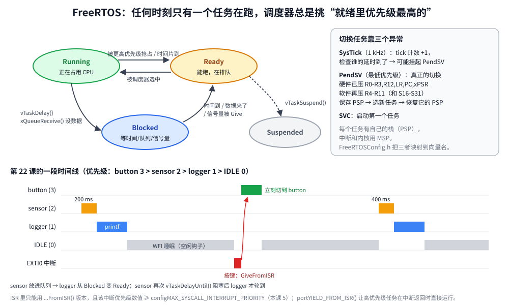

# 第 22 章　FreeRTOS：多任务

## 本章目标

- 明白什么时候需要 RTOS，它解决了“超级循环”的什么问题
- 理解任务、优先级、抢占、任务状态，以及 Cortex-M 上任务切换是怎么实现的（SysTick、PendSV、SVC）
- 把 FreeRTOS 内核源码加入工程并写 `FreeRTOSConfig.h`
- 使用任务、队列、二值信号量、互斥锁、软件定时器
- 从中断里安全地通知任务；理解中断优先级和 `configMAX_SYSCALL_INTERRUPT_PRIORITY`
- 检查每个任务的栈余量和堆使用量

## 22.1 为什么要 RTOS

前面所有例子都是“超级循环 + 中断”：

```c
for (;;) {
    if (button_flag) { ... }
    if (millis() - last > 200) { ... }
    if (uart_has_line()) { ... }
}
```

功能少时这很好。但当某一步要等待（等 I2C 传感器转换 50 ms、等网络回包），你要么卡住整个循环，要么把它拆成状态机。功能一多，所有逻辑就纠缠在一起，时序也难保证。

RTOS 让你把每件事写成一个独立的、可以**阻塞**的线性程序——“任务”。任务等待时让出 CPU，调度器去运行别的任务。代价是：每个任务要有自己的栈（RAM），任务间共享数据要加保护，调试也更复杂。

FreeRTOS 是最常用的 MCU RTOS：MIT 许可，内核只有几个 C 文件，ST、乐鑫、AWS 等都在用。

## 22.2 任务和调度



每个任务处于四种状态之一：

- **Running**：正在 CPU 上运行（单核上任何时刻只有一个）。
- **Ready**：可以运行，在等 CPU。
- **Blocked**：在等某个事件——延时到期、队列里来数据、信号量被释放。阻塞的任务**完全不消耗 CPU**。
- **Suspended**：被 `vTaskSuspend()` 挂起，直到 `vTaskResume()`。

调度规则很简单：**总是运行 Ready 状态里优先级最高的任务**。高优先级任务一旦变成 Ready（比如中断里给了它信号量），立刻抢占正在运行的低优先级任务。同优先级的任务每个 tick 轮流（时间片）。所有任务都阻塞时，运行优先级 0 的空闲任务。

### Cortex-M 上的任务切换

FreeRTOS 的 ARM_CM4F 移植用了三个异常：

- **SysTick**（1 kHz）：tick 计数加一，检查哪些任务的延时到期，需要切换时挂起 PendSV。
- **PendSV**（最低优先级）：真正的上下文切换。异常入口时硬件已经把 R0–R3、R12、LR、PC、xPSR 压到当前任务的栈上（第 7 章），PendSV 处理函数再把 R4–R11（用了 FPU 时还有 S16–S31）压栈，把栈指针保存到当前任务的控制块（TCB），取出新任务的栈指针，反向弹出。异常返回时，CPU 就“回到”了另一个任务。
- **SVC**：启动第一个任务。

任务用 **PSP**（进程栈指针），中断和内核用 **MSP**（主栈指针）——Cortex-M 天生就是为 RTOS 设计的。PendSV 设成最低优先级，保证切换总是在所有中断处理完后才发生。

## 22.3 把 FreeRTOS 加进工程

内核源码由 `examples/third_party/fetch.sh` 下载到 `third_party/freertos-kernel`（版本 V11.3.2）。需要的文件只有：

[`examples/22-freertos/Makefile`](../examples/22-freertos/Makefile)：

```makefile
RTOS := ../third_party/freertos-kernel

SRCS := main.c \
        $(RTOS)/tasks.c \
        $(RTOS)/queue.c \
        $(RTOS)/list.c \
        $(RTOS)/timers.c \
        $(RTOS)/portable/GCC/ARM_CM4F/port.c \
        $(RTOS)/portable/MemMang/heap_4.c

CPPFLAGS += -I$(RTOS)/include -I$(RTOS)/portable/GCC/ARM_CM4F
RUN_TIME := 1.3

include ../common/cmsis.mk
```

- `tasks.c`、`queue.c`（队列、信号量、互斥锁都基于它）、`list.c` 是内核；`timers.c` 是软件定时器。
- `port.c` 是 Cortex-M4F + GCC 的移植层（汇编写的 PendSV、SVC 处理函数）。
- `heap_4.c` 是内存分配器：从一个静态数组里分配，支持释放和合并空闲块。`heap_1` 只分配不释放；`heap_5` 支持多块不连续内存。

### `FreeRTOSConfig.h`

每个工程一份，决定内核的功能和参数。[完整文件](../examples/22-freertos/FreeRTOSConfig.h)里最关键的几项：

```c
#define configUSE_PREEMPTION                    1
#define configCPU_CLOCK_HZ                      (SystemCoreClock)
#define configTICK_RATE_HZ                      1000
#define configMAX_PRIORITIES                    5
#define configMINIMAL_STACK_SIZE                128    /* in words: 512 bytes */
#define configTOTAL_HEAP_SIZE                   (16 * 1024)

#define configCHECK_FOR_STACK_OVERFLOW          2
#define configUSE_MALLOC_FAILED_HOOK            1
#define configUSE_IDLE_HOOK                     1      /* sleeps with WFI, see main.c */

#define configPRIO_BITS                              4
#define configLIBRARY_LOWEST_INTERRUPT_PRIORITY      15
#define configLIBRARY_MAX_SYSCALL_INTERRUPT_PRIORITY 5
#define configKERNEL_INTERRUPT_PRIORITY      (configLIBRARY_LOWEST_INTERRUPT_PRIORITY << (8 - configPRIO_BITS))
#define configMAX_SYSCALL_INTERRUPT_PRIORITY (configLIBRARY_MAX_SYSCALL_INTERRUPT_PRIORITY << (8 - configPRIO_BITS))

/* The port's handlers take the names the vector table expects. */
#define vPortSVCHandler     SVC_Handler
#define xPortPendSVHandler  PendSV_Handler
#define xPortSysTickHandler SysTick_Handler
```

最后三行把移植层的函数名映射成启动文件向量表里的名字。这样 FreeRTOS 就接管了 SysTick——所以本课**不调用** `tick_init()`，也不用 `delay_ms()`，延时一律用 `vTaskDelay()`。

## 22.4 中断优先级：最容易出错的地方

F407 实现了 4 个优先级位，数值 0（最高）到 15（最低）。FreeRTOS 把它们分成两段：

- **0–4**：内核永远不会屏蔽它们，延迟最低，但**绝对不能调用任何 FreeRTOS API**。
- **5–15**：进入临界区时会被屏蔽（通过 `BASEPRI` 寄存器），可以调用 `...FromISR()` 结尾的 API。

```c
    /* Must be numerically >= configLIBRARY_MAX_SYSCALL_INTERRUPT_PRIORITY (5)
     * because the handler calls a FromISR API. */
    NVIC_SetPriority(EXTI0_IRQn, 6);
```

STM32 上中断的默认优先级是 0。如果忘了设置，又在中断里调用了 `xSemaphoreGiveFromISR()`，内核数据结构就可能被破坏，表现为随机死机。开启 `configASSERT` 后，移植层会检查这一点并断言失败。

## 22.5 示例程序

[`examples/22-freertos/main.c`](../examples/22-freertos/main.c) 有 4 个任务和 1 个软件定时器：

| 任务 | 优先级 | 做什么 | 用到的机制 |
|------|--------|--------|------------|
| `sensor` | 2 | 每 200 ms 产生一个读数 | `vTaskDelayUntil`、队列发送 |
| `logger` | 1 | 打印读数 | 队列接收（阻塞） |
| `button` | 3 | 处理按键 | 中断给出的二值信号量 |
| `monitor` | 1 | 1.2 s 后打印任务表，然后删除自己 | `uxTaskGetSystemState` |
| `blink`（定时器） | — | 每 250 ms 翻转蓝灯 | 软件定时器 |

### 创建任务并启动调度器

```c
    g_readings = xQueueCreate(4, sizeof(reading_t));
    g_button_sem = xSemaphoreCreateBinary();
    g_print_mutex = xSemaphoreCreateMutex();
    configASSERT(g_readings && g_button_sem && g_print_mutex);

    xTaskCreate(sensor_task, "sensor", 256, NULL, 2, NULL);
    xTaskCreate(logger_task, "logger", 256, NULL, 1, NULL);
    xTaskCreate(button_task, "button", 256, NULL, 3, NULL);
    xTaskCreate(monitor_task, "monitor", 384, NULL, 1, NULL);
    xTimerStart(xTimerCreate("blink", pdMS_TO_TICKS(250), pdTRUE, NULL, blink_timer), 0);

    vTaskStartScheduler();                  /* never returns unless the heap is too small */
```

栈大小的单位是**字**（4 字节），256 就是 1 KB。

### 队列：生产者和消费者

```c
static void sensor_task(void *arg)
{
    (void)arg;
    TickType_t last_wake = xTaskGetTickCount();
    for (uint32_t seq = 0;; seq++) {
        reading_t r = {seq, xTaskGetTickCount(), 200 + (int32_t)(seq * 7 % 13)};
        if (xQueueSend(g_readings, &r, 0) != pdPASS) {
            LOG("sensor: queue full, reading %lu dropped\n", (unsigned long)seq);
        }
        vTaskDelayUntil(&last_wake, pdMS_TO_TICKS(200));   /* fixed period, no drift */
    }
}

static void logger_task(void *arg)
{
    (void)arg;
    reading_t r;
    for (;;) {
        if (xQueueReceive(g_readings, &r, portMAX_DELAY) == pdPASS) {   /* sleeps until data */
            LOG("[%4lu ms] logger: reading #%lu = %ld (queued at %lu ms)\n",
                (unsigned long)xTaskGetTickCount(), (unsigned long)r.seq, (long)r.value,
                (unsigned long)r.when);
        }
    }
}
```

- 队列**按值复制**数据（这里每项 12 字节），发送方的局部变量随后可以复用。大数据就传指针，但要管好所有权。
- `vTaskDelayUntil` 相对于上次唤醒时间延时，周期不会因为任务本身的执行时间而漂移；`vTaskDelay` 是相对于现在。
- `portMAX_DELAY` 表示永远等下去。`logger` 大部分时间都阻塞在这里，不占 CPU。

### 中断通知任务

```c
void EXTI0_IRQHandler(void)
{
    BaseType_t woken = pdFALSE;
    EXTI->PR = EXTI_PR_PR0;
    xSemaphoreGiveFromISR(g_button_sem, &woken);
    portYIELD_FROM_ISR(woken);              /* switch right away if button_task outranks us */
}

static void button_task(void *arg)
{
    (void)arg;
    for (uint32_t presses = 1;; presses++) {
        xSemaphoreTake(g_button_sem, portMAX_DELAY);
        led_toggle(LED_ORANGE);
        LOG("[%4lu ms] button: press %lu handled in task context\n",
            (unsigned long)xTaskGetTickCount(), (unsigned long)presses);
    }
}
```

这是 RTOS 里处理中断的标准模式：**中断里只做最少的事**（清标志、通知任务），耗时的处理放在任务里。`woken` 告诉你这次 Give 有没有让一个比当前任务优先级更高的任务就绪；`portYIELD_FROM_ISR` 据此挂起 PendSV，中断一返回就直接切到 `button` 任务。

（更轻量的做法是**任务通知** `vTaskNotifyGiveFromISR` / `ulTaskNotifyTake`，不需要单独创建信号量对象。）

### 互斥锁保护共享资源

几个任务都调用 `printf`，它最终操作同一个 UART。如果 `logger` 打印到一半被 `button` 抢占，两行输出就会交错。用互斥锁包起来：

```c
#define LOG(...)                                         \
    do {                                                 \
        xSemaphoreTake(g_print_mutex, portMAX_DELAY);    \
        printf(__VA_ARGS__);                             \
        xSemaphoreGive(g_print_mutex);                   \
    } while (0)
```

互斥锁和二值信号量的区别：互斥锁有“所有者”，并实现了**优先级继承**——低优先级任务持有锁时，如果高优先级任务在等，低优先级任务临时提升到高优先级，避免被中等优先级任务长时间抢占（“优先级反转”）。

### 空闲钩子和调试钩子

```c
void vApplicationIdleHook(void)
{
    __WFI();                                /* nothing to run: sleep until the next interrupt */
}

void vApplicationStackOverflowHook(TaskHandle_t task, char *name)
{
    (void)task;
    printf("stack overflow in %s\n", name);
    for (;;) {
    }
}
```

`configCHECK_FOR_STACK_OVERFLOW = 2` 时，内核在每次切换任务时检查栈末尾的 16 字节填充图案有没有被改写。它不能捕获所有溢出，但开发阶段非常有用。

## 22.6 运行

```bash
cd examples/22-freertos
make run
```

[`stimulus.resc`](../examples/22-freertos/stimulus.resc) 在约 330 ms 和 780 ms 时各按一次按键。本机实际输出：

```
lesson 22: FreeRTOS, 4 tasks + 1 software timer
[   0 ms] logger: reading #0 = 200 (queued at 0 ms)
[ 200 ms] logger: reading #1 = 207 (queued at 200 ms)
[ 328 ms] button: press 1 handled in task context
[ 400 ms] logger: reading #2 = 201 (queued at 400 ms)
[ 600 ms] logger: reading #3 = 208 (queued at 600 ms)
[ 778 ms] button: press 2 handled in task context
[ 800 ms] logger: reading #4 = 202 (queued at 800 ms)
[1000 ms] logger: reading #5 = 209 (queued at 1000 ms)

task     state    prio  stack free (B)
monitor  running     1            1412
logger   ready       1             676
IDLE     ready       0             428
Tmr Svc  blocked     4             892
sensor   blocked     2             892
button   blocked     3             684
heap: 9088 bytes free, minimum ever 9088
[1203 ms] logger: reading #6 = 203 (queued at 1200 ms)
```

- 读数准确地每 200 ms 一个，入队和打印时间相同——`logger` 一收到数据就运行。
- 按键在中断发生后几乎立刻被 `button` 任务处理，没有等任何轮询。
- 任务表：`Tmr Svc` 是定时器服务任务，`blink` 回调在它里面运行。`stack free` 是栈的“高水位”——历史上最少还剩多少字节。`logger` 和 `button` 调用了 `printf`，用掉的栈明显更多。产品里根据这个数据调整栈大小，留 20%~30% 余量。
- 1200 ms 的读数在 1203 ms 才打印：`monitor` 当时持有打印锁，`logger` 等它打印完表格才能输出——互斥锁在起作用。
- Renode 日志里能看到蓝灯每 250 ms 翻转一次，橙灯在每次按键时翻转。

Renode 会对 FreeRTOS 写 NVIC 优先级寄存器（写入 0xFF，再读回看实现了几位）打出警告，可以忽略。

## 练习

1. 把 `sensor` 的周期改成 50 ms、`logger` 里加 `vTaskDelay(100)`，观察“queue full”。再把队列长度加大，或者提高 `logger` 优先级。
2. 用任务通知代替 `g_button_sem`。
3. 去掉 `LOG` 里的互斥锁，再给 `button` 加一个长一点的输出，看能不能制造输出交错。
4. 故意把 `monitor` 的栈改成 64 字，看栈溢出钩子是否被调用。
5. 把 EXTI0 的优先级改成 2，打开 `configASSERT` 看看会发生什么（提示：`port.c` 里的 `vPortValidateInterruptPriority`）。

## 常见坑

- **中断优先级数值小于 5 却调用了 FreeRTOS API**：随机死机，最难查的 RTOS 问题之一。
- **在中断里调用不带 `FromISR` 的 API**：同上。
- **栈太小**：`printf` 很吃栈（几百字节）。开启栈溢出检查，用高水位数据调整。
- **堆太小**：`xTaskCreate` 返回失败，或 `vTaskStartScheduler` 直接返回。检查返回值，开启 malloc 失败钩子。
- **在任务里忙等**：同优先级和低优先级任务全部饿死。等待一律用阻塞 API。
- **调度器启动前就用了 RTOS 对象**：比如中断在队列创建前就触发了。先创建对象，再使能中断。
- **两个模块都定义了 `SysTick_Handler`**：FreeRTOS 接管 SysTick 后，自己的 tick 代码要去掉（本课程的 `tick.c` 里它是弱符号，所以不冲突）。

---

上一章：[第 21 章　低功耗](21-low-power.md)　｜　下一章：[第 23 章　Bootloader](23-bootloader.md)
