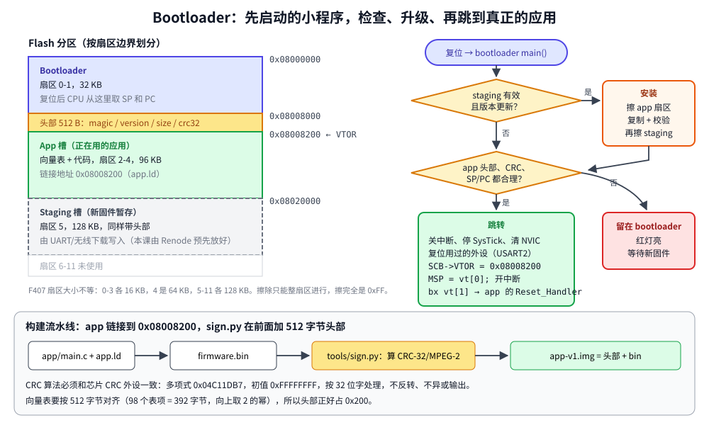

# 第 23 章　Bootloader 与固件升级

## 本章目标

- 理解 bootloader 是什么，为什么产品几乎都需要一个
- 规划 Flash 分区，给应用程序加一个带版本号和 CRC 的镜像头
- 用硬件 CRC 单元校验镜像，用 Flash 控制器擦除和编程
- 正确地从 bootloader 跳转到应用：`VTOR`、栈指针、复位外设
- 实现一个断电安全的“暂存区 → 应用区”升级流程，并在模拟器里演示升级和损坏检测

## 23.1 为什么需要 bootloader

到目前为止，你一直用调试器（或 Renode 的 `LoadELF`）把程序写进 Flash。产品出厂后没有调试器，固件升级只能靠程序自己：通过 UART、USB、CAN 或无线收到新固件，写进 Flash。

但程序不能安全地擦写自己正在运行的代码。所以把 Flash 分成两部分：

- **bootloader**：很小，几乎从不更新，复位后最先运行。它检查有没有新固件要安装、当前应用是否完好，然后跳转到应用。
- **应用**：真正的产品功能，可以随时被替换。

即使升级中途断电、新固件有 bug，只要 bootloader 还在，设备就能救回来，不会“变砖”。

（STM32 芯片里还有一个 ST 出厂固化在“系统存储器”里的 bootloader，BOOT0 引脚拉高时运行，支持通过 UART/USB DFU 烧写。它适合生产和救急，但不能定制升级逻辑，本章说的是你自己写的 bootloader。）

## 23.2 Flash 分区和镜像格式



F407 的 1 MB Flash 分成大小不等的**扇区**：0–3 号各 16 KB，4 号 64 KB，5–11 号各 128 KB。擦除只能以扇区为单位，所以分区边界要对齐扇区：

[`examples/23-bootloader/image.h`](../examples/23-bootloader/image.h)：

```c
/*
 * Flash layout and image header shared by the bootloader, the app and
 * tools/sign.py (which writes the header after the app is linked).
 *
 *   0x08000000  sectors 0-1   32 KB  bootloader
 *   0x08008000  sectors 2-4   96 KB  app slot:     header | vector table | code
 *   0x08020000  sector  5    128 KB  staging slot: a new image waiting to be installed
 */
#define APP_SLOT_ADDR      0x08008000u
#define APP_SLOT_SIZE      (96u * 1024u)
#define STAGING_SLOT_ADDR  0x08020000u
#define STAGING_SLOT_SIZE  (128u * 1024u)

/* The vector table must be aligned to its size rounded up to a power of two:
 * 16 + 82 entries = 392 bytes -> 512. The header fills the gap before it. */
#define IMAGE_HEADER_SIZE  0x200u
#define IMAGE_MAGIC        0x31474D49u          /* "IMG1" in memory */

typedef struct {
    uint32_t magic;
    uint32_t version;
    uint32_t size;      /* bytes after the header, a multiple of 4 */
    uint32_t crc32;     /* STM32 hardware CRC (CRC-32/MPEG-2) of those bytes */
} image_header_t;
```

每个镜像 = 512 字节的头 + 应用程序本身。头里有魔数（判断“这里有没有镜像”）、版本号（判断“是不是更新”）、长度和 CRC（判断“是不是完整的”）。

为什么头是 512 字节而不是 16 字节？因为头后面紧跟应用的向量表，`VTOR` 要求向量表地址按其大小（向上取整到 2 的幂）对齐。F407 的向量表是 392 字节，所以要 512 字节对齐。

## 23.3 让应用在另一个地址运行

应用只需要改链接脚本的 Flash 起始地址，其他和独立程序完全一样：

[`app/app.ld`](../examples/23-bootloader/app/app.ld)：

```
MEMORY
{
    FLASH (rx)  : ORIGIN = 0x08008200, LENGTH = 96K - 0x200
    RAM   (rwx) : ORIGIN = 0x20000000, LENGTH = 128K
}

_estack = ORIGIN(RAM) + LENGTH(RAM);

INCLUDE stm32f407-sections.ld
```

`stm32f407-sections.ld` 是所有课共用的段定义（第 3 章）；bootloader 的 [`bootloader.ld`](../examples/23-bootloader/bootloader/bootloader.ld) 也一样，只是 Flash 限制在前 32 KB。

链接完成后，[`tools/sign.py`](../examples/23-bootloader/tools/sign.py) 在 `.bin` 前面加上头：

```python
def crc32_stm32(data: bytes) -> int:
    """CRC-32/MPEG-2 over little-endian 32-bit words, as the STM32 CRC unit computes it."""
    crc = 0xFFFFFFFF
    for (word,) in struct.iter_unpack("<I", data):
        crc ^= word
        for _ in range(32):
            crc = ((crc << 1) ^ 0x04C11DB7) if crc & 0x80000000 else (crc << 1)
            crc &= 0xFFFFFFFF
    return crc
```

注意 STM32 的 CRC 单元**不是**常见的 zlib CRC-32：它按 32 位字处理，不反转位序，结果也不取反（这种算法叫 CRC-32/MPEG-2）。PC 端的算法必须和它完全一致。

## 23.4 校验镜像

[`bootloader/main.c`](../examples/23-bootloader/bootloader/main.c)：

```c
static uint32_t crc32_hw(const uint32_t *p, uint32_t words)
{
    RCC->AHB1ENR |= RCC_AHB1ENR_CRCEN;
    CRC->CR = CRC_CR_RESET;                 /* back to 0xFFFFFFFF */
    while (words--) {
        CRC->DR = *p++;
    }
    return CRC->DR;
}

static bool image_valid(const char *name, uint32_t slot, uint32_t slot_size)
{
    const image_header_t *h = header_at(slot);
    printf("  %s slot 0x%08lx: ", name, (unsigned long)slot);

    if (h->magic != IMAGE_MAGIC) {
        printf("no image\n");
        return false;
    }
    if (h->size == 0 || h->size % 4u || h->size > slot_size - IMAGE_HEADER_SIZE) {
        printf("bad size %lu\n", (unsigned long)h->size);
        return false;
    }
    const uint32_t *body = (const uint32_t *)(slot + IMAGE_HEADER_SIZE);
    uint32_t crc = crc32_hw(body, h->size / 4u);
    /* ... print version, size, crc ... */
    if (crc != h->crc32) {
        printf("but computed 0x%08lx: CORRUPT\n", (unsigned long)crc);
        return false;
    }

    /* The first two vector table entries must make sense before we trust them.
     * Every image is linked to run from the app slot, wherever it is stored. */
    uint32_t sp = body[0], pc = body[1];
    if (sp < SRAM1_BASE || sp > SRAM1_BASE + 128u * 1024u || (sp & 3u) || !(pc & 1u) ||
        pc < APP_SLOT_ADDR + IMAGE_HEADER_SIZE || pc >= APP_SLOT_ADDR + APP_SLOT_SIZE) {
        /* ... */
        return false;
    }
    printf("ok\n");
    return true;
}
```

硬件 CRC 每个字只要 4 个时钟周期，校验 96 KB 不到 1 ms。CRC 只能发现意外损坏；要防止别人装入恶意固件，还需要**数字签名**（比如 ECDSA，可以用 MCUboot 这类现成的方案）。

最后还检查了向量表的前两项：初始栈指针必须在 RAM 里、4 字节对齐；复位向量必须是 Thumb 地址（最低位为 1）且落在应用区内。这能挡住“CRC 碰巧对但链接地址错了”的镜像。

## 23.5 擦写 Flash

[`bootloader/flash.c`](../examples/23-bootloader/bootloader/flash.c)：

```c
void flash_unlock(void)
{
    if (FLASH->CR & FLASH_CR_LOCK) {
        FLASH->KEYR = 0x45670123u;          /* wrong order or value locks it until reset */
        FLASH->KEYR = 0xCDEF89ABu;
    }
}

uint32_t flash_erase_sector(unsigned sector)
{
    wait_ready();
    FLASH->SR = FLASH_ERRORS;                           /* rc_w1: write 1 to clear */
    /* PSIZE = x32: erase/program 32 bits at a time, valid for VDD 2.7-3.6 V. */
    FLASH->CR = FLASH_CR_PSIZE_1 | FLASH_CR_SER | (sector << FLASH_CR_SNB_Pos);
    FLASH->CR |= FLASH_CR_STRT;
    wait_ready();                                       /* 16 KB: ~0.5 s, 128 KB: ~1-2 s */
    FLASH->CR &= ~FLASH_CR_SER;
    return FLASH->SR & FLASH_ERRORS;
}

uint32_t flash_program(uint32_t addr, const uint32_t *src, size_t words)
{
    uint32_t err = 0;
    wait_ready();
    FLASH->SR = FLASH_ERRORS;
    FLASH->CR = FLASH_CR_PSIZE_1 | FLASH_CR_PG;
    for (size_t i = 0; i < words && !err; i++) {
        *(volatile uint32_t *)(addr + 4u * i) = src[i];   /* PG=1 turns this into a program */
        wait_ready();
        err = FLASH->SR & FLASH_ERRORS;
    }
    FLASH->CR &= ~FLASH_CR_PG;
    return err;
}
```

Flash 的物理特性决定了用法：

- **擦除**把整个扇区变成全 1（0xFF），很慢（秒级）。
- **编程**只能把 1 变成 0，所以写之前必须擦除。编程时 `PG=1`，然后像写 RAM 一样往 Flash 地址写一个字。
- 擦写期间如果 CPU 从**同一个 Bank** 取指令会被暂停（F407 只有一个 Bank），所以擦除时程序看起来“卡住”了。这也是看门狗超时要留够余量的原因（第 20 章）。
- 擦写次数有限（典型 1 万次），频繁保存的数据不要每次都擦扇区。

## 23.6 升级流程：断电也不怕

```c
static bool install_update(void)
{
    /* ... reject if not newer than the installed version ... */
    flash_unlock();
    int first = flash_sector_of(APP_SLOT_ADDR);
    int last = flash_sector_of(APP_SLOT_ADDR + APP_SLOT_SIZE - 1u);
    for (int s = first; s <= last; s++) {
        printf("  erase sector %d\n", s);
        if (flash_erase_sector((unsigned)s)) { /* ... */ }
    }
    printf("  program %lu bytes\n", (unsigned long)total);
    uint32_t err = flash_program(APP_SLOT_ADDR, (const uint32_t *)STAGING_SLOT_ADDR, total / 4u);
    if (!err) {
        /* Only drop the staged copy once the new app is known good, so a power
         * cut at any point leaves at least one complete image behind. */
        if (image_valid("new app", APP_SLOT_ADDR, APP_SLOT_SIZE)) {
            printf("  erase staging sector %d\n", flash_sector_of(STAGING_SLOT_ADDR));
            flash_erase_sector((unsigned)flash_sector_of(STAGING_SLOT_ADDR));
        } else {
            err = 1;
        }
    }
    flash_lock();
    return err == 0;
}
```

完整的升级过程分两步：

1. **应用**通过某种通信方式接收新固件，写进暂存区（本例中由 Renode 脚本直接装入，模拟“刚下载完”），然后复位。
2. **bootloader** 发现暂存区有一个有效的、更新的镜像，把它复制到应用区，校验通过后才擦除暂存区。

在任何一个时刻断电，重新上电后：暂存区还在 → 重新安装；暂存区已擦除 → 应用区一定是校验过的新版本。这就是“断电安全”。

这种方案叫“覆盖式”（overwrite）。更高级的有 **A/B 双分区**（两个都能运行，切换标志位，可以回滚）和 MCUboot 的“交换”（swap）方式。

## 23.7 跳转到应用

```c
static void __attribute__((noreturn)) jump_to_app(uint32_t vector_table)
{
    const uint32_t *vt = (const uint32_t *)vector_table;
    /* ... print ... */
    uart_flush();

    /* Hand over a chip that looks as close to reset as possible. */
    __disable_irq();
    SysTick->CTRL = 0;
    for (unsigned i = 0; i < 8; i++) {
        NVIC->ICER[i] = 0xFFFFFFFFu;
        NVIC->ICPR[i] = 0xFFFFFFFFu;
    }
    RCC->APB1RSTR |= RCC_APB1RSTR_USART2RST;
    RCC->APB1RSTR &= ~RCC_APB1RSTR_USART2RST;

    SCB->VTOR = vector_table;               /* the app's interrupts now use its own table */
    __DSB();
    __ISB();
    __enable_irq();                         /* ST's startup code never re-enables them */

    __asm volatile("msr msp, %0\n\t"
                   "bx  %1"
                   :
                   : "r"(vt[0]), "r"(vt[1])
                   : "memory");
    __builtin_unreachable();
}
```

回忆第 3 章：Cortex-M 复位时从地址 0 读初始栈指针、从地址 4 读复位向量。跳转到应用就是**用软件模拟这个过程**：

1. **让芯片尽量回到复位状态**：关中断、停 SysTick、禁用并清除所有挂起的中断、复位用过的外设。否则应用一开中断，可能立刻跳进一个它没准备好的中断。
2. **设置 `VTOR`**：以后发生中断时，CPU 从应用的向量表里取处理函数地址。忘了这一步，应用的中断会跳进 bootloader 的处理函数。
3. **设置 MSP** 为应用向量表第 0 项，然后**跳到**第 1 项（复位处理函数）。这两步要用汇编，因为改了 MSP 之后，C 代码的局部变量（在栈上）就不可信了。

`__enable_irq()` 那一行容易漏：ST 的启动代码不会执行 `cpsie i`，如果 bootloader 关了中断就跳转，应用里的所有中断都不会响应。

应用的 `main.c` 打印 `VTOR` 和自己向量表的地址来确认这一点，并启动 SysTick 验证中断确实能进到应用的处理函数里：

```c
    printf("app v%d: running, VTOR=0x%08lx, my vector table at 0x%08lx\n", APP_VERSION,
           (unsigned long)SCB->VTOR, (unsigned long)(uintptr_t)g_pfnVectors);

    tick_init(HSI_HZ);                      /* SysTick_Handler is found through VTOR */
```

## 23.8 运行三个场景

```bash
cd examples/23-bootloader
make run            # or: make run-valid / run-corrupt / run-update
```

[`Makefile`](../examples/23-bootloader/Makefile) 构建三个程序：bootloader、版本 1 的应用、版本 2 的应用（同一份源码，`APP_VERSION` 不同，v1 闪绿灯，v2 闪蓝灯），然后签名：

```
build/app-v1.img: version 1, 7996 bytes, crc 0xf9835c51
build/app-v2.img: version 2, 7996 bytes, crc 0x70fd08da
```

每个场景用不同的 Renode 脚本（通过 `STIMULUS=scenario-xxx.resc` 传给 `run.sh`），bootloader ELF 由 `run.sh` 装入，脚本再用 `sysbus LoadBinary` 把镜像放进 Flash。

**场景 1：正常启动**（[`scenario-valid.resc`](../examples/23-bootloader/scenario-valid.resc) 把 v1 放进应用区）

```
bootloader: started
  staging slot 0x08020000: no image
  app slot 0x08008000: version 1, 7996 bytes, crc 0xf9835c51 ok
bootloader: jump to app, VTOR=0x08008200 SP=0x20020000 PC=0x08009ef5
app v1: running, VTOR=0x08008200, my vector table at 0x08008200
app v1: SysTick interrupts work, t=150 ms
```

**场景 2：镜像损坏**（[`scenario-corrupt.resc`](../examples/23-bootloader/scenario-corrupt.resc) 装入 v1 后用 `sysbus WriteDoubleWord 0x08008400 0xDEADBEEF` 改坏一个字，模拟升级时断电或 Flash 单元损坏）

```
bootloader: started
  staging slot 0x08020000: no image
  app slot 0x08008000: version 1, 7996 bytes, crc 0xf9835c51 but computed 0x7d047639: CORRUPT
bootloader: no valid app, waiting for a new image
```

bootloader 拒绝运行损坏的程序，亮红灯等待。产品里这时应该进入“恢复模式”，通过串口接收新固件。

**场景 3：升级**（[`scenario-update.resc`](../examples/23-bootloader/scenario-update.resc) 应用区放 v1，暂存区放 v2，0.4 s 后按下按键让应用复位）

```
bootloader: started
  staging slot 0x08020000: version 2, 7996 bytes, crc 0x70fd08da ok
bootloader: installing version 2
  erase sector 2
  erase sector 3
  erase sector 4
  program 8508 bytes
  new app slot 0x08008000: version 2, 7996 bytes, crc 0x70fd08da ok
  erase staging sector 5
  app slot 0x08008000: version 2, 7996 bytes, crc 0x70fd08da ok
bootloader: jump to app, VTOR=0x08008200 SP=0x20020000 PC=0x08009ef5
app v2: running, VTOR=0x08008200, my vector table at 0x08008200
app v2: SysTick interrupts work, t=150 ms
app v2: button pressed, resetting
bootloader: started
  staging slot 0x08020000: no image
  app slot 0x08008000: version 2, 7996 bytes, crc 0x70fd08da ok
bootloader: jump to app, VTOR=0x08008200 SP=0x20020000 PC=0x08009ef5
app v2: running, VTOR=0x08008200, my vector table at 0x08008200
app v2: SysTick interrupts work, t=150 ms
```

- 第一次启动：安装 v2（8508 = 512 字节头 + 7996 字节程序），校验后擦除暂存区，跳到 v2。
- 按键后 `NVIC_SystemReset()` 复位芯片。Renode 的复位只重新装入 bootloader ELF，Flash 里 bootloader 写入的内容保留——和真芯片一样。
- 第二次启动：暂存区已空，直接运行 v2。

Renode 的 Flash 控制器模型做了简化：擦除瞬间完成并填充 0xFF，`PG` 位不检查（Flash 本身可以直接写），没写过的 Flash 读出 0 而不是 0xFF。这些差异不影响本例：魔数不对一律判为“no image”。

## 练习

1. 在 bootloader 里加一个“恢复模式”：上电时按住按键，就停在 bootloader，通过 UART 接收一个镜像（可以用简单的 XMODEM 协议或自定义的“长度 + 数据”格式）写进暂存区。
2. 在应用里实现接收：应用通过串口收到新镜像写进暂存区，再复位。注意：应用要能擦写扇区 5，但绝不能碰扇区 0–4。
3. 把 bootloader 区写保护：用选项字节 `nWRP` 保护扇区 0–1，防止应用的 bug 擦掉 bootloader。
4. 改成 A/B 双分区：两个应用区，头里加一个“已确认”标志。新版本第一次启动后若在 5 秒内没有确认（比如看门狗复位了），bootloader 回滚到旧版本。

## 常见坑

- **忘了设 `VTOR`**：应用一开中断就跳进 bootloader 的处理函数，表现为莫名其妙的 HardFault 或死循环。
- **向量表没有对齐**：`VTOR` 的低位被忽略，CPU 从错误的地址取中断向量。
- **跳转前没关外设和中断**：bootloader 开着的 UART 中断、SysTick 在应用初始化之前就触发了。
- **跳转后中断全不响应**：bootloader 关了中断，应用的启动代码不会重新打开。
- **应用的链接地址和实际存放地址不一致**：所有绝对地址都错了。本例的向量检查能发现这类错误。
- **CRC 算法和 PC 端不一致**：STM32 CRC 单元不是 zlib 的 CRC-32，见 23.3 节。
- **擦除时间太长触发看门狗**：128 KB 扇区可能要 2 秒，擦除前喂狗或把超时设长。
- **擦写 Flash 时中断响应变慢**：取指令会暂停，直到擦写完成。如果有必须及时响应的中断，要把处理函数和向量表放进 RAM。

---

上一章：[第 22 章　FreeRTOS](22-freertos.md)　｜　下一章：[第 24 章　USB](24-usb.md)
