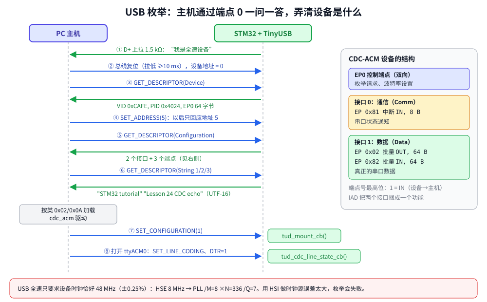

# 第 24 章　USB：做一个虚拟串口

## 本章目标

- 理解 USB 的基本概念：主机与设备、端点、传输类型、描述符、枚举
- 知道为什么 USB 必须用精确的 48 MHz 时钟，并把系统时钟配到 168 MHz
- 用开源协议栈 **TinyUSB** 实现一个 CDC-ACM 设备：插到电脑上就是一个串口
- 在真板上测试；了解模拟器在这里的局限

> 本章的例子**需要真实硬件**（第 15 章的 STM32F4DISCOVERY）。Renode 1.17 没有 STM32 OTG_FS 控制器的模型，例子在模拟器里只能编译和启动到“找不到 USB 控制器”。USB 的原理部分不依赖硬件，可以照常学习。

## 24.1 USB 基础

USB 是**主机主导**的总线：所有传输都由主机（PC）发起，设备只能回应。设备从不主动说话——即使“设备发数据给主机”，也是主机定期来问“有数据吗”。

**端点**（endpoint）是设备上的数据收发口，用 0–15 编号，加上方向位：`0x81` 是 1 号 IN 端点（设备 → 主机），`0x02` 是 2 号 OUT 端点（主机 → 设备）。每个设备都有**端点 0**，用于控制请求。

四种**传输类型**：

| 类型 | 特点 | 典型用途 |
|------|------|----------|
| 控制 Control | 有协议、保证送达 | 端点 0：枚举、配置 |
| 批量 Bulk | 保证送达，带宽有空余才传 | U 盘、串口数据 |
| 中断 Interrupt | 保证最大延迟，主机定期轮询 | 键盘、鼠标、状态通知 |
| 同步 Isochronous | 保证带宽，不重传 | 音频、视频 |

F407 有两个 USB 控制器：**OTG_FS**（全速 12 Mbit/s，内置 PHY，Discovery 板的 micro-USB 口 CN5 就接在它的 PA11/PA12 上）和 OTG_HS（高速 480 Mbit/s 需要外接 ULPI PHY）。两者都是 Synopsys 的 **DWC2** IP 核——很多芯片（ESP32-S2/S3、GD32、部分 NXP）用的是同一个核，所以驱动可以通用。

## 24.2 枚举：主机如何认识设备



设备插上后，主机通过端点 0 和设备一问一答：

1. 设备在 D+ 线上接 1.5 kΩ 上拉电阻，主机检测到“有全速设备插入”。
2. 主机**复位**总线，设备地址为 0。
3. 主机读**设备描述符**：厂商 ID（VID）、产品 ID（PID）、端点 0 的包大小。
4. 主机分配一个地址（`SET_ADDRESS`）。
5. 主机读**配置描述符**：有几个接口，每个接口属于什么类，用哪些端点。
6. 主机读**字符串描述符**：厂商名、产品名、序列号（UTF-16 编码）。
7. 主机根据接口的类选择驱动，发送 `SET_CONFIGURATION`，设备进入工作状态。

**描述符**就是设备的“自我介绍”。只要描述符说“我是 CDC 类”，Windows、Linux、macOS 都会自动加载内置的串口驱动，不需要安装任何东西。这就是 USB **类**（class）的意义：HID（键盘鼠标）、MSC（U 盘）、CDC（串口/网卡）、Audio、DFU（固件升级）等都有标准驱动。

## 24.3 48 MHz 时钟

USB 全速要求设备时钟误差不超过 ±0.25%。HSI 的精度是 ±1%，不满足要求，必须用外部晶振（Discovery 板上是 8 MHz HSE），并让 PLL 的 Q 输出正好 48 MHz：

[`examples/24-usb-cdc/main.c`](../examples/24-usb-cdc/main.c)：

```c
/*
 * HSE 8 MHz -> /M=8 -> 1 MHz -> xN=336 -> 336 MHz VCO
 *   /P=2 -> 168 MHz SYSCLK
 *   /Q=7 ->  48 MHz for USB (the USB core needs exactly 48 MHz)
 */
static void clock_init_168mhz(void)
{
    RCC->CR |= RCC_CR_HSEON;
    while (!(RCC->CR & RCC_CR_HSERDY)) {
    }
    RCC->APB1ENR |= RCC_APB1ENR_PWREN;
    PWR->CR |= PWR_CR_VOS;                              /* scale 1: required above 144 MHz */

    RCC->PLLCFGR = (8u << RCC_PLLCFGR_PLLM_Pos) | (336u << RCC_PLLCFGR_PLLN_Pos) |
                   (0u << RCC_PLLCFGR_PLLP_Pos) /* /2 */ | RCC_PLLCFGR_PLLSRC_HSE |
                   (7u << RCC_PLLCFGR_PLLQ_Pos);
    RCC->CR |= RCC_CR_PLLON;
    while (!(RCC->CR & RCC_CR_PLLRDY)) {
    }

    FLASH->ACR = FLASH_ACR_LATENCY_5WS | FLASH_ACR_PRFTEN | FLASH_ACR_ICEN | FLASH_ACR_DCEN;
    RCC->CFGR = RCC_CFGR_HPRE_DIV1 | RCC_CFGR_PPRE1_DIV4 | RCC_CFGR_PPRE2_DIV2 | RCC_CFGR_SW_PLL;
    while ((RCC->CFGR & RCC_CFGR_SWS) != RCC_CFGR_SWS_PLL) {
    }
    SystemCoreClock = SYSCLK_HZ;
}
```

这正是第 6 章讲过的时钟树配置，这次终于派上了用场：先设 Flash 等待周期再切换时钟，APB1 不超过 42 MHz（÷4）、APB2 不超过 84 MHz（÷2）。UART 的波特率也要按新的 PCLK1 = 42 MHz 计算：`uart_init(PCLK1_HZ, 115200)`。

引脚配置：

```c
static void usb_pins_init(void)
{
    RCC->AHB1ENR |= RCC_AHB1ENR_GPIOAEN;
    gpio_set_af(GPIOA, 11, 10);                         /* PA11 = DM, AF10 OTG_FS */
    gpio_set_af(GPIOA, 12, 10);                         /* PA12 = DP */
    GPIOA->OSPEEDR |= (3u << (11 * 2)) | (3u << (12 * 2));
    gpio_set_mode(GPIOA, 9, GPIO_MODE_INPUT);           /* PA9 = VBUS sense (5 V from host) */
    RCC->AHB2ENR |= RCC_AHB2ENR_OTGFSEN;
}
```

## 24.4 TinyUSB

USB 协议栈很复杂（枚举状态机、标准请求、类协议、端点 FIFO 管理），自己从寄存器写起要几千行。实际工作中都用现成的协议栈：

- **ST USB Device Library**（CubeMX 生成的那套）：和 HAL 绑定。
- **TinyUSB**：MIT 许可，支持几十个芯片系列，不依赖厂商 HAL，API 简洁。本章用它，由 `examples/third_party/fetch.sh` 下载（版本 0.21.0）。

### 加入工程

[`Makefile`](../examples/24-usb-cdc/Makefile)：

```makefile
TUSB := ../third_party/tinyusb/src

SRCS := main.c usb_descriptors.c \
        $(TUSB)/tusb.c \
        $(TUSB)/common/tusb_fifo.c \
        $(TUSB)/device/usbd.c \
        $(TUSB)/class/cdc/cdc_device.c \
        $(TUSB)/portable/synopsys/dwc2/dcd_dwc2.c \
        $(TUSB)/portable/synopsys/dwc2/dwc2_common.c

CPPFLAGS += -I$(TUSB)
```

`usbd.c` 是设备栈核心，`cdc_device.c` 是 CDC 类，`dcd_dwc2.c` 是 DWC2 控制器驱动（DCD = Device Controller Driver）。

配置在 [`tusb_config.h`](../examples/24-usb-cdc/tusb_config.h)：

```c
#define CFG_TUSB_MCU            OPT_MCU_STM32F4
#define CFG_TUSB_OS             OPT_OS_NONE         /* tud_task() is called from main's loop */

#define CFG_TUD_ENABLED         1
#define CFG_TUD_MAX_SPEED       OPT_MODE_FULL_SPEED /* the F407 OTG_FS port: 12 Mbit/s */
#define CFG_TUD_ENDPOINT0_SIZE  64

#define CFG_TUD_CDC             1
#define CFG_TUD_CDC_RX_BUFSIZE  64
#define CFG_TUD_CDC_TX_BUFSIZE  64
```

### 描述符

[`usb_descriptors.c`](../examples/24-usb-cdc/usb_descriptors.c) 提供描述符，TinyUSB 在主机请求时回调这些函数：

```c
static const tusb_desc_device_t desc_device = {
    .bLength = sizeof(tusb_desc_device_t),
    .bDescriptorType = TUSB_DESC_DEVICE,
    .bcdUSB = 0x0200,
    /* CDC uses two interfaces; an Interface Association Descriptor groups them,
     * which the spec requires to be announced with these three values. */
    .bDeviceClass = TUSB_CLASS_MISC,
    .bDeviceSubClass = MISC_SUBCLASS_COMMON,
    .bDeviceProtocol = MISC_PROTOCOL_IAD,
    .bMaxPacketSize0 = CFG_TUD_ENDPOINT0_SIZE,
    .idVendor = USB_VID,
    .idProduct = USB_PID,
    /* ... */
};

#define EPNUM_CDC_NOTIF 0x81    /* interrupt IN: serial state notifications */
#define EPNUM_CDC_OUT   0x02    /* bulk OUT: host -> device data */
#define EPNUM_CDC_IN    0x82    /* bulk IN:  device -> host data */

static const uint8_t desc_configuration[] = {
    /* config number, interface count, string index, total length, attributes, max power mA */
    TUD_CONFIG_DESCRIPTOR(1, ITF_NUM_TOTAL, 0, CONFIG_TOTAL_LEN, 0x00, 100),
    /* interface number, string index, notification EP and size, data EPs (out, in) and size */
    TUD_CDC_DESCRIPTOR(ITF_NUM_CDC, 4, EPNUM_CDC_NOTIF, 8, EPNUM_CDC_OUT, EPNUM_CDC_IN, 64),
};
```

一个 CDC-ACM 设备有两个接口：**通信接口**（一个中断端点，报告串口状态）和**数据接口**（一对批量端点，传真正的数据）。`TUD_CDC_DESCRIPTOR` 宏展开后是 66 字节的描述符数组，包括 IAD、两个接口描述符、CDC 功能描述符和三个端点描述符。

VID `0xCAFE` 是 TinyUSB 示例用的测试号，自己桌上用没问题；产品必须向 USB-IF 申请 VID，或使用芯片厂商提供的 PID 段。

### 主程序

```c
void OTG_FS_IRQHandler(void)
{
    tud_int_handler(0);                                 /* TinyUSB records events, tud_task() handles them */
}

void tud_mount_cb(void)
{
    printf("usb: configured by the host (enumeration done)\n");
    led_on(LED_GREEN);
}

void tud_cdc_line_state_cb(uint8_t itf, bool dtr, bool rts)
{
    (void)itf;
    (void)rts;
    printf("cdc: terminal %s\n", dtr ? "opened (DTR=1)" : "closed (DTR=0)");
    if (dtr) {
        tud_cdc_write_str("\r\nlesson 24: type a line, it comes back upper-cased\r\n");
        tud_cdc_write_flush();
    }
}

static void cdc_echo_task(void)
{
    if (!tud_cdc_available()) {
        return;
    }
    char buf[64];
    uint32_t n = tud_cdc_read(buf, sizeof buf);
    for (uint32_t i = 0; i < n; i++) {
        buf[i] = (char)toupper((unsigned char)buf[i]);
        if (buf[i] == '\r') {
            tud_cdc_write_char('\n');                   /* terminals send CR for Enter */
        }
        tud_cdc_write_char(buf[i]);
    }
    tud_cdc_write_flush();
    led_toggle(LED_BLUE);
}

int main(void)
{
    clock_init_168mhz();
    board_init_leds();
    uart_init(PCLK1_HZ, 115200);
    tick_init(SYSCLK_HZ);
    /* ... */
    usb_pins_init();
    tud_configure_dwc2_t cfg = CFG_TUD_CONFIGURE_DWC2_DEFAULT;
    cfg.vbus_sensing = true;                            /* PA9 is wired to VBUS on the Discovery */
    tud_configure(0, TUD_CFGID_DWC2, &cfg);

    tusb_rhport_init_t dev_init = {.role = TUSB_ROLE_DEVICE, .speed = TUSB_SPEED_AUTO};
    if (tusb_init(0, &dev_init)) {
        printf("usb: waiting for a host\n");
    } else {
        /* Reading the core's ID register (GSNPSID, 0x50000040) gave no DWC2 signature. */
        printf("usb: no USB controller found, stack not started\n");
        led_on(LED_RED);
    }

    for (;;) {
        tud_task();                                     /* handles queued USB events, never blocks */
        cdc_echo_task();
    }
}
```

TinyUSB 的结构和第 22 章的“中断只做最少的事”一致：`OTG_FS_IRQHandler` 只把事件放进队列，`tud_task()` 在主循环里处理事件、回应主机请求、调用你的回调。用 FreeRTOS 时，把 `CFG_TUSB_OS` 设为 `OPT_OS_FREERTOS`，`tud_task()` 放在一个专门的任务里，它会阻塞等待事件。

DTR（Data Terminal Ready）是串口的一根控制线：终端程序打开端口时主机把它置 1。所以 `line_state` 回调是“有人在听”的信号，此时再发欢迎语，不会丢。

## 24.5 在模拟器里

```bash
cd examples/24-usb-cdc
make run
```

本机实际输出：

```
lesson 24: USB CDC, SYSCLK 168 MHz, USB clock 48 MHz
usb: no USB controller found, stack not started
```

Renode 没有 OTG_FS 模型，0x50000000 处的寄存器全部读出 0。TinyUSB 初始化时读 `GSNPSID` 寄存器检查是不是 DWC2 核，失败后返回 false。程序检查了返回值并亮红灯——即使在真芯片上，**检查初始化函数的返回值**也是好习惯。

时钟配置部分在 Renode 里能正常跑（PLL 立即就绪），所以第一行输出说明 168 MHz 配置和 42 MHz PCLK1 下的 UART 波特率计算都没问题。

## 24.6 在真板上测试

1. 编译并烧写（第 15 章）：

   ```bash
   cd examples/24-usb-cdc
   make
   openocd -f board/stm32f4discovery.cfg -c "program build/firmware.elf verify reset exit"
   ```

2. 把 USB-TTL 模块接到 PA2/PA3 看日志（第 15 章），然后用第二根线连接 Discovery 板的 **micro-USB 口 CN5**（不是 ST-LINK 用的 mini-USB 口）和电脑。日志应该是：

   ```
   lesson 24: USB CDC, SYSCLK 168 MHz, USB clock 48 MHz
   usb: waiting for a host
   usb: configured by the host (enumeration done)
   cdc: host set 115200 baud, 8 data bits
   ```

   （具体的 line coding 由主机和终端程序决定。）

3. **Linux**（WSL 先用 `usbipd attach` 把这个设备也转进去，见第 15 章）：

   ```bash
   lsusb | grep cafe          # ID cafe:4024 STM32 tutorial Lesson 24 CDC echo
   dmesg | tail               # cdc_acm 1-1:1.0: ttyACM0: USB ACM device
   picocom /dev/ttyACM0       # 波特率无所谓，Ctrl-A Ctrl-X 退出
   ```

   打开终端时日志里出现 `cdc: terminal opened (DTR=1)`，终端里出现欢迎语。输入 `hello`，回显 `HELLO`。

4. **Windows 10/11** 自带 CDC 驱动，设备管理器的“端口 (COM 和 LPT)”下会出现“USB 串行设备 (COMx)”，用 PuTTY 打开即可。

5. 拔掉 USB 线，日志出现 `usb: unplugged`，绿灯熄灭。

如果枚举失败（Windows 提示“无法识别的 USB 设备”，`dmesg` 里出现 `device descriptor read/64, error -71`），先检查时钟：用示波器或 MCO 引脚（PA8）确认 48 MHz，再检查 HSE 是否起振。

## 练习

1. 把 USART2 收到的数据转发到 USB、USB 收到的数据转发到 USART2，做一个 USB 转串口桥（在 `tud_cdc_line_coding_cb` 里按主机设置的波特率重配 UART）。
2. 序列号改为读取芯片的 96 位唯一 ID（地址 `0x1FFF7A10`），这样同一台电脑上插多块板子也能区分。
3. 增加第二个 CDC 接口（`CFG_TUD_CDC 2`），电脑上会出现两个串口。
4. 改成 HID 键盘：按下用户按键时“输入”一个字符串（参考 TinyUSB 的 `examples/device/hid_composite`）。
5. 用 FreeRTOS 运行 TinyUSB：`OPT_OS_FREERTOS`，`tud_task()` 放在单独任务中。

## 常见坑

- **用 HSI 当时钟源**：枚举时好时坏，或完全失败。USB 必须用 HSE。
- **PLL Q 不是 48 MHz**：比如为了 180 MHz 主频改了 N，忘了 Q 也跟着变。
- **VBUS 检测设置与硬件不符**：板子没有把 VBUS 接到 PA9 却开了 `vbus_sensing`，设备永远不上拉 D+，主机看不到它。CubeMX 里对应的是“VBUS sensing”选项。
- **描述符长度算错**：配置描述符的 `wTotalLength` 必须等于实际字节数，否则主机拒绝。用 TinyUSB 的宏可以避免。
- **在回调里长时间阻塞**：`tud_task()` 不能及时运行，主机请求超时。
- **同一 VID/PID 换了描述符结构**：Windows 会缓存驱动信息，改了接口布局后要换 PID 或在设备管理器里卸载旧设备。
- **调试器暂停时 USB 断开**：断点停住时设备不能回应主机，主机会认为设备掉线。

---

上一章：[第 23 章　Bootloader](23-bootloader.md)　｜　下一章：[第 25 章　单元测试与 CI](25-testing-ci.md)
