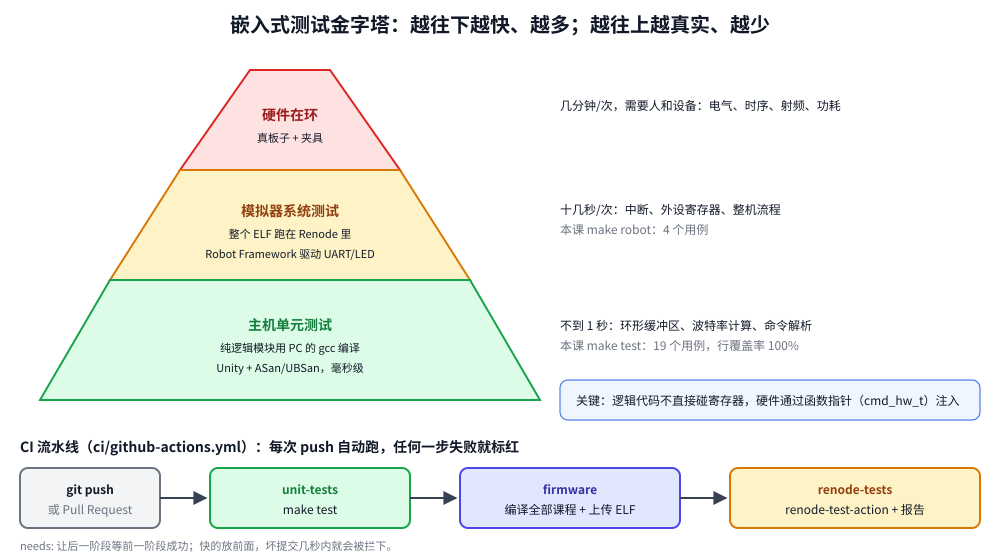

# 第 25 章　单元测试与持续集成

## 本章目标

- 把代码分成“纯逻辑”和“硬件访问”两层，让大部分代码能在 PC 上测试
- 用 **Unity** 测试框架写单元测试，用假的硬件接口（fake）测试依赖硬件的逻辑
- 用 AddressSanitizer、UndefinedBehaviorSanitizer 和 gcov 覆盖率在 PC 上抓 bug
- 用 Renode + Robot Framework 对真实固件做**系统测试**：通过串口发命令、检查 LED
- 用 GitHub Actions 在每次提交时自动跑完所有测试

## 25.1 嵌入式代码为什么难测，怎么办

在板子上测试很慢：编译、烧写、手动操作、看结果，一轮几分钟；很多边界情况（缓冲区刚好满、计数器溢出、非法输入）手动几乎测不到。

办法是**分层**：



- **单元测试**（最多、最快）：把不碰寄存器的代码——协议解析、环形缓冲区、数学计算、状态机——编译成 PC 程序测试，几毫秒跑完几百个用例，还能用 PC 上强大的检查工具。
- **系统测试**（较少）：在 Renode 里运行**完全相同的固件 ELF**，像用户一样通过串口操作，检查输出和引脚状态。不需要硬件，可以在 CI 服务器上跑。
- **硬件测试**（最少）：最终在真板上验证时序、电气特性等模拟器做不到的东西。

能这样分层的前提是代码结构：**业务逻辑不直接访问硬件**。

## 25.2 例子的结构

[`examples/25-testing`](../examples/25-testing) 是第 9 章那种串口命令行的改进版：

```
25-testing/
├── src/                 # 纯逻辑：PC 和 STM32 都能编译
│   ├── ringbuf.c/.h     # 中断与主循环之间的环形缓冲区
│   ├── baud.c/.h        # 波特率寄存器计算
│   └── cmd.c/.h         # 命令解析与执行
├── firmware/main.c      # 硬件胶水：UART 中断、LED，调用 src/
├── test/
│   ├── test_ringbuf.c   # 单元测试（Unity）
│   ├── test_baud.c
│   ├── test_cmd.c
│   └── firmware.robot   # 系统测试（Renode + Robot Framework）
├── ci/github-actions.yml
└── Makefile
```

`Makefile` 把同一批源文件构建两次：

```makefile
SRCS := firmware/main.c src/ringbuf.c src/baud.c src/cmd.c
CPPFLAGS += -Isrc
include ../common/cmsis.mk               # make: firmware for the STM32

HOST_CC     := gcc
HOST_CFLAGS := -std=c11 -g -O0 -Wall -Wextra -Werror -Isrc -I$(UNITY)
SANITIZE    := -fsanitize=address,undefined -fno-omit-frame-pointer -fno-sanitize-recover=all

$(HOST_BUILD)/test_%: test/test_%.c $(MODULES) $(UNITY)/unity.c
	@mkdir -p $(dir $@)
	$(HOST_CC) $(HOST_CFLAGS) $(EXTRA_HOST_FLAGS) $^ -o $@

test: EXTRA_HOST_FLAGS := $(SANITIZE)
test: $(addprefix $(HOST_BUILD)/test_,$(TESTS))
	@for t in $^; do echo "== $$t"; ./$$t || exit 1; done
```

## 25.3 被测代码：环形缓冲区

[`src/ringbuf.c`](../examples/25-testing/src/ringbuf.c) 是一个单生产者（中断）、单消费者（主循环）的无锁环形缓冲区：

```c
typedef struct {
    uint8_t *buf;
    uint32_t mask;              /* size - 1; size is a power of two */
    volatile uint32_t head;     /* total bytes ever written; only the producer changes it */
    volatile uint32_t tail;     /* total bytes ever read; only the consumer changes it */
} ringbuf_t;

/* head and tail run freely and wrap at 2^32; unsigned subtraction still gives
 * the right count, and masking gives the array index. */
uint32_t rb_count(const ringbuf_t *rb)
{
    return rb->head - rb->tail;
}

bool rb_put(ringbuf_t *rb, uint8_t byte)
{
    uint32_t head = rb->head;
    if (head - rb->tail > rb->mask) {
        return false;
    }
    rb->buf[head & rb->mask] = byte;
    rb->head = head + 1u;       /* publish only after the byte is stored */
    return true;
}
```

`head` 和 `tail` 是“写过/读过的总字节数”，不在到达数组末尾时回绕，所以“满”和“空”不需要额外的标志位，数组的每个字节都能用上。它的正确性依赖无符号整数的回绕——这正是适合单元测试的那种细节。

固件里，UART 接收中断往里放，主循环往外取：

```c
void USART2_IRQHandler(void)
{
    if (USART2->SR & USART_SR_RXNE) {
        if (!rb_put(&g_rx, (uint8_t)USART2->DR)) {
            g_rx_dropped++;
        }
    }
}
```

## 25.4 Unity 单元测试

**Unity** 是一个为嵌入式 C 设计的测试框架，只有一个 `.c` 和两个头文件，由 `examples/third_party/fetch.sh` 下载（版本 v2.6.1）。每个测试是一个函数，`setUp()` 和 `tearDown()` 在每个测试前后运行：

[`test/test_ringbuf.c`](../examples/25-testing/test/test_ringbuf.c)：

```c
static uint8_t storage[8];
static ringbuf_t rb;

void setUp(void)
{
    TEST_ASSERT_TRUE(rb_init(&rb, storage, sizeof storage));
}

static void test_holds_exactly_size_bytes(void)
{
    for (int i = 0; i < 8; i++) {
        TEST_ASSERT_TRUE(rb_put(&rb, (uint8_t)i));
    }
    TEST_ASSERT_FALSE(rb_put(&rb, 99));         /* full: rejected, nothing overwritten */
    TEST_ASSERT_EQUAL_UINT32(8, rb_count(&rb));
    uint8_t b;
    rb_get(&rb, &b);
    TEST_ASSERT_EQUAL_UINT8(0, b);
}

static void test_counters_wrap_at_2_pow_32(void)
{
    /* White-box: after ~4 billion bytes the free-running counters overflow. */
    rb.head = rb.tail = UINT32_MAX - 1u;
    for (int i = 0; i < 5; i++) {
        TEST_ASSERT_TRUE(rb_put(&rb, (uint8_t)i));
    }
    TEST_ASSERT_EQUAL_UINT32(5, rb_count(&rb));
    /* ... and they come out in order ... */
}

int main(void)
{
    UNITY_BEGIN();
    RUN_TEST(test_new_buffer_is_empty);
    RUN_TEST(test_bytes_come_out_in_order);
    RUN_TEST(test_holds_exactly_size_bytes);
    RUN_TEST(test_wraps_around_the_array);
    RUN_TEST(test_counters_wrap_at_2_pow_32);
    RUN_TEST(test_rejects_sizes_that_are_not_powers_of_two);
    return UNITY_END();
}
```

`test_counters_wrap_at_2_pow_32` 测的是要传 40 亿字节才会出现的情况——在板子上 115200 波特率要跑 4 天，在 PC 上不到 1 微秒。

[`test/test_baud.c`](../examples/25-testing/test/test_baud.c) 则把第 8 章手算的 BRR 值固定下来：

```c
static void test_brr_for_115200_at_16mhz_matches_chapter_8(void)
{
    TEST_ASSERT_EQUAL_HEX32(0x8B, uart_brr(16000000, 115200));
    TEST_ASSERT_EQUAL_UINT32(115107, uart_baud_from_brr(16000000, 0x8B));
}
```

## 25.5 用假硬件测试依赖硬件的逻辑

命令解释器要点亮 LED、读时间，怎么在 PC 上测？让它通过一个**函数指针结构体**访问硬件，而不是直接调用 `led_on()`：

[`src/cmd.h`](../examples/25-testing/src/cmd.h)：

```c
typedef struct {
    void (*led_set)(int led, bool on);
    uint32_t (*millis)(void);
} cmd_hw_t;

int cmd_execute(const char *line, char *out, size_t out_len, const cmd_hw_t *hw);
```

固件传入真实实现：

```c
static const cmd_hw_t g_hw = {board_led_set, millis};
    /* ... */
    cmd_execute(line, reply, sizeof reply, &g_hw);
```

测试传入**假实现**（fake），它只记录被调用的情况：

[`test/test_cmd.c`](../examples/25-testing/test/test_cmd.c)：

```c
static int fake_led_calls;
static int fake_last_led;
static bool fake_last_on;
static uint32_t fake_now_ms;

static void fake_led_set(int led, bool on)
{
    fake_led_calls++;
    fake_last_led = led;
    fake_last_on = on;
}

static uint32_t fake_millis(void)
{
    return fake_now_ms;
}

static const cmd_hw_t hw = {fake_led_set, fake_millis};

static void test_led_red_on(void)
{
    TEST_ASSERT_EQUAL_INT(0, cmd_execute("led red on", out, sizeof out, &hw));
    TEST_ASSERT_EQUAL_STRING("ok", out);
    TEST_ASSERT_EQUAL_INT(1, fake_led_calls);
    TEST_ASSERT_EQUAL_INT(CMD_LED_RED, fake_last_led);
    TEST_ASSERT_TRUE(fake_last_on);
}

static void test_bad_led_arguments_touch_nothing(void)
{
    TEST_ASSERT_EQUAL_INT(-1, cmd_execute("led purple on", out, sizeof out, &hw));
    TEST_ASSERT_EQUAL_INT(-1, cmd_execute("led red maybe", out, sizeof out, &hw));
    TEST_ASSERT_EQUAL_INT(-1, cmd_execute("led red", out, sizeof out, &hw));
    TEST_ASSERT_EQUAL_INT(0, fake_led_calls);
    TEST_ASSERT_EQUAL_STRING("error: usage: led <green|orange|red|blue> <on|off>", out);
}

static void test_uptime_uses_the_clock(void)
{
    fake_now_ms = 4321;
    cmd_execute("uptime", out, sizeof out, &hw);
    TEST_ASSERT_EQUAL_STRING("uptime 4321 ms", out);
}

static void test_reply_is_truncated_not_overflowed(void)
{
    char tiny[8];
    memset(tiny, '#', sizeof tiny);
    cmd_execute("help", tiny, sizeof tiny, &hw);
    TEST_ASSERT_EQUAL_STRING("command", tiny);   /* 7 chars + NUL */
}
```

假时钟可以设成任意值，测试“运行了 49 天”之类的场景也不用等。这种做法也叫**依赖注入**：C++ 里可以用虚函数接口或模板参数，C 里用函数指针结构体，或者在链接时用测试版本替换实现（“链接时替换”）。

## 25.6 运行单元测试

```bash
cd examples/25-testing
make test
```

本机实际输出（编译命令略）：

```
== build/host/test_ringbuf
test/test_ringbuf.c:85:test_new_buffer_is_empty:PASS
test/test_ringbuf.c:86:test_bytes_come_out_in_order:PASS
test/test_ringbuf.c:87:test_holds_exactly_size_bytes:PASS
test/test_ringbuf.c:88:test_wraps_around_the_array:PASS
test/test_ringbuf.c:89:test_counters_wrap_at_2_pow_32:PASS
test/test_ringbuf.c:90:test_rejects_sizes_that_are_not_powers_of_two:PASS

-----------------------
6 Tests 0 Failures 0 Ignored 
OK
== build/host/test_baud
test/test_baud.c:36:test_brr_for_115200_at_16mhz_matches_chapter_8:PASS
test/test_baud.c:37:test_brr_rounds_to_nearest:PASS
test/test_baud.c:38:test_error_is_small_for_common_rates:PASS
test/test_baud.c:39:test_error_of_115200_at_16mhz:PASS

-----------------------
4 Tests 0 Failures 0 Ignored 
OK
== build/host/test_cmd
test/test_cmd.c:111:test_led_red_on:PASS
...
test/test_cmd.c:119:test_reply_is_truncated_not_overflowed:PASS

-----------------------
9 Tests 0 Failures 0 Ignored 
OK
```

测试失败时是什么样？把 `rb_put` 里的 `>` 改成 `>=`（一个典型的差一错误，缓冲区少存一个字节），再 `make test`：

```
test/test_ringbuf.c:36:test_holds_exactly_size_bytes:FAIL: Expected TRUE Was FALSE
...
6 Tests 1 Failures 0 Ignored 
FAIL
```

文件名和行号直接指向失败的断言，`make` 返回非零，CI 会把这次提交标红。

### Sanitizer：让 PC 帮你查内存错误

`make test` 用了 `-fsanitize=address,undefined`：

- **AddressSanitizer** 检查数组越界、使用已释放的内存、栈溢出等。MCU 上越界写通常不会立刻崩溃，而是悄悄改坏别的变量——这类 bug 在 PC 上一跑就现形。
- **UndefinedBehaviorSanitizer** 检查有符号整数溢出、移位超过位宽、空指针解引用、未对齐访问等未定义行为。

这是在 PC 上测试嵌入式代码的另一大好处：MCU 上没有这些工具。

### 覆盖率

```bash
make coverage
```

```
File 'src/ringbuf.c'
Lines executed:100.00% of 24
File 'src/baud.c'
Lines executed:100.00% of 7
File 'src/cmd.c'
Lines executed:100.00% of 53
```

`--coverage` 让 gcc 插桩，运行后 `gcov` 统计每一行执行了几次。覆盖率低说明有代码没测到；但 100% 不代表没有 bug——它只说明每行都跑过，不说明每种情况都对。

## 25.7 系统测试：在 Renode 里测试固件

单元测试测不到硬件胶水：中断有没有使能、UART 配置对不对、LED 引脚接对没有。这部分用 Renode 跑**真实固件**来测。

先看看固件手动运行的样子：

```bash
make run
```

```
lesson 25: command shell, type help
> help
commands: help, led <color> <on|off>, baud <pclk_hz> <baud>, uptime
> led red on
ok
> baud 16000000 115200
BRR=139 (0x008b), actual 115107 baud, error -807 ppm
> uptime
uptime 201 ms
>
```

[`stimulus.resc`](../examples/25-testing/stimulus.resc) 用 `sysbus.usart2 WriteLine "..."` 模拟键盘输入。把“输入 → 检查输出”写成自动化测试，就是 **Robot Framework**。Renode 自带 Robot 关键字库，`renode-test` 命令负责启动 Renode 并运行测试。

[`test/firmware.robot`](../examples/25-testing/test/firmware.robot)：

```
*** Variables ***
${ELF}          ${CURDIR}/../build/firmware.elf
${BOARD}        ${CURDIR}/../../common/board.resc
${UART}         sysbus.usart2
${PROMPT}       >

*** Keywords ***
Boot Firmware
    Execute Command          $bin=@${ELF}
    Execute Command          include @${BOARD}
    Create Terminal Tester   ${UART}    timeout=1    defaultPauseEmulation=true
    Start Emulation
    Wait For Line On Uart    lesson 25: command shell
    Wait For Prompt On Uart  ${PROMPT}

Send Command
    [Arguments]    ${command}
    Write Line To Uart       ${command}    waitForEcho=true

*** Test Cases ***
Turns The Red LED On And Off
    Boot Firmware
    Create LED Tester        sysbus.gpioPortD.RedLED    defaultTimeout=0.1
    Assert LED State         false
    Send Command             led red on
    Wait For Line On Uart    ok
    Assert LED State         true
    Send Command             led red off
    Wait For Line On Uart    ok
    Assert LED State         false

Rejects Unknown Commands
    Boot Firmware
    Send Command             selfdestruct
    Wait For Line On Uart    error: unknown command 'selfdestruct'
```

- Robot 的语法是“关键字 + 参数”，用**两个以上空格**分隔。
- `Boot Firmware` 是自定义关键字：装入 ELF、加载第 1 章以来一直在用的 `board.resc`、在 USART2 上挂一个终端测试器。
- `Wait For Line On Uart` 在超时（这里是 1 秒**虚拟时间**）内等待一行包含指定文本的输出。`defaultPauseEmulation=true` 让模拟在匹配后暂停，测试步骤之间时间不会流逝，结果完全可重复。
- `Create LED Tester` + `Assert LED State` 检查 `board.repl` 里定义的 LED 的状态——测的是真实的 GPIO 寄存器写入。
- 每个测试用例结束后，`renode-test` 自动执行 `Reset Emulation` 清空模拟，所以每个用例都从 `Boot Firmware` 开始，互不影响。

### 安装和运行

`renode-test` 需要几个 Python 包（Robot Framework 等），装在一个独立的虚拟环境里，不影响系统：

```bash
python3 -m venv ~/.local/opt/renode-venv
~/.local/opt/renode-venv/bin/pip install -r ~/.local/opt/renode/tests/requirements.txt
```

运行：

```bash
source ~/.local/opt/renode-venv/bin/activate
make robot RENODE_TEST=~/.local/opt/renode/renode-test
deactivate
```

本机实际输出：

```
cd build && /home/zackzh/.local/opt/renode/renode-test ../test/firmware.robot
...
+++++ Starting test 'firmware.Prints Help'
+++++ Finished test 'firmware.Prints Help' in 10.23 seconds with status OK
+++++ Starting test 'firmware.Turns The Red LED On And Off'
+++++ Finished test 'firmware.Turns The Red LED On And Off' in 4.27 seconds with status OK
+++++ Starting test 'firmware.Computes A Baud Rate Divider'
+++++ Finished test 'firmware.Computes A Baud Rate Divider' in 3.36 seconds with status OK
+++++ Starting test 'firmware.Rejects Unknown Commands'
+++++ Finished test 'firmware.Rejects Unknown Commands' in 2.99 seconds with status OK
Suite ../test/firmware.robot finished successfully in 21.88 seconds.
...
Report:  /home/zackzh/workspace/mcu/stm32/examples/25-testing/build/report.html
Tests finished successfully :)
```

用浏览器打开 `build/log.html` 能看到每个关键字的执行过程和 UART 内容，失败时这是第一手资料。

## 25.8 持续集成（CI）

**持续集成**就是每次提交代码，服务器自动构建并运行所有测试，有问题立刻知道是哪次提交引入的。[`ci/github-actions.yml`](../examples/25-testing/ci/github-actions.yml) 是一个 GitHub Actions 配置，复制到仓库根目录的 `.github/workflows/ci.yml` 即可启用：

```yaml
jobs:
  unit-tests:
    runs-on: ubuntu-24.04
    steps:
      - uses: actions/checkout@v4
      - name: Fetch vendor code
        run: examples/third_party/fetch.sh
      - name: Host unit tests (Unity + ASan + UBSan)
        run: make -C examples/25-testing test

  firmware:
    needs: unit-tests
    steps:
      # ... install gcc-arm-none-eabi, fetch vendor code ...
      - name: Build every lesson
        run: |
          for d in examples/[0-9][0-9]-*/; do
            echo "::group::$d"
            make -C "$d" || exit 1
            echo "::endgroup::"
          done

  renode-tests:
    needs: firmware
    steps:
      # ... build the lesson 25 firmware ...
      - name: Run Robot tests in Renode
        uses: antmicro/renode-test-action@v5
        with:
          renode-version: '1.17.0'
          tests-to-run: examples/25-testing/test/firmware.robot
```

三个任务按“快的在前”排列：单元测试几秒钟就能发现大部分问题，失败了就不必再花时间构建和跑模拟器。第二个任务编译所有课的固件，保证改公共代码（比如 `common/`）时不会弄坏别的课。最后用 Antmicro 官方的 Action 下载 Renode 并运行 Robot 测试。

GitLab CI、Jenkins 等其他系统的思路完全一样：每一步就是本章用过的 `make` 命令。

## 练习

1. 给 `cmd.c` 加一个 `blink <color> <times>` 命令，先写测试（测试驱动开发：先看到测试失败，再实现让它通过）。`millis` 不够用的话，给 `cmd_hw_t` 加一个 `delay_ms`，在假实现里只累加假时钟。
2. 故意在 `cmd.c` 里写一个越界：`char word[8]` 但复制 16 个字符，看 AddressSanitizer 的报告。
3. 加一个 Robot 测试：输入 `uptime` 两次，中间用 `Execute Command  emulation RunFor "0.5"` 让虚拟时间前进 0.5 秒，检查两次结果相差约 500 ms。
4. 为第 23 章的 bootloader 写 Robot 测试：三个场景各一个测试用例，检查 `CORRUPT` 和 `app v2: running`。
5. 把 `ringbuf.c` 改成能存储任意大小元素的版本，保持现有测试全部通过（重构的安全网）。

## 常见坑

- **业务逻辑里直接写寄存器**：没法在 PC 上编译。把硬件访问集中到少数几个文件，通过接口调用。
- **PC 和 MCU 的类型差异**：`int` 都是 32 位还好，但 `long` 在 64 位 Linux 上是 64 位，在 ARM 上是 32 位。共享代码里用 `<stdint.h>` 的固定宽度类型。
- **字节序和对齐**：x86 和 Cortex-M 都是小端，但 Cortex-M0 不支持非对齐访问。用 `memcpy` 读写协议数据。
- **测试依赖执行顺序**：全局状态没在 `setUp()` 里复位，单独运行某个测试时结果不同。
- **Robot 参数里有 `=`**：`name=value` 形式的参数会被当成命名参数（即使转义了也一样），所以本例的 `BRR=...` 只匹配了等号后面的部分。
- **Robot 测试不稳定**：用真实时间等待（`Sleep`）会受机器负载影响。用 `defaultPauseEmulation=true` 和虚拟时间的超时，结果才可重复。
- **只测“快乐路径”**：非法输入、缓冲区满、超时这些分支才是 bug 最多的地方，用覆盖率报告找出没测到的分支。

---

上一章：[第 24 章　USB](24-usb.md)　｜　[返回目录](README.md)　｜　附录：[A 速查表](appendix-a-cheatsheet.md)、[B Renode 使用说明](appendix-b-renode.md)
